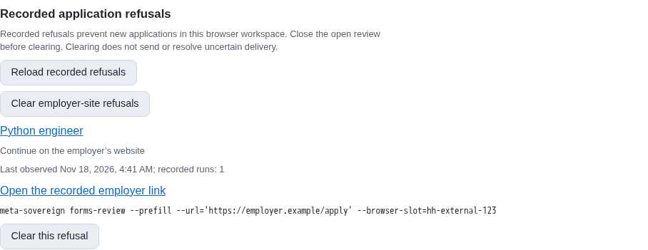
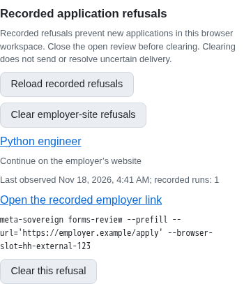

# Employer links discovered after a refusal

[PR #57](https://github.com/link-foundation/meta-sovereign/pull/57) remains draft. This correction covers part of HH05; acceptance remains 86 verified and 32 unfinished.

On published parent `c4ebc9de786e62e2dda08e74a9a853ed57c1882d`, observe an employer-site refusal before its safe external link appears, then read the same native application after the link becomes available. The ledger returns its existing record whenever request identity and refusal reason match. It therefore permanently loses the later link and its Forms prefill command. The exact-parent regression fails on the missing revision update; the experiment restores the production source in `finally`.

The same-attempt path now acknowledges changed title/link metadata while preserving the original observation time, attempt count and request identity. Missing later metadata retains known values. Unchanged metadata does not write a new revision. The existing bounded URL validation, private storage, writer ownership, failed-save rollback and uncertain delivery reservations still apply. Reading the notice never opens the employer link or submits an application.

The focused service/interface run passes 18 checks with one worker and a 384 MiB Node heap. Deno independently passes the new same-attempt regression. The mandatory native scenario now records an unsafe-link refusal first, discovers a safe link later, checks unchanged time and one attempt, reloads, verifies the saved link, refuses reopening, checks four locales and clears the record. It reports six link variants, zero provider submissions and closed owned browsers. Desktop and phone screenshots are inspected. Full runtime/browser coverage remains exact-source hosted validation.

The adjacent `data/vacancy-skip-metadata.tar.gz` and hash manifest preserve the actual parent source, failing regression, focused and native logs, changed source and screenshots. The reproduction is `python3 experiments/issue-56/vacancy-skip-metadata-before.py`; focused verification uses `node --test --test-concurrency=1 js/tests/job-vacancy-skips.test.js js/tests/job-vacancy-skips-interface.test.js`.

