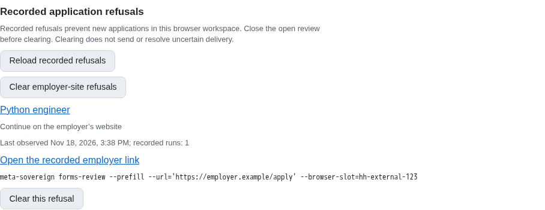
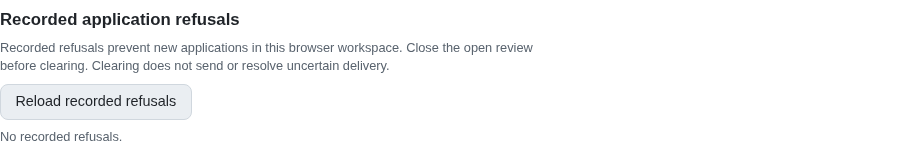

# Preview preserves permanent vacancy refusals

[PR #57](https://github.com/link-foundation/meta-sovereign/pull/57) remains draft
and unmerged, with 88 verified and 30 unfinished criteria. This is a correction
within unfinished HH08, not acceptance of its complete reference contract.

On published source `b3364503e8bfb4989659e0f4a7fc7de57edbff1c`, open a vacancy
with native preview enabled and read a rendered employer-site refusal. Close
the owned browser and reload: a permanent refusal appears, although preview
issued no entry or submission. The same observer can overwrite metadata,
increment attempts, replace a reason or remove an existing record. Application
dispatch and vacancy-cache writes already respect preview; the refusal observer
lacked that guard.

The shared observer now ignores preview observations before reading or writing
the permanent ledger. Native refusal states remain visible in the current
review. Live observations, revisioned owner clears, durable dispatch reservations
and uncertain delivery holds retain their existing behavior. This does not erase
records created by an earlier preview or infer that an unknown dispatch failed.

Nine new focused regressions cover all three native refusal reasons after an
actual private Lino reopen; metadata, attempt, reason and removal preservation;
and both text and binary Lino routes. All nine fail with the actual published
module and pass with the guard. The full focused skip/interface group passes
28 tests, including live persistence, later-link recovery, explicit clearing,
failed saves and unknown-delivery preservation.

The finite native browser check exercises three isolated rendered provider
refusals through the production UI and shared service. It preserves owner
answers, four-language recovery and phone layout, with zero provider entries
or submissions and closed owned browsers. The existing mandatory visibility
scenario includes this check without adding a fifth browser-group scenario.
Before/after screenshots show the polluted ledger and the corrected empty
ledger after reload. Independent MCP inspection also passes all four locales and the phone layout,
with an empty ledger and drained zero-click fixture. Its first assertion
incorrectly counted only the application browser, omitting read-only discovery
browsers; the original failed check and truthful fixture statistics are retained.
A baseline favicon 404 is preserved separately from the empty page-error list.
Complete exact-source hosted matrices remain required.

Reproduce the parent with
`node --test --test-concurrency=1 experiments/issue-56/vacancy-skip-preview-parent.mjs`.
Run the focused group with
`node --test --test-concurrency=1 js/tests/job-vacancy-skip-preview.test.js js/tests/job-vacancy-skips.test.js js/tests/job-vacancy-skips-interface.test.js`.
The bounded native probe is
`node experiments/issue-56/vacancy-skip-preview-native.mjs`; add `--native` to
the parent loader for its before screenshot and expected assertion failure.

Native preview and the existing supervised sending preset remain distinct.
The pinned HH reference's `--test-mode` can send a real application with staged
confirmations; this correction preserves this application's established
zero-dispatch preview semantics and does not claim complete reference parity.
Authenticated behavior and every other unfinished HH08 requirement remain
required. The adjacent `data/vacancy-skip-preview.tar.gz` and hash manifest
preserve parent/current sources, focused and native receipts, independent MCP
inspection, image review and scoped static checks. Full duplication and runtime
matrices remain hosted checks.

