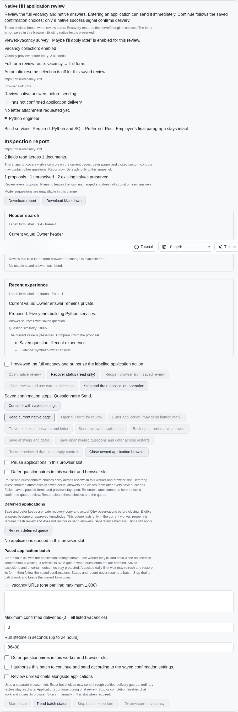
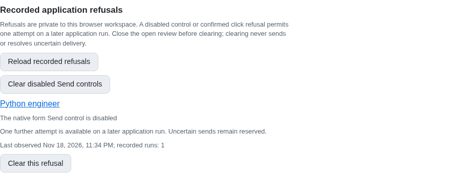
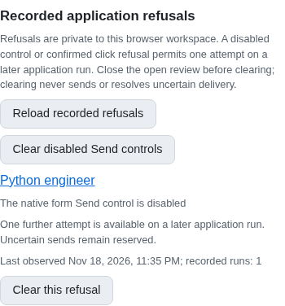

# Bounded retries for definitive native refusals

[PR #57](https://github.com/link-foundation/meta-sovereign/pull/57) remains draft
and unmerged. HH05 and all thirty unfinished original criteria remain required.
This unit implements four transient reasons from the pinned HH registry at
`fa0991b8c2d0896fb3b4be6c69947f0590094b15`:
`apply_button_disabled`, `button_disabled`, `apply_click_failed` and `click_failed`.
The remaining skip reasons, viewed-vacancy behavior and complete processed/question
policy still need parity evidence before HH05 can be accepted.

Previously, native disabled controls did not enter the durable refusal registry.
The actual published parent `9c369eaf45d8d33c2b095924d7f956defef2ee3c` fails eleven
of the fourteen new focused checks; the permanent-refusal and two uncertain-write
controls pass. A real native DOM scenario also fails at its missing disabled Send
record, after preserving the owner's answer and observing zero submissions.

Each worker has an execution identity. Starting an explicit real batch creates a
new identity after durable admission; reading status or replaying a saved batch
does not. A definitive refusal blocks the same vacancy in that run. A later run
can make one additional attempt. A second run's refusal blocks further admission
until the owner clears the revisioned record. Repeated reads, or a change between
these four reasons in one run, do not consume another run. The three existing
permanent reasons retain their original wire shape and remain blocked until
cleared. Missing execution context conservatively blocks admission.

Disabled controls qualify only on the bound native page, without challenge,
daily limit, error, pause, hold or uncertain delivery. A click qualifies only when
the dispatcher explicitly confirms `dispatched: false`, after restoring that
attempt's prior reservation. Thrown, missing and ambiguous acknowledgments retain
the existing unknown-delivery reservation. No refusal record unlocks an uncertain
write. Confirmed native delivery removes the stale refusal. Default-off tracing
contains the event, reason and run count, without URLs, questions or answers.

Search, discovery, manual application admission and real batch admission share
the policy. Private acknowledged storage, text/binary Lino, CLI list/clear and the
translated refusal panel preserve the reason, attempt count and execution identity.
The panel explains whether another run may retry or an explicit clear is needed.
Existing owner answers, browser ownership and clear revision guards remain.
A later run does not permit replacing an already issued application journal with
a different request identity; recovery of that journal remains guarded.

```sh
python3 experiments/issue-56/vacancy-skip-retries-before.py
NODE_OPTIONS=--max-old-space-size=384 node --test --test-concurrency=1 \
  --test-timeout=10000 js/tests/job-vacancy-skip-retries.test.js \
  js/tests/job-vacancy-skips-interface.test.js js/tests/job-vacancy-skips.test.js \
  js/tests/job-vacancy-selection.test.js js/tests/job-vacancy-discovery.test.js \
  js/tests/job-application-batch-safety.test.js
NODE_OPTIONS=--max-old-space-size=384 \
  node experiments/issue-56/vacancy-skip-retries-native.mjs
```

All 73 focused checks pass with concurrency one. They cover restart exhaustion,
same-run stability, permanent compatibility, confirmed delivery, definitive click
refusals, uncertain dispatch, rejected evidence, discovery/search admission,
three finite batch runs, transport metadata, translated rendering, persisted
clearing and existing ownership controls. The registered native scenario uses
actual browser controls and the application API, while provider traffic stays
inside isolated HH fixture routes. It is included in both existing hosted engines.
Full browser and runtime matrices remain hosted.

Native and independent Playwright MCP inspections preserve the owner's answer,
observe both disabled controls in one run, retain the acknowledgment across
reload, verify four selected locales, clear the selected reason and observe zero
submissions or page errors. Desktop and 390px phone views fit. Every owned browser,
fixture and server is closed. The first native draft used a stale generated bundle;
the second waited on an application selection that reload does not retain. Both
failures are preserved. The first independent locale probe reset English on each
reload; its result is retained as unverified. The corrected probe preserves the
selected locale and checks the rendered document language on every pass. An early
non-TTY MCP fixture required explicit termination; the final TTY fixture drains
normally. These fixture corrections do not establish authenticated HH parity.

Published-parent problem state:



Corrected durable recovery guidance:



Independent phone inspection:



The [archive](data/vacancy-skip-retries.tar.gz) and
[manifest](data/vacancy-skip-retries.tar.sha256.json) preserve parent/current source,
focused checks, native/MCP evidence, fixture failures and screenshot bytes.
Rebuild with [the collector](../../../experiments/issue-56/collect-vacancy-skip-retries.py).
Exact-source hosted confirmation remains required.
