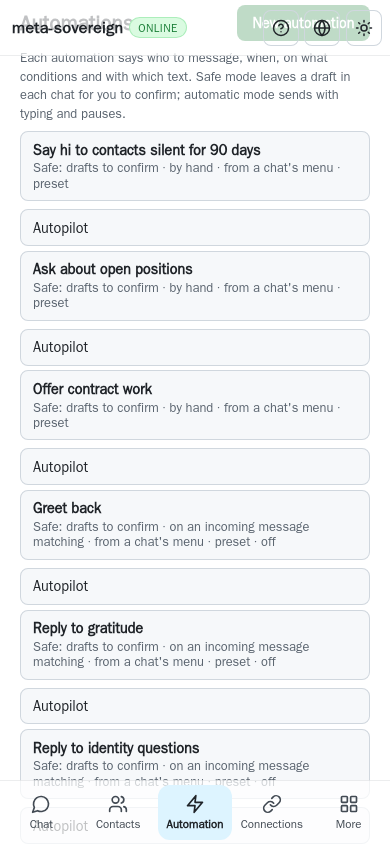
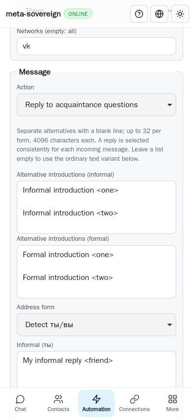
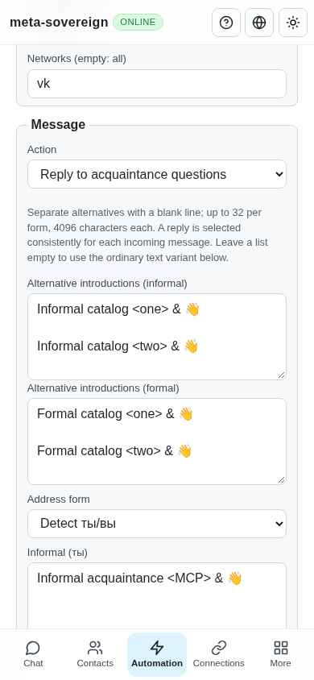

# Configurable VK acquaintance replies

The pinned `konard/vk-bot` trigger recognizes complete personal incoming “мы знакомы (с тобой/вами)?” questions. It uses a per-peer one-day interval and chooses an introduction from 18 example texts; its two tests cover “Мы знакомы?” and “Мы знакомы с тобой?”. The complete trigger (`e72483e690cf5a4fccc69b66cc7e7a2425c3f393`) and tests (`ffcba41928cdb5e68e4fed0b5a0596e752b247eb`) were read as data at reference commit `175d2d13218d9e791ae2f3e824a0d24f10319dcb`. No reference code was executed or copied.

Published parent `e56d8854` has no acquaintance action or preset. This adds a disabled safe-mode preset with an independently written bounded whole-question recognizer and configurable formal/informal introductions. The reference's sample profession text becomes an editable default. Optional owner-written introduction catalogs provide variation (at most 32 per address form, 4096 characters per entry), without copying its personal claims. Selection is stable for each incoming identity so previews and confirmation retain exact text. Empty catalogs use the ordinary variant. A confirmed generated selection does not become a persistent owner edit; explicit edits still carry forward, and reset restores catalog selection. The one-day default uses the existing acknowledged per-automation/per-chat run ledger and outbox. Pending, uncertain and recent confirmed deliveries block repeats; another chat remains independent. No new worker or state file is introduced.

The existing latest-private-message proof is extended to the new action. It freezes the exact incoming record and saved action, then rechecks before typing and after outbox admission. Manual tests retain this guard. Groups/community peers, owner replies, extra questions, service/deleted records and unorderable history refuse. Edits to reply variants are carried through the normal review. A shared bounded question parser preserves the existing identity grammar. The existing editor, preview, CLI and both default Lino APIs expose the same data; all four UI locales include the new action, recognizer and refusal reasons.

## Reproduction and focused verification

```sh
python3 -B experiments/issue-56/vk-acquaintance-parent.py
node --test --test-concurrency=1 js/tests/vk-acquaintance.test.js
deno test --allow-all --no-check js/tests/vk-acquaintance.test.js
E2E_BROWSER=webkit python3 -B experiments/issue-56/vk-acquaintance-parent.py --browser
RUN_BROWSER_E2E=1 E2E_BROWSER=webkit node experiments/issue-56/vk-acquaintance-browser.mjs
```

The actual-parent expectation fails because the preset is missing. Six focused Node and six Deno cases pass after implementation: pinned and expanded complete questions; personal/latest guards; acknowledged daily cooldown across durable Lino reopen and expiry; no recovery replay; late incoming/owner/policy/post-admission refusal; CLI/offline/editor/scheduler/frozen proof; bounded catalog validation, stable selection, address override, owner edit and confirmation persistence; actual VK-adapter confirmation and positive mocked receipt in both default Lino encodings. The 28 existing identity/gratitude/API checks pass. Tests and fixture inputs remain finite with one local worker; full runtime/platform/browser matrices remain in CI. The new native scenario is mandatory in the existing Greetings entry.

The first fixture omitted an informal address observation and inserted the formal chat first, so three assertions expecting an informal-first result failed. The implementation correctly chose its conservative formal default. Corrected fixtures retain explicit earlier identity questions for both forms, without changing production behavior. These failure logs remain preserved. The first native parent attempt found no installed Chromium headless shell; it was not counted as verification. The available WebKit engine then passed the actual-parent and current scenario. A later build invocation used a nonexistent root-level script path; the log is preserved, and the corrected `js/scripts/build-web.mjs` build succeeded before the final native and MCP checks. No browser download or local matrix was run.

Native WebKit before/after captures show the absent preset and saved editable variants and introduction catalogs, with the one-day control and private previews. An additional focused identity scenario verifies the shared native-helper extraction without overwriting prior screenshots. Independent Playwright MCP verifies all four languages, literal `<MCP>`/emoji content, saved variants, exactly two private previews, stable alternatives across language changes and phone fit. Both browser checks have zero sends/page exceptions and close owned resources. MCP emits existing `ERR_CACHE_WRITE_FAILURE` console diagnostics for the bundle and a missing fixture favicon; the complete console log is retained and a clean console is not claimed. There were no authenticated provider sessions.





[Checked evidence](data/vk-acquaintance.tar.gz) and its [SHA-256 manifest](data/vk-acquaintance.tar.sha256.json) preserve current/actual-parent sources, pinned reference bytes, all finite logs and screenshot hashes. Scoped lint/format/secrets/diff and the unchanged duplication gate are checked before publication. VK04 awaits exact-head hosted verification; all 78 original unchecked criteria remain active. [PR #57](https://github.com/link-foundation/meta-sovereign/pull/57) remains draft and unmerged.
