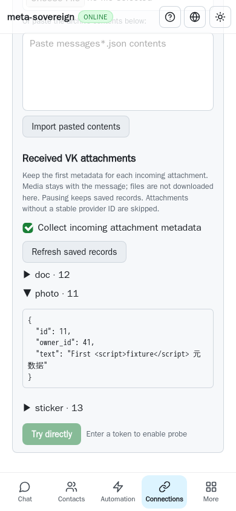
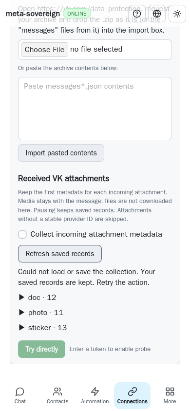

# Incoming VK attachment metadata

VK09 requires incoming attachment metadata to be collected once and retained
across restart. The complete `triggers/attachments.js` from `konard/vk-bot`
at `175d2d13218d9e791ae2f3e824a0d24f10319dcb` was read as reference data
(blob `09650a1a503051e96e23be9f6da6803cf7da7505`). It cleans incoming
attachments and saves the first record per ID in a JSON file. The independent
implementation uses the existing workspace storage and qualifies IDs by
provider/type/owner to avoid collisions. It requires an explicit opt-in so
an existing account does not silently enable another example trigger.

The prior app rendered/stored messages and media, but had no independent
first-observation metadata collection. The regression swaps the actual
published `2733ff54` production source bytes, imports a finite native VK JSON
archive and expects four collected identities. The parent imports all four
messages but collects zero metadata records. Restoring the implementation
passes. The actual parent UI bundle also lacks the collection controls.

```sh
python3 -B experiments/issue-56/vk-attachments-parent.py
E2E_BROWSER=webkit python3 -B experiments/issue-56/vk-attachments-parent.py --browser
node --test --test-concurrency=1 js/tests/vk-attachment-metadata.test.js js/tests/cli-help-imports.test.js
deno test -A --no-check js/tests/vk-attachment-metadata.test.js
RUN_BROWSER_E2E=1 E2E_BROWSER=webkit node experiments/issue-56/vk-attachments-native.mjs
```

Twelve focused Node/Deno cases cover actual archive ingestion, qualified IDs,
first-observation deduplication, durable Lino restart, default-off and retained
pause/resume, bounded/incomplete metadata, recursive credential omission,
concurrent collection, refused acknowledgements and rollback. They exercise
actual generic live reads, VK Long Poll, conversation catch-up/backfill,
duplicate older-history recovery, downloaded JSON reimport and offline
individual writes. CLI factory controls and public command admission,
read-only listing, both real default Lino route encodings, trusted-origin
refusal and all four locale dictionaries are included. Existing lightweight
CLI contracts and mandatory browser registry checks run separately with
limited concurrency: 15 Node checks, 12 Deno cases and two registry checks
pass. The combined provider compatibility/regression run passes 33 tests.
Full suites and runtime/browser matrices remain in CI.

One owned native WebKit scenario verifies literal metadata, deduplication,
acknowledged pause through reload, skipped paused input, refused-save state
and retained records, then successful resume and refresh. It observes four
records, zero provider effects and zero page exceptions. Native before/after
desktop and 390px phone screenshots preserve the visual evidence. Independent
Playwright MCP checks acknowledgement, reload, retained metadata and literal
rendering in English, Russian, Hindi and Chinese with a phone screenshot per
language. Its page exceptions are empty. Its console retains browser resource
cache write diagnostics; a clean console is not claimed. All owned browser
contexts, pages and servers drain.

The first local native attempt selected an unavailable Chromium executable;
the installed WebKit engine provided the scoped check without downloading
another browser. A later checkbox assertion expected an immediate optimistic
toggle, while the controlled UI correctly waited for acknowledgement. The
fixture now clicks and waits for the acknowledged state. The first MCP reload
predicate also treated a missing control as ready; its corrected predicate
requires the mounted, enabled control. The checkbox and readiness failed
probes remain in the evidence. No production save behavior or test deadline
was weakened.

The [user guide](../../VK-ATTACHMENT-METADATA.md) records collection scope,
limits, controls and retained existing media behavior. T3 Code's grouped
settings and Telegram's provider-aware attachment catalog references in
[Chat References](../../CHAT-REFERENCES.md) guided the use of the existing
connection panel, shared controls, loading state and literal detail view;
no external implementation was copied. Archive/HTML rows without stable
native IDs remain explicitly unsupported for collection, while their message
media stays intact. No authenticated account or live provider effect is
claimed.





[Checked source/log archive](data/vk-attachments.tar.gz) and
[SHA-256 manifest](data/vk-attachments.tar.sha256.json) preserve production
and exact-parent sources, pinned reference bytes, focused/native/MCP logs
and screenshot hashes. All five exact-head workflows and 66 jobs now pass
on `9e934842`; the [hosted receipt](hosted-verification-9e93.md) verifies VK09.
Every original unmet criterion remains required, and
[PR #57](https://github.com/link-foundation/meta-sovereign/pull/57) stays
draft and unmerged.
