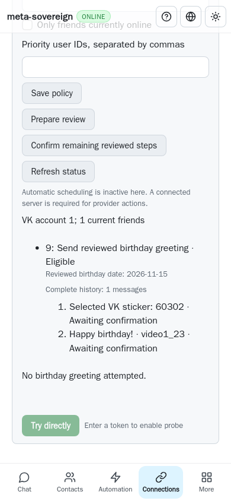
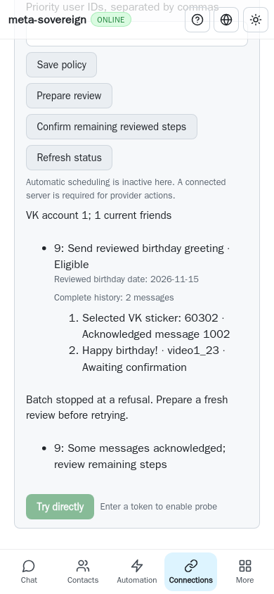
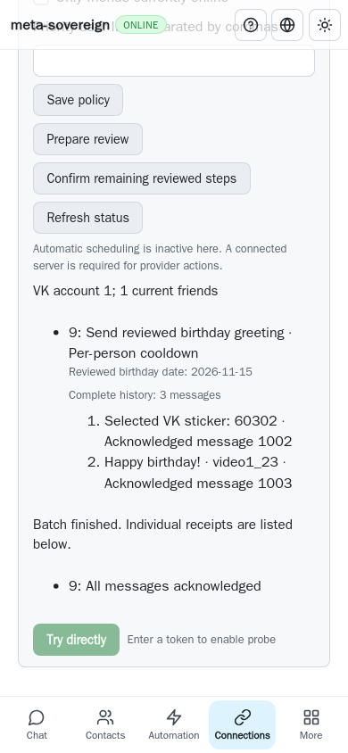

# Reviewed VK birthday greetings (VK21 / VD05 catalog)

The full pinned `konard/vk-bot` birthday entry and trigger at
`175d2d13218d9e791ae2f3e824a0d24f10319dcb`, and desktop catalog, trigger
and both tests at `8fbf3b7c42fd8e995ef137cab9b9653a7dc9b1a1`, are preserved
in the evidence archive. They select today's friends, stickers and message/media
variants; the desktop version offers ten short wishes and skips recent chats.
This implementation learns that behavior without copying personal promises,
Russian catalogs or native media IDs as defaults. Official `users.get` birthday
fields are retained from VK schema revision
`333481bd082ad747d4873ef4a77f9247097eeef0`.

An independent disabled `vk-birthday` policy shares the existing owned ordered
message executor. It supplies original ten-message defaults, editable text,
sticker and native photo/audio/video/doc catalogs, an explicit IANA time zone
and date-based cycle. The same saved configuration and review are available
through foreground CLI, both default Lino encodings, offline settings and
English, Russian, Hindi and Chinese connection controls. See the
[four-language guide](../../VK-BIRTHDAY-GREETINGS.md).

Review freezes the account, credential, settings, local calendar date, current
friendship, write permission, online preference and complete conversation.
Private, invalid and nonmatching birthdays, unread/recent chats, protected IDs,
opt-outs, future/service evidence and uncertain prior delivery hold effects.
Zero allows no delivery. Calendar validation preserves yearless February 29
without treating it as February 28; a stated future birth year is invalid.

Each optional sticker and subsequent text/media step has a frozen native random
ID and requires its own acknowledged positive message receipt. The provider
performs no automatic write retries. Both real rate admission and acknowledged
pending intent recheck fresh evidence. The final asynchronous consent read also
rechecks the reviewed date, covering a midnight boundary during that read.
The default spacing is 15 seconds between steps and 30 seconds between people.
Durable causal Lino reopen retains completed steps: a definite partial outcome
needs manual review and resumes only the remaining original payload. Unknown
outcomes never replay. The per-person date receipt prevents duplicate greetings
after provider history clearing; next year's eligible cycle can choose another
variant. Duplicate catalog values remain a valid bounded single choice.

Published parent `3badd29a` fails the new birthday capability regression and
lacks the controls in actual rendered before screenshots. Eighteen new checks
cover configuration, calendar edges, provider fields, canonical Chat receipts,
native media/access keys, filters, empty history, causal partial restart,
uncertainty, failed acknowledgements, late guards, scheduler shutdown, CLI,
both Lino encodings and complete translations. Thirty-four focused Node and
34 Deno checks include the existing ordered-policy and wall interfaces.

The native WebKit scenario confirms a sticker, refuses text/media, reloads and
reviews the one retained receipt, then confirms only the remaining payload.
The subsequent review holds the same date and retains both actual positive receipts, rather than showing newly selected unsent steps. The initial misleading draft screenshot is preserved in the archive. Independent Playwright MCP checks
all four phone languages with two synthetic sends, no unexpected messages,
no page exceptions and drained owned fixtures. Favicon/cache console diagnostics
are retained; a clean console is not claimed. No authenticated provider session
or live provider effect is claimed. The native scenario is registered in the
existing hosted VK browser group; full matrices remain hosted.

Failed draft evidence is preserved: the restart fixture initially used the wrong
Lino-store argument shape, and the first browser draft expected complete delivery
from its deliberately refusing second step. Corrected fixtures exercise actual
partial recovery. The existing CLI admission regression caught the missing lightweight command name; the corrected catalog retains help isolation and all registered commands. Fourteen compatibility checks pass. Initial strict lint and duplication failures are retained.
Shared consent mutations and interface assertions remove repetition while
preserving every check and the unchanged 6.5% gate. The previous wall release
metadata failure is investigated in [its own case](ci-single-changeset.md);
the birthday notes extend the one existing release changeset.

The [checked archive](data/vk-birthday.tar.gz) and
[manifest](data/vk-birthday.tar.sha256.json) preserve source/parent bytes,
pinned references, schema, logs and twelve PNG hashes. Exact-head hosted
verification remains required before VK21 acceptance. Every unchecked original
criterion remains required; [PR #57](https://github.com/link-foundation/meta-sovereign/pull/57)
remains draft and unmerged until the full requested scope is verified.
