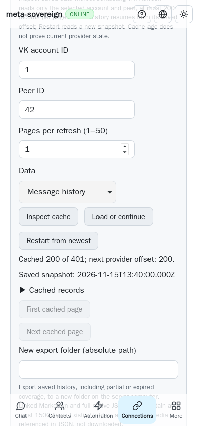
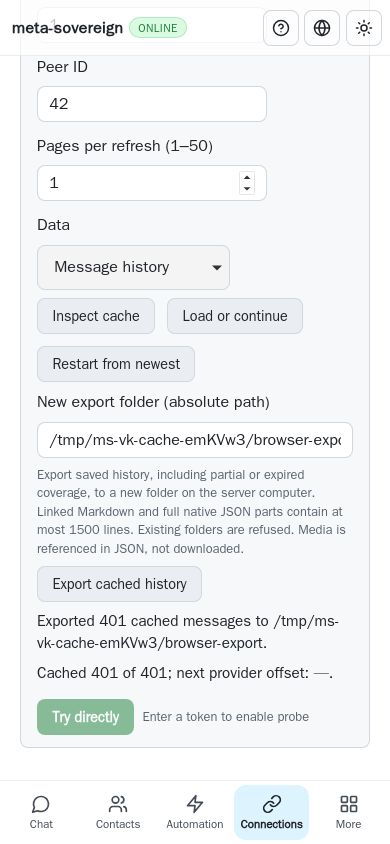

# VK24 history export and persistent read caches

The pinned `konard/vk-bot` revision
`175d2d13218d9e791ae2f3e824a0d24f10319dcb` contains seven relevant complete
scripts: `convert-messages-to-markdown.js`, `load-messages.js` and the function,
friend, friend-conversation, friend-count and message cache helpers. Their Git
blobs are preserved with the evidence. The existing VK adapter and shared
history synchronization could read messages, but the actual parent
`35764037b1fba1fbbd613e46d366359a5c1f0959` had no account-scoped cache command,
history export or connection controls. Its admission assertion fails and its
native connection screenshot shows the missing panel.

The shared implementation preserves the reference's history, conversation,
friend metadata and count use cases with explicit cache identity and coverage.
Account, data kind and peer identify each cache. Metadata fields include native
online/last-seen/write-permission and profile information. Successful empty
results and zero counts remain valid. The reference's month/two-week/hour/
36-month age policies become explicit 30/14-day, one-hour and 1080-day metadata;
conversations retain the reference's unexpired snapshot behavior. Expiry never
deletes an archive or implies that a provider operation succeeded.

Refresh reads bounded native pages and repeatedly verifies the current account,
credential and newest page. History IDs must remain descending across pages.
Immutable page evidence is acknowledged before an index advances. Failed
mutation/flush restores its previous acknowledged cursor; causal write metadata
does not create false concurrent edits. Continuing partial history refuses a
changed head rather than silently skipping messages. Explicit restart creates
a fresh snapshot. Inspection verifies the selected page's identity and hash
without contacting VK. Refreshes sharing a store serialize their admission.

Exports reuse the existing bounded linked Markdown/structured writer. Messages
are written oldest first, with UTC time, native IDs, author profile links,
quoted reply text and full original records containing replies, forwards,
direction and media references. No media is downloaded. Oversized text
continues with original-record links; parts stay at most 1500 lines. Each export
creates a new absolute directory outside the store, refusing existing paths and
symlinks. Its manifest states exact complete/partial and expired coverage.
Failure retains inspectable partial files without a completed manifest or
success receipt. The existing Telegram writer behavior remains covered.

Foreground CLI, both default Lino encodings, provider-free offline inspection
and four-language Connections controls use the same operations. The
[user guide](../../VK-HISTORY-CACHE.md) explains paging, age, restart and export
paths. Refresh/export require the server. Neither this feature nor its fixture
has a send/delete operation.

A held-request regression found that ordinary server close disconnects sockets
before releasing its store. Cache tasks now have their own runtime ownership:
shutdown refuses new admission and waits for admitted reads/exports, even after
HTTP disconnects. Removing only that ownership call reproduces premature close;
the restored implementation retains the acknowledged page before release.
Tracing defaults off; explicit debug emits page/count/status metadata without
credentials or message content.

Focused evidence includes 15 new cache/interface checks and twelve existing
export checks on Node and Deno. They exercise all five caches, zero/empty data,
200/400/401 resumable coverage, account/token/head/page corruption, failed page
and index acknowledgements, concurrent/causal writes, strict bounds, partial
expired export, overwrite refusal, 1600-line message splitting, CLI closure,
both Lino forms, origin refusal, offline locales, tracing and held shutdown.
The mandatory native case loads all 401 synthetic messages, exports them and
inspects after reload without another provider call. Native WebKit has zero
page exceptions and zero message sends.

Independent MCP checks four translated 390-pixel layouts, partial history,
export receipts and read-only reload. Four manifests independently confirm
200/401 partial coverage and offset 200. The persistent MCP profile initially
reported HTTP cache-write errors for the bundle. That evidence is retained;
repeating with only Chromium HTTP cache disabled removes those errors. The
fixture's missing favicon is its sole remaining console error. All owned
browsers and fixture servers close; no authenticated live-provider action is
claimed.

The [checked archive](data/vk-cache.tar.gz) and
[manifest](data/vk-cache.tar.sha256.json) preserve pinned source blobs, exact
parent source, regressions, focused checks, scoped quality logs and ten PNG
hashes. Run `python3 -B experiments/issue-56/collect-vk-cache.py` to validate and
rebuild this evidence. The [active checklist](vk-cache-plan.md) still requires
exact-head hosted checks before accepting VK24. Every other unchecked issue
requirement remains active in
[PR #57](https://github.com/link-foundation/meta-sovereign/pull/57).
