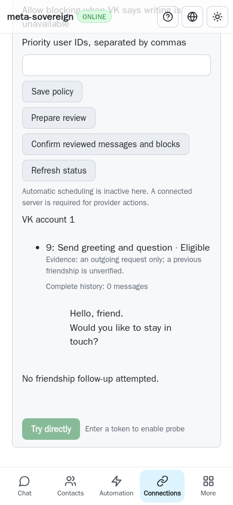
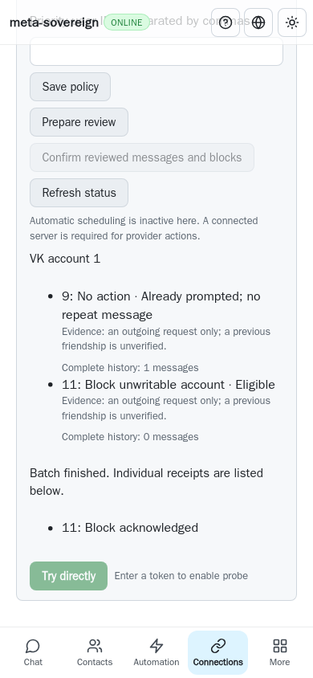
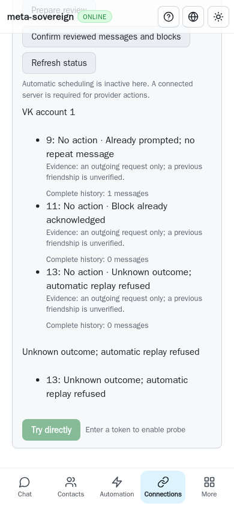

# Cancelled-friendship reactions (VK14)

An independent disabled follow-up policy now reviews outgoing personal
requests, a configurable combined greeting/question and separately enabled
unanswered/unwritable blocking. [Usage](../../VK-FRIENDSHIP-FOLLOW-UP.md)
describes controls and evidence limits. VK14 remains unchecked until the
published implementation passes exact-head hosted checks. Every other
unfinished issue requirement remains active; PR57 stays draft and unmerged.

Complete pinned `konard/vk-bot` trigger at
`175d2d13218d9e791ae2f3e824a0d24f10319dcb`, blob
`23a5bc0cf5ba87a0f347264080128c75eeb9aa01`, and its caller were read and
preserved. The reference checks outgoing requests, permissions and message
history, recognizes an earlier Russian question, then prompts once or bans
after two unanswered days/unwritable state. Its caller's optional example
runs every twenty minutes with twenty candidates. The reference's outgoing
requests do not establish previous friendship. The implementation exposes
that distinction, preserves historical question recognition, uses a neutral
default question, requires separate blocking consent, persists uncertainty
and never records queued work as delivery. A greeting and question form one
reviewed native message with one acknowledgement.

Official `VKCOM/vk-api-schema` blobs preserve personal
`messages.getConversationsById` conversation/permission/last-message fields,
bounded `messages.getHistory`, positive `messages.send` IDs and `account.ban`
parameters/results. Their exact response receipts and source hashes are in
the archive. Complete histories above 1,000 messages, missing conversations,
inconsistent identities/counts/order/tail, duplicate/deleted records or future
dates cannot authorize action. Priority union, shared opt-outs, automatic
quiet hours, five-minute review expiry and fresh account/credential checks
apply after the actual provider limiter and durable intent acknowledgement.

Actual-parent reproduction at published `b0bb53ae`:

```sh
python3 -B experiments/issue-56/vk-cancelled-parent.py --browser
```

The parent's real adapter refuses the new capability and its real browser
lacks the controls, with zero provider effects. The probe restores every
production source before current verification. Fourteen focused Node and
fourteen Deno tests cover native receipt validation, durable store reopen,
actual Chat/outbox projection, historical prompts, explicit blocking choices,
changed evidence, failed intent/outcome persistence and owned shutdown.
Node also passes five browser registration/partition contracts. Forty-three
existing acceptance/desktop/maintenance checks pass after shared changes.
The initial shutdown fixture expected an HTTP response after closing its
server; Node and Deno reject that socket differently. The final check invokes
the real owned scheduler callback, aborts pacing, drains it and verifies only
one action without depending on runtime-specific socket errors. Both failing
draft logs are retained.

```sh
NODE_OPTIONS=--max-old-space-size=384 node --test --test-concurrency=1 --test-timeout=20000 js/tests/vk-cancelled-capability.test.js js/tests/vk-cancelled.test.js js/tests/vk-cancelled-guards.test.js js/tests/vk-cancelled-interfaces.test.js js/tests/ci-browser-shards.test.js
deno test --v8-flags=--max-old-space-size=384 --allow-all --no-check js/tests/vk-cancelled-capability.test.js js/tests/vk-cancelled.test.js js/tests/vk-cancelled-guards.test.js js/tests/vk-cancelled-interfaces.test.js
NODE_OPTIONS=--max-old-space-size=384 node experiments/issue-56/vk-cancelled-native.mjs
```

One native WebKit case verifies saved text, exact review with zero effects,
one acknowledged prompt, separate blocking consent, retained unknown state
and failed-save recovery: two synthetic prompt calls, one block and zero page
exceptions. It is included in the existing mandatory friend browser entry.
Independent Playwright MCP checks English, Russian, Hindi and Chinese with
one synthetic prompt, zero blocks, no repeated messages, zero page exceptions
and closed owned resources. Its preserved console includes favicon/cache
write diagnostics; no clean-console claim is made. The existing friend,
online and desktop native cases remain required compatibility checks.
No authenticated provider sessions or live provider effects are claimed.
Full browser/platform/runtime matrices remain hosted.

The [archive](data/vk-cancelled.tar.gz) and
[manifest](data/vk-cancelled.tar.sha256.json) preserve actual parent/current
sources, complete pinned research and official schemas, focused logs, built
browser bytes, independent MCP receipts and twelve screenshot hashes.
[Collector](../../../experiments/issue-56/collect-vk-cancelled.py).





