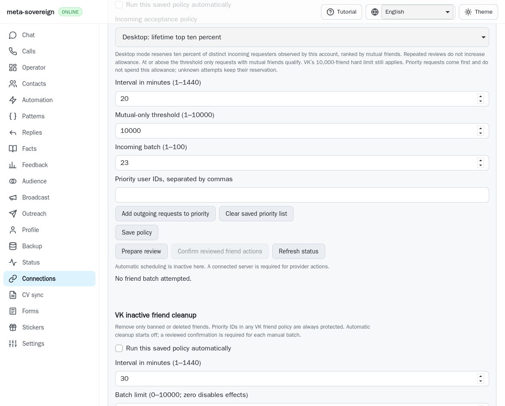
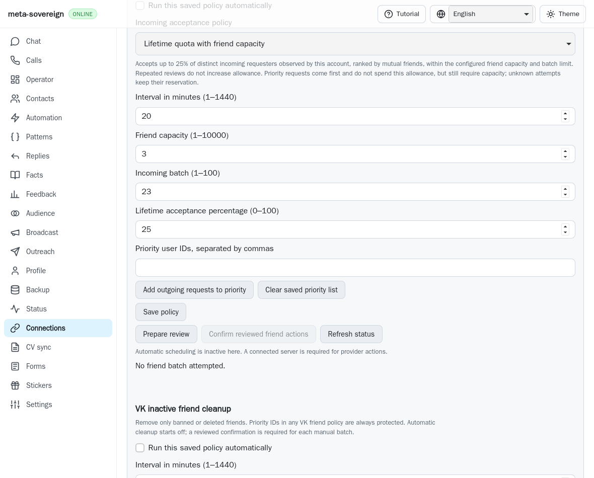

# Configured VK lifetime percentage and friend capacity

The pinned desktop bot exposes `topPercentMutuals` (default 10) in
[`config.js`](https://github.com/konard/vk-bot-desktop/blob/8fbf3b7c42fd8e995ef137cab9b9653a7dc9b1a1/config.js).
Its actual
[selector](https://github.com/konard/vk-bot-desktop/blob/8fbf3b7c42fd8e995ef137cab9b9653a7dc9b1a1/src/bot/friend-prioritization.js)
subtracts lifetime accepted requests from the floored configured percentage of
observed requests, then limits acceptance by remaining friend capacity. It
returns early at capacity. The later mutual-only branch cannot override that
return. The native implementation previously fixed the percentage at ten and
offered a separate mutual-threshold interpretation of `maxFriends`.

The additional `desktop-configured` policy implements configured capacity and
percentage. `topPercentMutuals` accepts finite numbers from 0 through 100,
including fractions; omission retains ten percent without changing old saved
record shapes. Allowance is `floor(distinct observed * percentage / 100)` minus
confirmed or uncertain reservations. Repeated reviews, reopening and policy
edits never replenish observations or discard reservations. Fresh capacity,
mutual evidence, policy and acknowledged quota are checked before effects.
Priority requests retain the native exemption from this allowance, come first
and still require capacity. The existing ranked-batch and mutual-threshold
policies remain available with their original capacity behavior. The latter
also honors an explicitly configured percentage.

Global/local readable Lino defaults, explicit CLI flags, both API encodings and
saved owner choices share the same validation. The four-language controls expose
the percentage only for lifetime policies and label capacity and the legacy
threshold according to their actual behavior. Failed saves keep the owner's
draft and retain the previously acknowledged policy after reload.

Reproduce the published gap with the finite parent probe:

```sh
node --max-old-space-size=384 --test --test-concurrency=1 experiments/issue-56/vk-configured-parent.mjs
```

It loads the exact four production modules from `132c16f6` together: ten checks
fail and the legacy-record control passes. Current focused checks pass 15/15,
and the combined relevant settings, defaults, browser-registration and legacy
checks pass 43/43:

```sh
node --max-old-space-size=384 --test --test-concurrency=1 js/tests/vk-configured-policy.test.js js/tests/vk-configured-interfaces.test.js
```

The single mandatory `test:e2e:vk-configured` scenario uses a private synthetic
account with the production server and SPA. Isolated WebKit verifies 25% and
capacity three, exactly two explicitly confirmed synthetic friend actions, no
messages, fresh capacity refusal, retained lifetime reservations, refused-save
recovery and all four languages. The unchanged mutual-threshold scenario also
passes its five-action quota and threshold controls. Every fixture is drained.
The initial Chromium attempt refuses before fixture creation because its
headless-shell executable is absent; no browser installation is attempted.

Before and after renders show the missing controls and the configured policy:

| Before                                                                                   | After                                                                                     |
| ---------------------------------------------------------------------------------------- | ----------------------------------------------------------------------------------------- |
|  |  |

The [before phone](../../screenshots/issue-56-vk-configured/before-phone.png) and
[after phone](../../screenshots/issue-56-vk-configured/after-phone.png) images
retain the same 390-pixel viewport. An independent Playwright MCP browser saves
and reloads 12.5% in English, Russian, Hindi and Chinese, then retains a refused
35% draft while durable settings remain 12.5%. It records zero provider actions,
zero messages, no page exceptions and closed server/browser ownership. The
complete console receipt also contains one `ERR_CACHE_WRITE_FAILURE` for the
bundle; its cause remains unexplained. The functional checks succeed, and this
receipt is not described as a clean console run.

The [source-bound archive](data/vk-configured.tar.gz) and
[per-entry hashes](data/vk-configured.tar.sha256.json) retain exact parent and
current sources, pinned reference bytes, complete focused results, native/MCP
receipts, that console warning and all eight valid inspected images. Scoped
static checks pass. Complete runtime/platform/browser and duplication checks
remain in hosted CI. This correction supports the unfinished VD07 audit;
**88 verified / 30 unfinished** remains unchanged in
[PR #57](https://github.com/link-foundation/meta-sovereign/pull/57).
