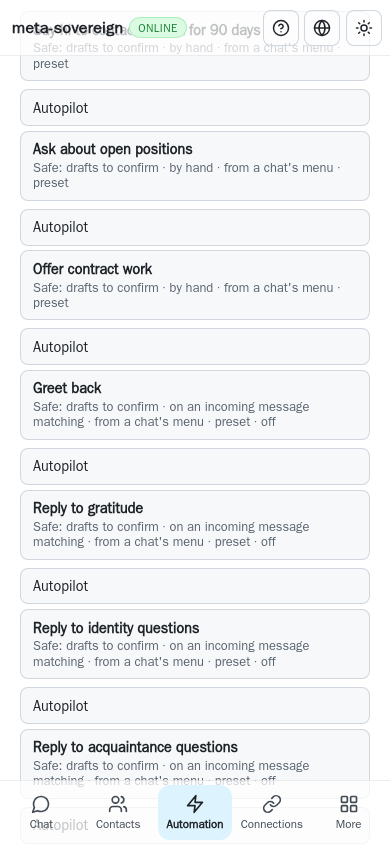
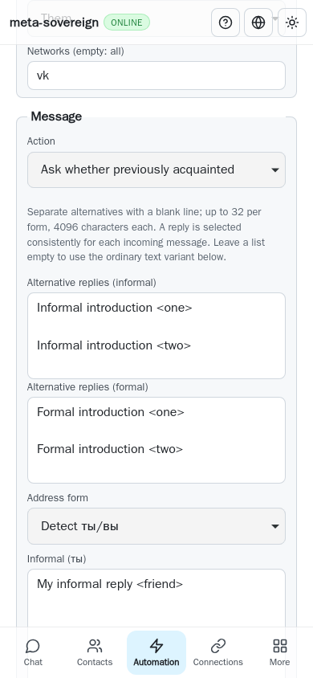
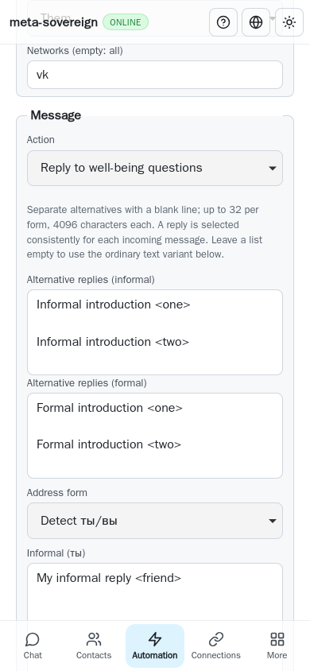
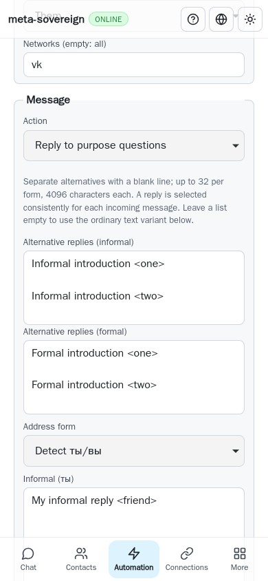
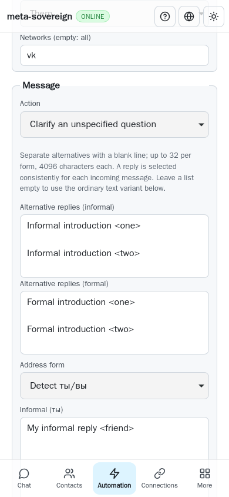

# Contextual personal VK reply presets

The pinned `konard/vk-bot` references were read as data at `175d2d13218d9e791ae2f3e824a0d24f10319dcb`. No reference implementation was executed or copied. Four independently written presets cover VK05, VK07 and VK08:

| Reference               | Source blob                                | Tests blob                                 | Behavior retained                                                                                   |
| ----------------------- | ------------------------------------------ | ------------------------------------------ | --------------------------------------------------------------------------------------------------- |
| `have-we-talked-before` | `77e906b2dbea0e52172c01eefad431d35f8a32d1` | None present                               | Exactly two recorded personal greetings, outgoing then incoming; ask whether previously acquainted. |
| `well-being`            | `d62a1f4255159fd553ec1affd44f1e41cf3c2ead` | `4fa4c1518ec1c726dddc2c3e99117f62464cc5eb` | Configurable replies to complete Russian/English well-being questions.                              |
| `goal`                  | `aad1ebca503d8d1e8b1fe0dc9156e38dc6775c13` | `bd283023c3eaacf318bf7cbb650bc33101c9460b` | Configurable replies to personal purpose questions.                                                 |
| `undefined-question`    | `036dd92183403a126a1b5e22f4166c3621faa5e6` | `c655d9baab620e238f91be5938c81b078de0215c` | Clarify a bare question after the relevant adjacent outgoing turn.                                  |

The well-being source accepts fewer forms than its tests. This implementation includes all seven pinned positive examples, including English, an omitted question mark and a greeting prefix, while refusing additional questions and unrelated words. The undefined-question tests omit history; VK08 explicitly requires the outgoing context, so the implementation requires it. First-exchange detection uses the recorded history and makes no claim that a partially imported conversation is complete. Defaults are editable personal text rather than copied catalogs of someone else's claims. Greeting text and incoming/outgoing sticker catalogs share the existing recognizer.

All four presets start disabled in safe mode, use private incoming recognition and prepare drafts for review. Configurable formal/informal texts and optional bounded alternative catalogs reuse the acquaintance editor and stable per-incoming selection. The ordinary address override, owner edit/reset, CLI, offline editor, scheduler, default text/binary Lino APIs, acknowledged daily cooldown and durable outbox remain shared. Confirmed generated choices preserve catalogs; explicit edits carry forward. Four UI languages include preset, action, recognizer and refusal labels.

The first-exchange and clarification proofs freeze both the latest incoming record and its actual adjacent outgoing record. First exchange also rechecks the stored message count. The bounded store reader retains at most three newest projected records, preserving a possible previous-turn timestamp tie, and counts older records without materializing a second history. Deleted/service records, groups, ambiguous order, intervening incoming turns, changed saved policy and late mutations refuse before typing and after outbox admission. There is no recovery replay. The separate ordered sticker-plus-text follow-up in VK06 remains required and is not implemented by these presets.

## Reproduction and verification

```sh
python3 -B experiments/issue-56/vk-contextual-parent.py
node --test --test-concurrency=1 js/tests/vk-contextual.test.js
deno test --allow-all --no-check js/tests/vk-contextual.test.js
E2E_BROWSER=webkit python3 -B experiments/issue-56/vk-contextual-parent.py --browser
RUN_BROWSER_E2E=1 E2E_BROWSER=webkit node experiments/issue-56/vk-contextual-browser.mjs
```

Actual published parent `c930cf39` fails four preset expectations. Ten focused Node and ten Deno cases pass: every pinned recognition example; private/latest/context guards; finite negative cases; history reorder/ties/intervening records; mutations before typing and after admission; editor, CLI, scheduler and offline parity; durable restart and cooldown; exact confirmation proofs; and all four actual VK adapter paths through both default Lino encodings, with eight mocked positive receipts. No authenticated VK account is used. Existing identity/gratitude/acquaintance/API compatibility checks and the mandatory browser registry are checked separately. Local experiments remain finite and sequential; full runtime/platform/browser matrices stay in CI.

Four focused native WebKit scenarios pass against the actual parent and current draft. Before screenshots show the absent presets; after screenshots show saved text, alternative catalogs and the daily cooldown with exactly two private previews. Independent Playwright MCP checks each preset in all four languages, retained literal content and stable choices across language changes, plus the 390px phone layout. There are zero sends or page exceptions, and every owned browser/server is closed. Existing fixture favicon 404 and browser cache-write console diagnostics remain preserved; a clean console is not claimed. The 34 existing compatibility tests and two mandatory registry checks pass. After consolidating shared preset defaults, mutation-boundary assertions and evidence verification, 44 focused Node tests, ten Deno contextual tests, one additional Node adapter-helper check and the four rebuilt native scenarios pass. The shared reply editor follows the restrained controls and explicit review states in the pinned T3/Telegram product guidance.

The first compatibility run overlapped the read-only parent comparison's temporary source replacement. It completed successfully, but is not used as the final compatibility evidence; all 34 tests were rerun after source restoration. The initial unchanged duplication gate reported 6.51%; consolidating those shared paths brought it below the 6.50% limit without exclusions or weakened assertions. Initial scoped lint identified the existing locale file-size ceiling and complexity rule; locale additions were moved into the shared reply dictionaries and the context comparator extracted, retaining both rules.







[Checked source/log evidence](data/vk-contextual.tar.gz) and its [SHA-256 manifest](data/vk-contextual.tar.sha256.json) preserve actual-parent/current bytes, pinned source/test snapshots, finite logs and all twenty screenshot hashes. Scoped format/lint/secrets/diff and the unchanged duplication gate are checked before publication. Exact-head hosted checks remain pending. Every original incomplete issue requirement remains active. [PR #57](https://github.com/link-foundation/meta-sovereign/pull/57) stays draft and unmerged.
