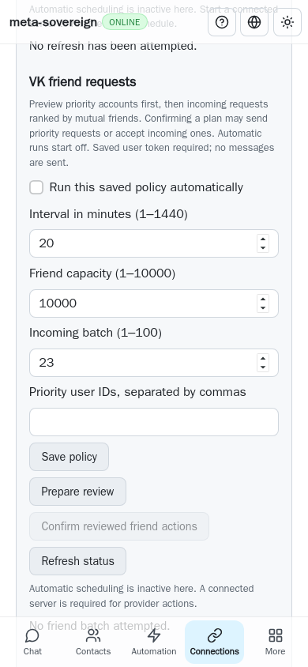
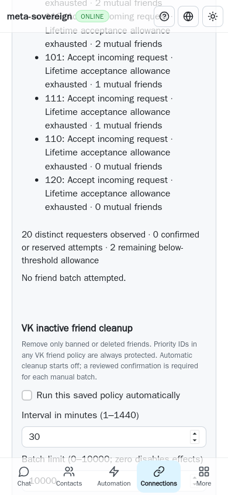
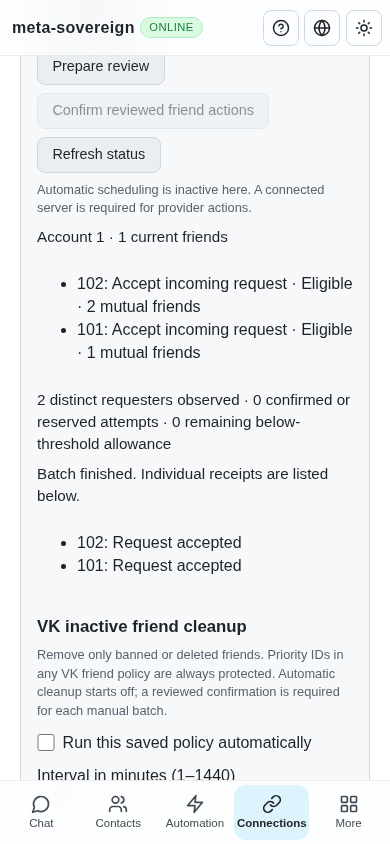

# Desktop friend acceptance policy (VD04)

The independently selectable desktop policy preserves the existing Ranked batch
mode and adds persistent top-ten-percent and mutual-only selection through the
same guarded friend service. [Usage](../../VK-FRIEND-REQUESTS.md) describes the
saved mode, threshold and quota. VD04 remains unchecked until its exact published
head passes hosted checks. Other incomplete issue criteria remain required;
PR57 stays draft and unmerged.

The pinned reference is `konard/vk-bot-desktop` at
`8fbf3b7c42fd8e995ef137cab9b9653a7dc9b1a1`. Complete source and tests read:
accept trigger `60bd5d3bd902ca5fea157847590f6dcf2b3b3a77`, prioritization
`e71dba5d0e7c59352978a2b06b69650849323af2`, acceptance tests
`b673ed4ed6c48445ab541a932d4e3313d636a77a` and prioritization tests
`6a7c96b0242f7fa763c12536b93567d420b3887d`. The README requests top ten
percent below capacity and mutual-only above it, with protected priorities.
The implementation returns at capacity before its mutual-only branch can run
and increments its accumulated request count on repeated scans. Those defects
are not copied: distinct observed requester IDs establish lifetime allowance,
and the saved desktop threshold switches to mutual-only selection while the
absolute VK 10,000-friend limit always refuses new actions. Ranked batch retains
its existing capacity meaning.

Official `VKCOM/vk-api-schema` method, response and object blobs retained with
the [maintenance evidence](vk-maintenance.md) specify `friends.getMutual`
`target_uids` and per-target `common_count`. The adapter requires a complete,
unique, nonnegative integer response. It ranks mutual counts descending with
stable numeric ties and puts configured priorities first. Priorities neither
spend this quota nor lose their maintenance protection.

Actual-parent reproduction at `f2cf0d6e`:

```sh
python3 -B experiments/issue-56/vk-desktop-parent.py --browser
```

The normalizer assertion fails because the saved mode becomes `undefined`.
The parent's real browser has no desktop choice and performs zero provider
effects. The probe restores every production source before verification.

Forty-three focused Node and 43 Deno checks pass across policy settings, the
desktop policy, existing acceptance and maintenance. Nine selected desktop
checks pass after adding the translated mutual-count label. Cases cover durable
quota and reopen, repeated observations, priority ranking, mutual-only selection,
hard-cap refusal, malformed mutual evidence, fresh threshold/count changes,
definite refusal refunds, unknown/unconfirmed reservations, failed intent and
outcome persistence, late acknowledgement changes, CLI, both default Lino
encodings, trusted origin, explicit confirmation and offline/four-language choices.
Five browser registration and partition contracts also pass.

```sh
NODE_OPTIONS=--max-old-space-size=384 node --test --test-concurrency=1 --test-timeout=20000 js/tests/vk-desktop-policy-settings.test.js js/tests/vk-desktop-policy.test.js js/tests/vk-friends.test.js js/tests/vk-maintenance.test.js
deno test --v8-flags=--max-old-space-size=384 --allow-all --no-check js/tests/vk-desktop-policy-settings.test.js js/tests/vk-desktop-policy.test.js js/tests/vk-friends.test.js js/tests/vk-maintenance.test.js
NODE_OPTIONS=--max-old-space-size=384 node experiments/issue-56/vk-desktop-native.mjs
```

One native WebKit case verifies saved selection, exact ranked acceptance, quota
retention, mutual-only selection, uncertain attempts, failed-save recovery and
phone fit. It records five synthetic friend actions, no messages and no page
exceptions. The existing mandatory friend browser entry includes this case.
Independent Playwright MCP review checks English, Russian, Hindi and Chinese,
including reviewed actions and reload, with eight synthetic friend actions,
zero messages or page exceptions and closed owned resources. Its retained
console includes a cache-write diagnostic; this is not a clean-console claim.
No authenticated provider session or live provider effect is claimed. Full
runtime, platform and browser matrices remain in hosted CI.

The [archive](data/vk-desktop-policy.tar.gz) and
[manifest](data/vk-desktop-policy.tar.sha256.json) preserve exact parent/current
sources, complete pinned source/tests, provider schema responses, bounded logs,
built browser bytes, independent MCP receipts and twelve screenshot hashes.
Recollect with
[collect-vk-desktop.py](../../../experiments/issue-56/collect-vk-desktop.py).




