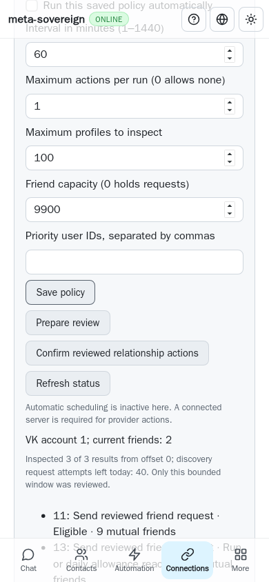
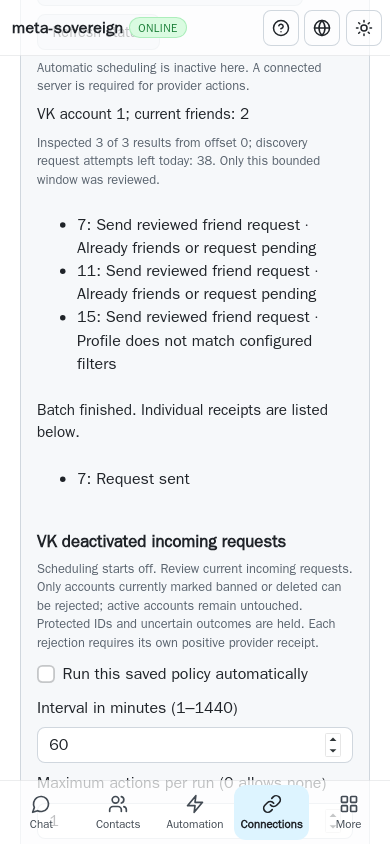
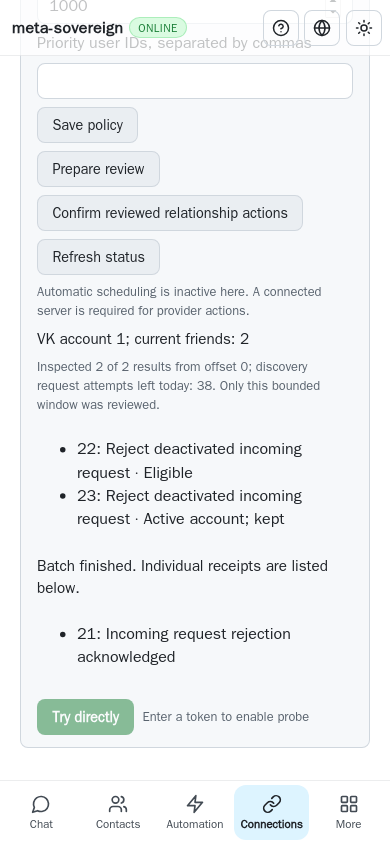

# Reviewed VK friendship discovery (VK23)

The complete pinned `konard/vk-bot` standalone best-suggestion,
deactivated-request, community-friend, outgoing-request and outgoing-message
scripts at `175d2d13218d9e791ae2f3e824a0d24f10319dcb` are retained in the
evidence archive. Official friends, groups and user-profile method/receipt
definitions are pinned at `333481bd082ad747d4873ef4a77f9247097eeef0`.

Three independent disabled policies provide bounded current suggestion ranking,
configurable finite community-member windows and deactivated incoming-request
rejection. Suggestions use mutual counts with stable ID ties and all original
profile permissions. Community filters preserve online/photo/open/sex checks,
current membership and capacity without copying the original personal community
or its unbounded random search. Incoming rejection requires current incoming
status, current banned/deleted evidence and the specific native
`in_request_deleted: 1` receipt. A removed-friend receipt is not accepted.
The [four-language guide](../../VK-FRIEND-DISCOVERY.md) explains configuration,
pacing, inspection bounds, the CLI and default text/binary Lino API.

New discovery requests share a durable 40-attempt allowance per account and UTC
day. Reserving an attempt precedes issuance and is deliberately conservative:
refused, uncertain or subsequently cancelled attempts are not refunded. Native
provider errors 8, 14 and 29 retain shared pauses through restart. Current account,
credentials, policy, global opt-outs, every VK friend policy's protected IDs,
five-minute lifetime, provider evidence and prior journal receipt are rechecked
after actual rate admission and after acknowledged intent. Stop drains owned
work. Pending/unknown results survive causal Lino close/reopen and cannot replay
through a different friendship policy. Failed receipt acknowledgements never
become a claimed success or overwrite a concurrent receipt.

Existing current-friend, incoming acceptance and outgoing-request reviews remain
available without provider effects until confirmed. The focused inspection test
reads every fixture friend/incoming/outgoing ID. Cleanup covers its complete
supported friend list; outgoing review covers its configured bound, up to 10,000.
The new incoming policy separately checks finite request pages up to 10,000.
The source `outgoing-messages.js` is a paced delivery queue, not inspection.
Its complete typing/read/text/sticker queue behavior remains explicitly required
under VK26; this unit does not claim that queue criterion is implemented.

Published parent `aae37f2d` fails the capability regression on missing
`discoverySnapshot`; an actual parent render lacks all three controls. Reproduce
with `python -B experiments/issue-56/vk-discovery-before.py --browser`.
Nineteen focused Node and nineteen Deno checks pass. They cover independent
settings and bounds, stable ranks, original filters, finite pagination, strict
receipts, shared causal uncertainty, daily allowance and pause restart, changed
rate-wait evidence, late durable acknowledgements, concurrent receipts, edited
reviews, failed intent/outcome writes, owned Stop, CLI, both Lino formats,
offline capability, translations and existing read-only inspections.

One native WebKit scenario confirms ranked suggestion 11, community request 7
and deactivated-request rejection 21, then reloads each policy and verifies no
replay. It records no unexpected message or page exception. Independent
Playwright MCP checks English, Russian, Hindi and Chinese with retained receipts,
disabled schedules and phone overflow checks. Its fixture issues one synthetic
request and closes all resources. The initial MCP session reports a missing
favicon and Chromium cache-write diagnostics; a repeat with browser cache
disabled passes all four languages and the final console has no errors. Both
receipts are retained. No authenticated provider session or live action is claimed.
The native scenario is registered in the mandatory hosted VK browser group.

Strict formatting, lint, secret scanning and the unchanged duplication threshold
pass. Shared compatibility checks pass 48 on Node and 47 on Deno with one existing
Deno skip. The affected maintenance and reengagement policies share the same
origin-protected route and Connections control factories, retaining independent
settings and owned schedulers. The checked
[archive](data/vk-discovery.tar.gz) and
[manifest](data/vk-discovery.tar.sha256.json) retain current/parent source bytes,
pinned references, native schemas, logs and eighteen PNG hashes.

Exact-head hosted acceptance is still required. VK23 remains unchecked pending
its complete inventory audit, including its outgoing-message behavior mapping.
All other unchecked requirements retain their full scope in
[PR #57](https://github.com/link-foundation/meta-sovereign/pull/57), which stays
draft and unmerged until the whole issue is verified.
