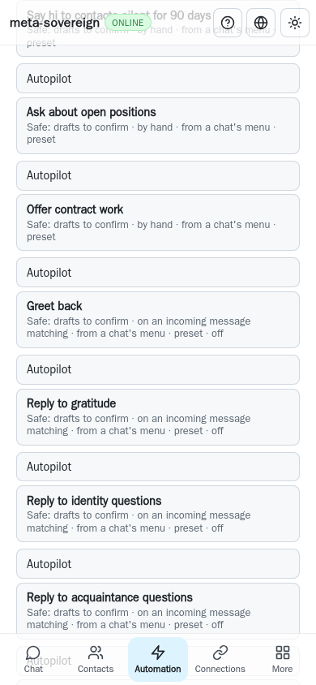
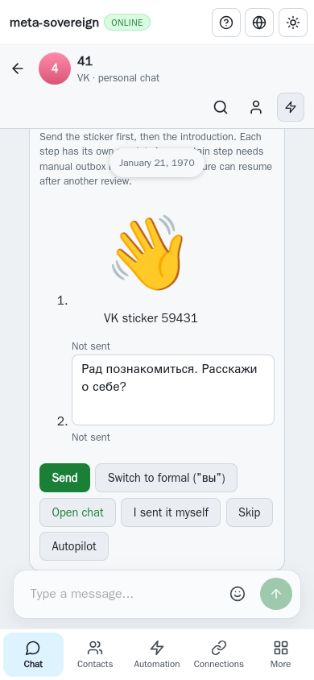
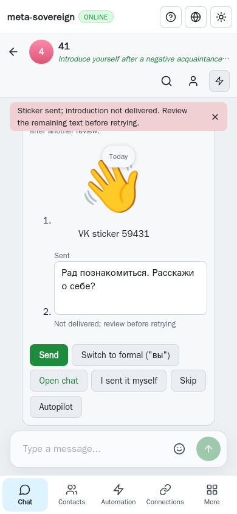
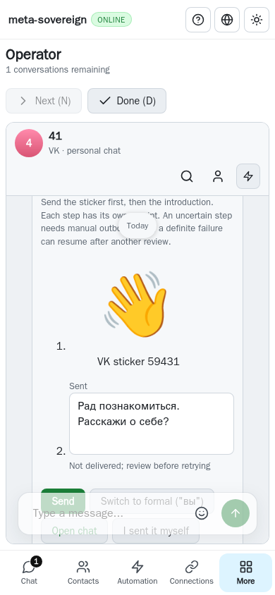

# Ordered VK acquaintance follow-up

VK06 requires a negative answer to the actual preceding acquaintance question to produce sticker `59431` followed by a configurable introduction. The complete pinned `konard/vk-bot` source and tests at `175d2d13218d9e791ae2f3e824a0d24f10319dcb` were read as data: trigger blob `ecf505ca7c864d2cd9499c444064f3ae80ffff31` and test blob `082b20d7d3f387a546ff7a50f14be959d41d25ae`. All twenty positive examples are covered. The implementation is independently written and uses editable owner introductions instead of copying somebody else's identity claims.

The disabled safe preset reuses personal-only recognition, adjacent-turn evidence, formal/informal preferences, stable bounded catalogs, offline editing, CLI, scheduler and default text/binary Lino APIs. It freezes both context records and the selected sticker. One reviewed draft contains two independently keyed effects. A per-store synchronous lock prevents overlapping confirmation before either effect starts. The queued reviewed content is flushed before the first effect. Each positive API message ID is retained in its own durable outbox record and canonical VK history record before the next step. Imported copies of that exact owned acknowledgement are recognized; unrelated incoming/outgoing messages still invalidate context.

Each child repeats the latest-context and policy validation before typing and after durable outbox admission; opt-out checks remain shared. A definite second-step failure preserves the acknowledged sticker and original pair. Read-only status, reload, runner reconstruction and unreviewed automated runs cannot resume it. Fresh confirmation resumes only the failed text with its original idempotency key. Changed content or evidence refuses. Unknown or interrupted steps never replay. A VK result without a positive API ID is recorded as unknown, creates no sent history, and stops the pair. The automatic continuation therefore requires API acknowledgements; browser-only delivery without them does not establish success.

## Reproduction and focused checks

```sh
python3 -B experiments/issue-56/vk-engagement-parent.py
node --test --test-concurrency=1 js/tests/vk-engagement.test.js js/tests/draft-confirmation.test.js js/tests/automation-planning.test.js
deno test --allow-all --no-check js/tests/vk-engagement.test.js js/tests/automation-planning.test.js
E2E_BROWSER=webkit python3 -B experiments/issue-56/vk-engagement-parent.py --browser
RUN_BROWSER_E2E=1 E2E_BROWSER=webkit node experiments/issue-56/vk-engagement-browser.mjs
```

The actual published parent `d6841cad` fails the missing-preset assertion and its native before view lacks the ordered preset. The focused Node checks pass 28/28, including ten shared confirmation cases and five planning/notice cases; Deno passes all thirteen ordered-reply cases and the five planning/notice cases. They cover every pinned positive example, bounded negatives, personal/latest/adjacent guards and timestamp ambiguity, formal/catalog/editor/CLI/scheduler parity, both default Lino encodings, frozen proof mutation and owner text overrides, distinct real-adapter mocked receipts, durable reopen, partial retry, uncertainty, concurrency, missing receipts, failed settlement/flush, canonical imported acknowledgements and late context/policy/opt-out mutations. The ordinary personal-reply compatibility tests and mandatory browser registry are checked separately. Full runtime/platform/browser matrices remain in CI.

One native WebKit scenario covers configuration/reload, stable private previews, shared ordered plan/Chat/Operator rendering, a mocked definite text refusal, partial state after reload, and reviewed text-only retry. Three fake API endpoint calls produce two positive acknowledgements: one sticker, one text. A refused browser-fallback stub prevents external navigation on the definite API refusal. The partial banner preserves the acknowledged first step; native fixture images use a local illustration, while the independent review loads the referenced sticker preview. No live provider sends or authenticated accounts are used. The first Operator fixture omitted an unread snapshot and could not open its target under the existing unread-only default; supplying the fixture's actual unread state preserves production filtering. The final screenshots explicitly set each desktop/phone viewport. Independent Playwright MCP checks saved variants, stable selection, translated ordered review and sticker-first rendering in English, Russian, Hindi and Chinese, including 390px phone width. Every owned browser/server closes. The ordered sticker help does not offer the ordinary text-only fallback. Page exceptions are empty; the preserved browser cache diagnostic means a clean console is not claimed.

Review found another concrete edge case: a successful function return with no positive VK message ID initially appeared as sent even though the pair correctly stopped. It now remains unknown, with no sent ledger/history and no restart replay. The regression covers that distinction. Scoped lint (zero errors; two advisory complexity/length warnings in the shared MCP callback), formatting, secrets, diff and the unchanged duplication gate are checked before publication; no thresholds, browser engines, test deadlines or assertions are weakened.






[Checked source and log archive](data/vk-engagement.tar.gz) and [SHA-256 manifest](data/vk-engagement.tar.sha256.json) preserve source bytes, actual-parent snapshots, pinned references, focused logs, native/MCP evidence and screenshot hashes. Exact-head hosted checks remain pending; VK06 remains unchecked until they pass. Every original unmet criterion remains required. [PR #57](https://github.com/link-foundation/meta-sovereign/pull/57) stays draft and unmerged.
