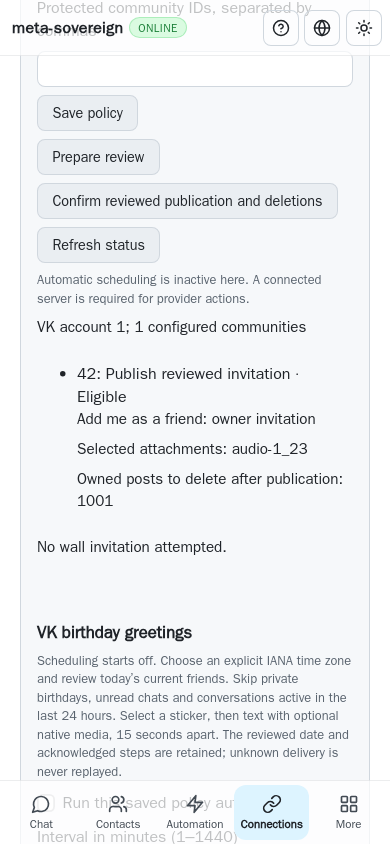
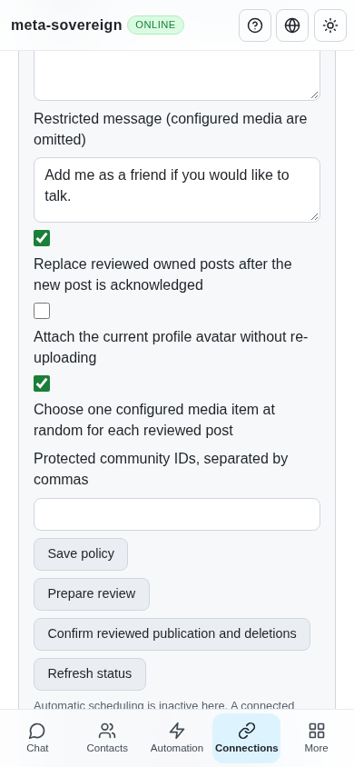

# Friend invitation source audit and media choice

The complete pinned `konard/vk-bot` friend invitation trigger at
`175d2d13218d9e791ae2f3e824a0d24f10319dcb` is preserved with GitHub's blob
envelope (`12c5f2a3623954cbef45f3b1f3825804a1560f0e`). Its standalone
caller (`8712a8ef10bf7810f9e28632a7ae02907d811350`) invokes that trigger.
Despite the filename, it posts to configured community walls using negative
`owner_id` values. It does not enumerate friends, post to personal friend walls
or send private invitations. The earlier inventory inferred personal-wall
behavior from the name; its wording is corrected against the actual source.
Personal reference destinations, texts and native media remain out of defaults.

The [shared reviewed wall workflow](vk-wall.md) already provides configured
communities, invitation variants, restricted content, native attachments and
optional current avatar reuse. It retains positive publication before owned
replacement, manual partial recovery, durable uncertainty and provider refusal
pauses through foreground CLI, both Lino encodings and four-language controls.
This audit found that the source's random single-audio choice was missing: the
workflow previously attached every configured item.

An optional `randomAttachment` choice now selects exactly one configured native
media item for each new review. It starts off, preserves existing fixed-media
behavior and appears as `--random-attachment`, the same Lino/offline setting and
a translated shared checkbox. The current avatar stays additional. Restricted
communities omit the pool, and empty pools add nothing. Review freezes the exact
selection; delivery and partial continuation never rerandomize it. Existing
saved settings and older fixed-media receipt hashes remain valid. Changing the
choice after review prevents publication until a fresh review.

The actual parent `8f077003` fails the new capability assertion and lacks the
checkbox. Six new focused cases and seventeen existing wall/interface cases
pass on both Node and Deno. They cover legacy settings, invalid booleans, empty,
singleton, duplicate and ten-item pools, current avatar, restricted content,
exact native delivery, changed-review refusal and restart recovery for both
random and legacy fixed-media partials. Native WebKit checks four synthetic
attempts, frozen media, no repost, visible deduplication, reload and failed-save
rollback. Independent MCP checks all four phone languages, two synthetic wall
calls and no page exceptions or overflow. Original cache-write errors are
preserved; an uncached repeat retains all assertions and only a fixture favicon 404. Both owned fixtures and the browser are closed. No live VK action is claimed.

The full audit also identifies two remaining parity requirements: the source
can hold a matching top-ten invitation authored by anybody, while the existing
workflow holds the current account's invitations; the source skips missing-post
errors 100/104, while safe continuation needs positive current absence evidence.
The [follow-up implementation](vk-wall-parity.md) now covers both behaviors
with distinct absent/deleted evidence and reviewed recovery. Exact final-head
hosted verification remains required. VK20 stays unchecked. All 57
unchecked original inventory rows remain required in this single PR.

The [checked archive](data/vk-friend-invitations.tar.gz) and
[manifest](data/vk-friend-invitations.tar.sha256.json) preserve actual parent
bytes, complete pinned source, original failing assertions, native/MCP evidence,
quality checks and twelve PNG hashes. Work continues in
[PR #57](https://github.com/link-foundation/meta-sovereign/pull/57).
