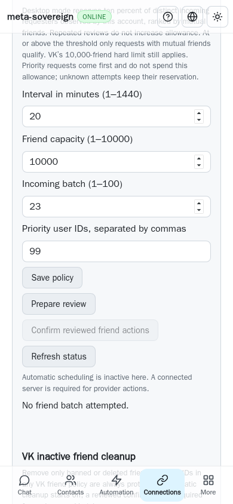
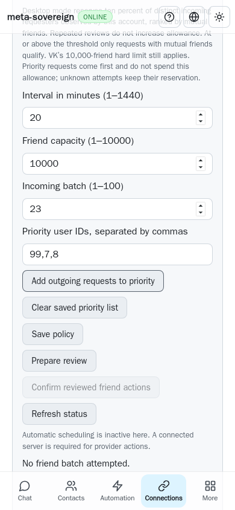

# Outgoing-request priority controls

The pinned desktop requirements call for initializing a protected priority list
from existing outgoing requests, inspecting it and clearing it explicitly. The
published parent `54c95247` supports manual ID entry but rejects the foreground
`seed-priority` command and has neither UI action.

The shared friend job now merges a complete outgoing-request observation with
owner-entered priorities. Reads use at most ten 1,000-item pages, require exact
page sizes and a stable total, reject duplicate IDs and verify the account again
after the scan. Changing credentials, stopping the service or refusing a durable
write preserves the previous acknowledged list. The list supports VK's 10,000
account bound; subsequent relationship checks use provider-sized chunks.

Settings edits serialize across seeding, explicit clearing and ordinary saves.
Shutdown drains admitted scans, and a scan finishing after stop cannot save.
Existing shared cleanup/cancellation guards protect seeded IDs. Neither action
sends, accepts or cancels a provider request. Persisted legacy null/empty lists
and numeric singletons normalize on read; new writes remain strictly validated.

The [persisted-list follow-up](legacy-priorities.md) extends read normalization
to cleanup, cancellation and every personal policy while retaining strict new
writes and refusing populated unknown shapes.

CLI commands `vk-friends seed-priority` and `vk-friends clear-priority` own and
close their stores. The corresponding `/api/vk/friends/seed-priority` and
`/api/vk/friends/clear-priority` actions enforce trusted origins through both
default Lino encodings. Four-language controls retain the saved list on refusal,
replace a priority draft only after acknowledgement, preserve other draft fields
and survive reload. They reuse existing spacing and disabled/busy/error states,
following the product vision's explicit, reversible settings interactions.

Reproduce the parent and current behavior:

```sh
python3 -B experiments/issue-56/friend-priority-before.py
node --test --test-concurrency=1 --test-timeout=30000 js/tests/vk-friend-priority.test.js
node experiments/issue-56/friend-priority-native.mjs
```

The parent probe restores the actual CLI and prebuilt UI bundle, requires the
specific unsupported-command failure and captures the missing controls. An
initial broad-source probe failed at import time because old settings lacked a
new constant; its diagnostic is retained and does not count as a reproduction.
Forty-one focused checks pass on each of Node and Deno. After validation and UI
refactoring, the seven new regression checks pass again on each runtime. Strict
lint, formatting, secret scanning and the unchanged duplication gate pass.

One focused native WebKit case verifies merge, refused clear, retained drafts and
reload. Independent Playwright MCP verifies translated labels, acknowledged
merge/clear/reload and desktop/phone layout in all four languages. It reports
zero page errors, one expected favicon 404 and navigation-aborted owned requests;
all diagnostics are retained. The browser and temporary server close, with zero
provider writes or messages. No authenticated provider result is claimed.




[Checked source/log archive](data/vk-friend-priority.tar.gz) ·
[Hash manifest](data/vk-friend-priority.tar.sha256.json).
VD12 retains hosted verification as unfinished. All **60 of 118** unchecked
inventory rows remain active; [PR #57](https://github.com/link-foundation/meta-sovereign/pull/57)
stays draft and unmerged.
