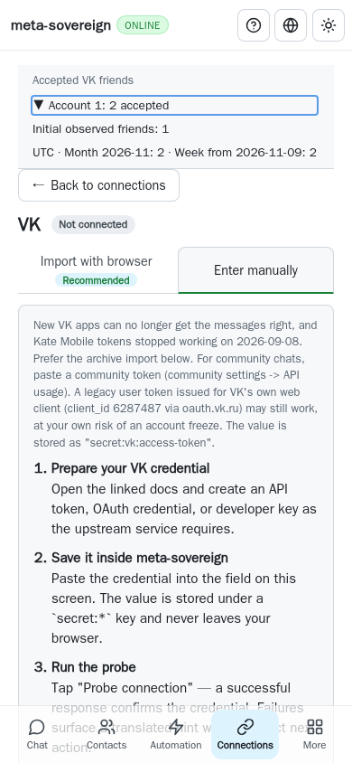
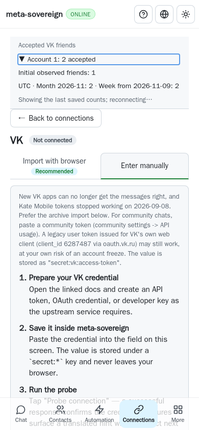

# Acknowledged accepted-friend statistics

VD11 remains unchecked until exact-head hosted verification. PR #57 stays draft
and unmerged; the other unfinished issue requirements remain required.

The pinned [desktop stats implementation](https://github.com/konard/vk-bot-desktop/blob/8fbf3b7c42fd8e995ef137cab9b9653a7dc9b1a1/src/bot/stats.js)
and full desktop requirement audit call for an initial friend count, accepted
totals for all time/current month/current week, separate Links Notation files
under `stats`, and a summary near the top of the app after the first acceptance.
Our implementation is original. It follows the shared neutral appearance and
truthful delivery/recovery rules in the product vision and pinned Chat References.

The existing per-person delivery record can be replaced when a later request or
removal changes that relationship. Counting those records alone loses accepted
history. The finite exact-parent regression accepts two friends, positively
observes the relationship, then sends a later request to one of them. The total
falls from two to one (`1 !== 2`). New immutable, account-scoped acceptance
receipts preserve both. Only a confirmed native acceptance receipt (`2`) counts;
outgoing requests, refusals, missing acknowledgements and uncertain outcomes do
not. Archiving old acceptance evidence must succeed before replacement.

The first complete account snapshot records the initial count once. CLI status,
both default Lino API encodings at `GET /api/vk/friends/stats`, and offline local
reads share the canonical calculation. Legacy accepted records without a
confirmation date count toward the total and are explicitly labelled undated;
they are never assigned an invented month or week. UTC months and Monday-start
UTC weeks use calendar dates, including weeks across year boundaries.

Production jobs project private durable files under the selected store:

- `stats/vk-friends/ACCOUNT/total.lino`
- `stats/vk-friends/ACCOUNT/months/YYYY-MM.lino`
- `stats/vk-friends/ACCOUNT/weeks/YYYY-MM-DD.lino`

Each projection touches only the total and current month/week, and skips identical
bytes. Historical period files retain their bytes and modification times. Files
use the official Links Notation formatter, owner-only durable writes and atomic
replacement. Canonical receipts remain the source of truth if a derived file
write fails. A fresh review repairs the projection without replaying the consumed
action. Read-only status never writes projections. In-memory server fixtures do
not acquire the user's store directory.

The four-language top-of-surface summary appears only after an acceptance. Native
keyboard-expandable details show the initial observation and UTC period counts.
Failed reads retain the last server snapshot with a recovery message; owned
polling admits one read at a time, backs off and cancels on unmount. An offline
cache never replaces a newer server snapshot, and extra Telegram account tabs
cannot fall back to the primary local store. Chat and Operator retain room for
their conversation surfaces when the summary expands.

Focused verification: 28 Node cases (statistics/feed plus existing friend tests),
11 Bun and 11 Deno cases. Coverage includes exact-parent loss, UTC month/week and
year boundaries, initial-count preservation, history-write refusal, consumed-plan
admission, derived-file refusal/repair, real Lino restart, account isolation,
official notation parsing, private modes, historical file preservation, both
Lino transports, offline scope, malformed summaries and cancelled/held reads.
Run the relevant tests with concurrency one; no full local suite is needed.

Native WebKit verifies actual reviewed synthetic acceptance, failure retention,
recovery, reload and VK/Chat/Operator desktop and phone layouts. Independent MCP
checks English, Russian, Hindi and Chinese at both widths. Both fixtures own and
close their browsers/servers. Each makes exactly two synthetic acceptances and
zero message sends, with no authenticated provider sessions. The initial MCP run
reported browser cache-write failures while rendering correctly; its raw result
is retained. Serving the isolated fixture directly in the follow-up removes
those errors. That run has no page or console errors; its only failed requests
are cancelled event streams during document replacement.

Reproduce with `python3 -B experiments/issue-56/friend-stats-before.py` and
`node experiments/issue-56/friend-stats-native.mjs`. Hosted browser/runtime matrices
remain required before VD11 is accepted. See the [active checklist](vk-friend-stats-plan.md),
[checked evidence archive](data/vk-friend-stats.tar.gz) and
[SHA-256 manifest](data/vk-friend-stats.tar.sha256.json).

Before: confirmed acceptances have no top-of-window summary.

After: compact accepted total and expandable initial/UTC counts.

After a failed refresh: last acknowledged counts remain visible.

