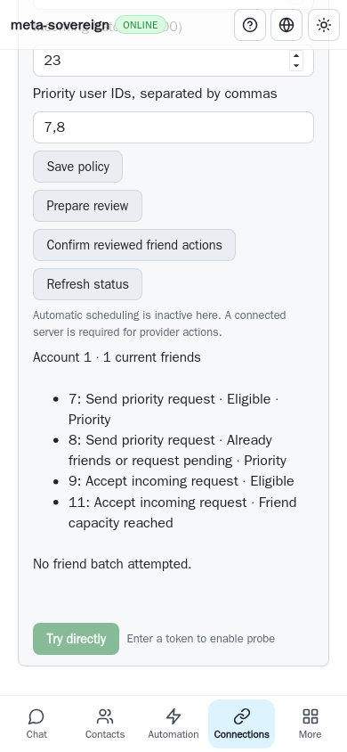
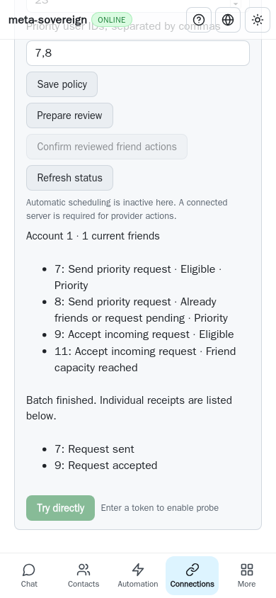
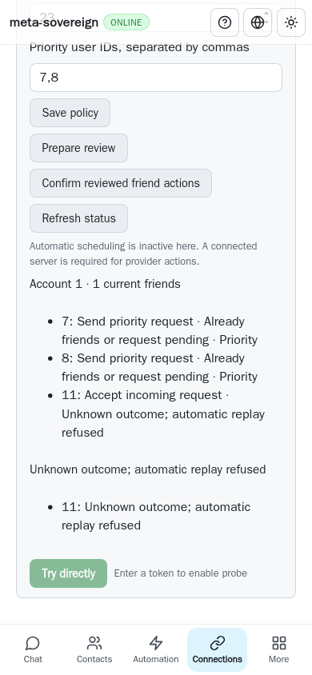

# Reviewed VK friend requests (VK11)

The published parent `e21ddaa906ff5244a0233814b6a4a37f0fece3ce` has no friend
snapshot/action adapter or connection controls. This unit adds priority-first
requests and bounded acceptance through the existing provider adapter, shared
store, CLI, default text/binary Lino API and four-language connection panel.
[Usage](../../VK-FRIEND-REQUESTS.md) describes defaults, review and recovery.

The pinned reference is `konard/vk-bot` at
`175d2d13218d9e791ae2f3e824a0d24f10319dcb`, acceptance trigger blob
`3a37b6260631649982914ed415ce9c45a845f88b` and caller blob
`422683021e1d58778c28d4fbddb489c20cc80328`. Its policy requests priority
accounts before accepting a mutual-ranked incoming batch of 23, below capacity
10000, with ten-second spacing and a twenty-minute caller. Personal priority
IDs are not imported. Owner configuration starts disabled with empty priorities.
The current official VK method/response/object schemas are preserved in the
archive; positive `friends.add` receipts are 1 (sent), 2 (accepted), 4 (resent).

A five-minute review freezes settings, credential identity, provider account,
friend count and target relationships. Before each write, after the adapter's
rate wait and acknowledged intent, the executor checks current consent,
credential, provider identity, relationship and available capacity. The plan is
consumed once. Per-target records preserve confirmed, refused and unknown
outcomes across restart; failed outcome acknowledgement retains pending intent
as unknown. Unknown actions cannot replay. Confirmed actions wait for later
provider observation before a subsequent relationship can become eligible.

Saved automatic policy uses an owned minute timer and the configured interval.
Read failures count as attempts, preventing one-minute retries of a saved
twenty-minute policy. Stop aborts pacing and drains issued work. CLI stays
foreground. Offline controls save acknowledged policy but expose no provider
actions or running scheduler. The shared connected/offline API and route helper
also retain the online-status job's origin, encoding and acknowledgement rules.

Reproduce the actual-parent failure with
`python3 -B experiments/issue-56/vk-friends-parent.py --browser`. Its selected
adapter test must fail and the parent screenshots show absent controls; all
production replacements restore in `finally`. Focused verification uses
`node --test --test-concurrency=1 --test-timeout=30000 js/tests/vk-friends.test.js js/tests/vk-online.test.js`.
The final Node receipt includes 36 passing checks: 17 friend regressions,
14 online compatibility checks, three CLI import contracts and two MCP
code-generation checks. Deno passes the same 31 feature checks. Two browser
registry checks preserve mandatory hosted Chromium/WebKit coverage.

The native WebKit scenario verifies priority order, capacity, explicit review,
actual mocked receipts, retained uncertainty and failed-save rollback across
reload. It records three synthetic friend calls, zero messages and zero page
exceptions. Independent MCP checks English, Russian, Hindi and Chinese, saved
choices, confirmed review and phone overflow, with four synthetic calls and
zero page exceptions. Existing online native and four-language MCP scenarios
also pass after shared API extraction. Browsers and owned fixture servers close.
No authenticated provider sessions or live VK effects were used.

Early draft checks exposed missing credential binding and missed settlement
when an accepted target disappears from incoming requests. Credential digests
and separate observed-confirmed target reads resolve those regressions. The
CLI probe also exposed its stripped positional-argument convention, corrected
in both implementation and fixtures. A failed-save probe was corrected to use
default Lino rather than enabling JSON compatibility. Initial duplication failed
at the unchanged 6.5% limit; shared route handling removes repeated admission
and response logic. A separate failing-before shutdown regression verifies that all jobs stop before a held online request is drained. No exclusions, thresholds or deadlines were weakened.
MCP console evidence records the fixture's absent favicon and browser cache
write errors; application page exceptions remain zero. The first online
compatibility launcher skipped without its required environment flag; its
replacement explicitly enables the native scenario and passes.

Before on the actual parent:

Reviewed capacity and priority, confirmed receipts, and retained unknown action:

The checked [source/log archive](data/vk-friends.tar.gz) and
[manifest](data/vk-friends.tar.sha256.json) preserve parent sources, source pins,
failed draft checks, final receipts and screenshot hashes. Exact-head hosted
verification remains pending, so VK11 stays unchecked. The desktop reference's
top-ten-percent/mutual-only policy, friend deletion/cancellation/rejection and
every other incomplete original criterion remain required. [PR #57](https://github.com/link-foundation/meta-sovereign/pull/57)
stays draft and unmerged; this unit does not complete issue #56.
