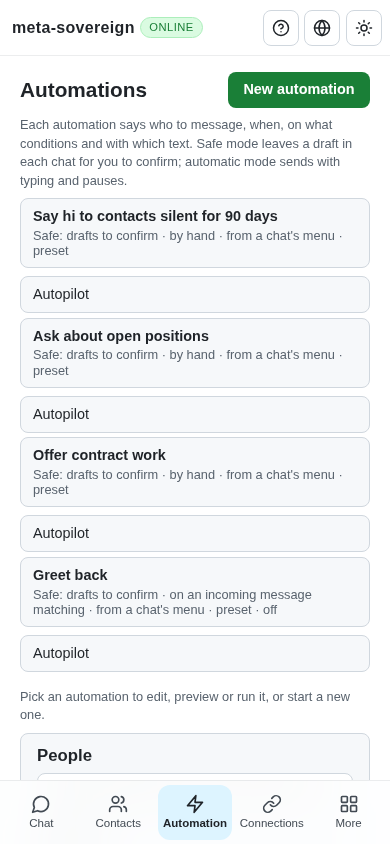
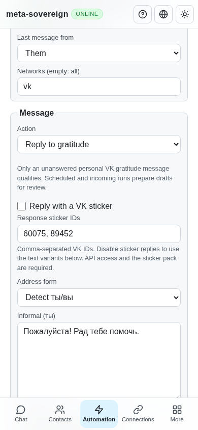
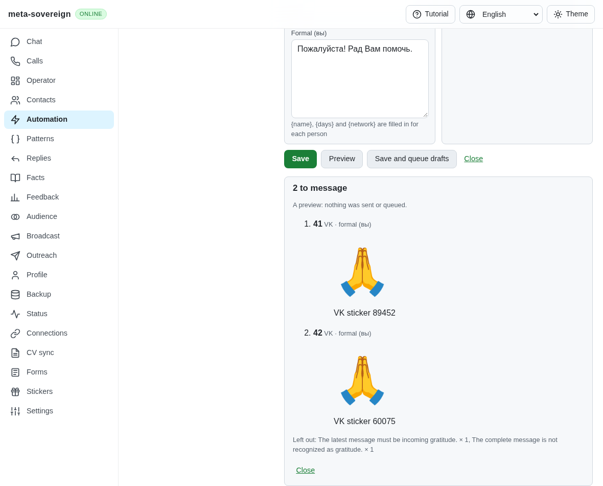

# Configurable personal VK gratitude replies

The published parent `727e361a8c318a39bc8e23941a5bc41a80445f13` has no
gratitude preset or action. The focused planning assertion fails on that actual
parent, and its production browser screen has no gratitude controls. The same
assertion and browser flow pass with this implementation.

The pinned [gratitude trigger](https://github.com/konard/vk-bot/blob/175d2d13218d9e791ae2f3e824a0d24f10319dcb/triggers/gratitude.js)
responds to incoming user gratitude text or known stickers. Its tests and
sticker catalogue were read as data; no downloaded implementation was run.
The independent whole-message recognizer covers all 84 pinned contextual
phrase cases and 38 incoming sticker identifiers. Text inputs are bounded to
1,024 characters and 64 tokens; unrelated or question-bearing text refuses.

## Behavior

**Automation → Reply to gratitude** starts disabled in safe mode. The shared
automation engine plans only the latest unanswered incoming personal VK user
dialog, including manual condition-bypass previews. Outgoing/deleted/service
messages, community/group peers, conflicting historical chat types and
ambiguous or invalid timestamps refuse. The user can choose response sticker
IDs or formal/informal text variants through CLI, the existing Lino API,
offline planning and the shared four-language editor.

The preview shows the exact chosen sticker. Its choice remains stable across
preview, confirmation, durable draft recovery and delivery. Entering nonempty
text or changing address form selects text instead; sending a sticker records
its actual metadata rather than learning an empty text template. The real VK
adapter forwards the sticker ID. Unsupported browser sticker fallback refuses.

Safe drafts require confirmation; scheduled and incoming runs only prepare
drafts. Manual auto runs retain exact-preview confirmation, pacing, limits,
opt-outs and the durable outbox. Before typing and again after outbox admission,
delivery rechecks the latest message fingerprint, destination, sticker choice
and current saved action/edit policy. Changes require a new review. Recovery
does not send. Continuous authenticated VK watching is not claimed by this unit; see [user instructions](../../VK-GRATITUDE.md).

## Reproduction and verification

```sh
python3 -B experiments/issue-56/vk-gratitude-parent.py
node --test --test-concurrency=1 js/tests/vk-gratitude.test.js
deno test --allow-all --no-check js/tests/vk-gratitude.test.js
RUN_BROWSER_E2E=1 E2E_EXECUTABLE_PATH=/opt/google/chrome/chrome python3 -B experiments/issue-56/vk-gratitude-parent.py --browser
RUN_BROWSER_E2E=1 E2E_EXECUTABLE_PATH=/opt/google/chrome/chrome node experiments/issue-56/vk-gratitude-browser.mjs
```

Thirteen focused Node and thirteen Deno cases cover recognition, private-dialog
selection, unchanged-sticker confirmation, edits, owner replies, late message
and policy changes, conflicting history, scheduler direction, unsupported
fallback, all locales, CLI/offline previews and durable Lino reopen. Both default
Lino encodings exercise the actual VK adapter against a local mocked
`messages.send` endpoint, assert one positive receipt, and refuse replay. This
is adapter integration evidence; no authenticated provider session was used.
Sixty-three existing automation/model/server/CLI/i18n checks also pass.

One focused native Chromium scenario captures actual-parent absence and the new
desktop/phone controls, exact sticker preview, save/reload and text-only preview.
It is registered in the existing mandatory Greetings browser entry for hosted
engine coverage, with unchanged job budgets. Independent Playwright MCP checks
translated labels and retained edits in English, Russian, Hindi and Chinese.
Owned contexts and servers close with zero page exceptions and zero sends.
Shared VK browser setup and viewport capture remove duplicated fixture code;
the existing greeting scenario passes after that extraction. Scoped lint,
format, secret, diff and the unchanged 6.5% duplication gate are required.





The [evidence archive](data/vk-gratitude.tar.gz) and
[SHA-256 manifest](data/vk-gratitude.tar.sha256.json) preserve parent sources,
reference blobs, focused logs, verified browser bundle and screenshots. VK02
awaits its own exact-head hosted checks. Every unchecked original criterion
remains required; [PR #57](https://github.com/link-foundation/meta-sovereign/pull/57)
stays draft and unmerged.

Subsequent [exact-head hosted verification](hosted-verification-2733.md)
passes all five workflows and 66 jobs at `2733ff54`. The relevant VK reply
criteria are now checked; 71 original inventory rows remain incomplete.
