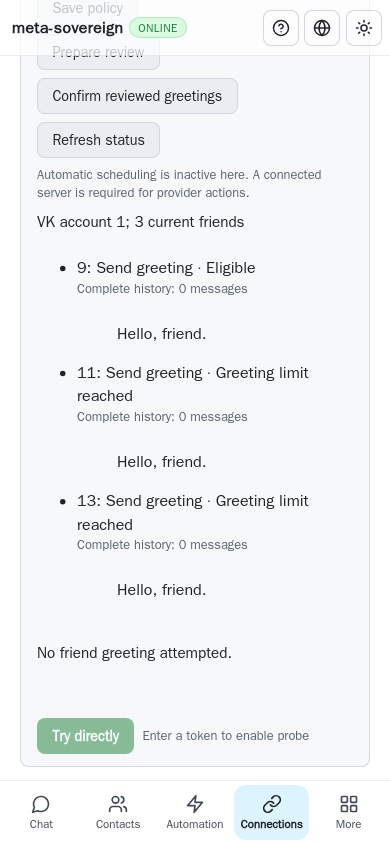
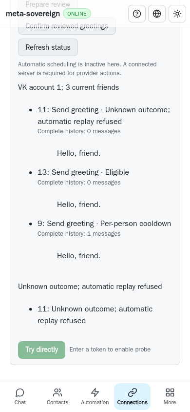

# Reviewed proactive VK friend greetings (VK15)

The pinned `konard/vk-bot` tree at
`175d2d13218d9e791ae2f3e824a0d24f10319dcb` has a foreground caller
`greet-friends.js` (blob `69f7a091bc5b1c2a778d406489102826822304e6`)
and batch trigger `triggers/greet-friends.js`
(blob `40a75bb95de348f3ab96eb841002dd16587036ed`). The complete caller and
trigger are preserved, alongside the distinct topic/help/music triggers. The
batch policy prioritizes empty and oldest conversations, optionally ordering by
friend counts, while checking permissions, unread state and a finite limit.
The topic/help/music policies add online and seven-/31-day windows; these
separate criteria remain required and are not claimed implemented by VK15.

The existing stored-chat Greetings feature cannot prove current friendship or
provider permission. An independent, initially disabled provider policy now
reviews actual current friends with configurable online-only, empty-only,
silence, per-person cooldown, scan and delivery limits. Online-only defaults on
as a conservative configurable choice; the batch reference itself does not
require it. Optional total-friend ordering precedes empty/oldest ordering.
Configured native stickers replace text, with their ID visible in review.

The complete current friend list is bounded to 10,000; each reviewed history
must be complete within 1,000 messages. Unknown, malformed, partial, unread,
service, future, protected and unwritable evidence cannot authorize delivery.
Both shared opt-outs and the priority union apply. The plan freezes the account,
credential identity, settings, exact content, provider fingerprint and prior
durable cooldown receipt for five minutes. Immediately after the actual rate
wait, and again after intent acknowledgement, current evidence must match.
Concurrent receipts are preserved rather than replaced by this review's refusal.

The shared personal executor retains VK14's once-only behavior while allowing
a later greeting only after both silence and cooldown. Every attempt has a
persisted nonzero native identity, one provider call, guarded outbox key and
positive native receipt before acknowledgement. Actual Chat records retain the
native message/sticker identity. Refusal and uncertainty stay distinct;
unknown or unacknowledged attempts do not replay through restart. Owned
scheduling starts after server port ownership, respects quiet hours and drains
on close, aborting its 30-second spacing wait.

[Usage](../../VK-FRIEND-GREETINGS.md) covers foreground CLI, saved opt-in,
both default Lino API encodings, offline editing and shared four-language UI.
Official VKCOM schema blobs preserve personal `friends.get`, online/private
write booleans and conversation unread fields. No authenticated live provider
session or real delivery is claimed.

The actual published parent `07d3159e` fails the adapter capability regression
and has no greeting controls; finite native before screenshots preserve that
absence. Focused checks cover every filter, ordering and scan limits, positive
text/sticker receipts, durable Lino reopen, later eligible cycles, lost/refused
receipts, failed acknowledgements, changed live inputs at both admission stages,
concurrent cooldown receipts, owned scheduling, CLI and both Lino encodings.
Existing VK14 regressions verify the shared executor retains prior behavior.

The native WebKit scenario verifies exact review with zero effects, saved text,
one acknowledgement, cooldown, unknown outcome after reload and failed-save
rollback. Independent MCP verifies English, Russian, Hindi and Chinese with
390-pixel screenshots, one synthetic greeting and zero page exceptions. The
first MCP script wrongly confirmed the next eligible friend on every language
pass; preserve its failure and diagnose it as a review-script assumption. The
corrected script sends once, then checks that person's cooldown across locales.
Console favicon/cache-write diagnostics are preserved; a clean console is not
claimed. All owned fixture resources and browser pages close.

The checked [archive](data/vk-greet.tar.gz) and
[manifest](data/vk-greet.tar.sha256.json) retain sources, actual parent,
pinned research, official schemas, failed drafts, focused receipts, built-bundle
identity and screenshot hashes. Exact-head hosted verification remains pending.
VK15 and every other unchecked issue criterion remain unaccepted.
[PR #57](https://github.com/link-foundation/meta-sovereign/pull/57) remains draft
and unmerged.
