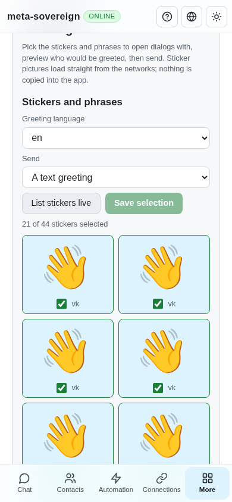
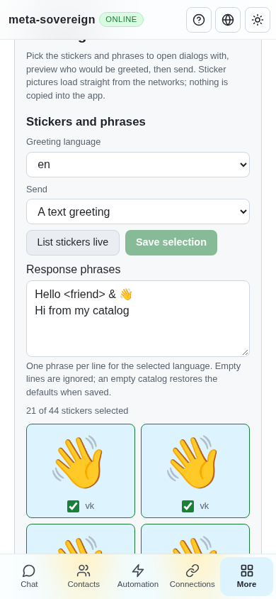

# VK greeting recognition and response catalogs

The actual published parent `0a6283651778b914102c6ddb49a19d29cbf80070`
accepts `greetings-select --texts` without changing any phrases. Its browser
screen has no phrase editor. A reply plan built from actual `vkMessageLink`
records also includes an imported outgoing message and a positive-ID group.
The planner projects neither normalized outgoing direction nor a personal-dialog
restriction into its shared send boundary.

The pinned [VK greeting trigger](https://github.com/konard/vk-bot/blob/175d2d13218d9e791ae2f3e824a0d24f10319dcb/triggers/greeting.js)
requires a user dialog, ignores outgoing requests and limits repeat greetings
within a day. The preceding [greeting implementation PR](https://github.com/link-foundation/meta-sovereign/pull/36)
provides the existing shared detector, selection storage, sticker controls,
preview, confirmation, paced outbox and delivery adapters. The correction reuses
those contracts. No reference implementation code is copied.

## Behavior

CLI `greetings-select --texts` accepts newline-separated literal phrases for the
selected language. The shared four-language Greetings screen edits the same
catalog. Saving uses the existing acknowledged selection API/store; other
languages survive edits, empty lines are ignored and an empty catalog restores
its language defaults. Incoming detected language still selects the corresponding
catalog; a sticker or wave uses the selected fallback language. Existing sticker
catalog configuration remains available.

Greeting aggregation retains the source normalizer's outgoing flag and explicit
chat type. VK candidates must have a canonical positive personal user peer ID
below the group range, with no conflicting group/channel type. Shared planning,
dry run and actual sending apply the same destination check. Repeated greetings,
opt-outs, confirmation, daily/run caps, pacing and the guarded outbox remain in
force. Other providers keep their existing destination capabilities.

## Reproduction and verification

```sh
node experiments/issue-56/vk-greeting-catalog-probe.mjs
python3 -B experiments/issue-56/vk-greeting-catalog-parent.py
node --test --test-concurrency=1 js/tests/vk-greeting-catalog.test.js
deno test --allow-all --no-check js/tests/vk-greeting-catalog.test.js
node experiments/issue-56/vk-greeting-reference-probe.mjs
RUN_BROWSER_E2E=1 E2E_EXECUTABLE_PATH=/opt/google/chrome/chrome node experiments/issue-56/vk-greeting-catalog-browser.mjs
```

Six final regressions fail on the actual parent and pass after correction. Nine
focused Node and nine Deno checks cover imported text/stickers/outgoing/group
records, summary and direct-plan bypasses, per-language CLI storage, durable Lino
reopen, offline preview/save/default reset, both default Lino API encodings and
all four UI locales. Confirmed API sends use the actual VK adapter with a mocked
`messages.send` endpoint, assert its positive message ID and stored greeting,
and refuse confirmation replay. Dry run retains the daily/opt-out guards.

The pinned audit independently checks all 98 numeric sticker IDs in the source
trigger and 35 finite Russian greeting forms. Static reference cases also run
in the focused test. Nineteen existing detector/catalog/planner/runner/selection
checks pass. The legacy runner fixture's invalid peer `boom` is replaced with a
valid numeric personal peer while preserving its original provider failure,
pacing, outbox and success assertions.

One native Chromium scenario captures the parent/current production UI at desktop
and phone widths, saves and reloads literal catalog entries, and verifies that
only the two private incoming dialogs are ready. It is mandatory in the existing
Greetings browser CI entry; engine budgets stay unchanged. Independent Playwright
MCP verifies English, Russian, Hindi and Chinese labels, retained values, private
reply eligibility and phone wrapping. Both browser checks report zero page
exceptions and sends; the independent owned fixture reports closed resources.

The first browser harness used an unprefixed action selector and timed out; its
log is retained alongside the corrected successful parent capture. Two draft
tests initially queried the wrong existing receipt/preview fields; the corrected
parent regressions and positive run remain separately preserved. Scoped lint
first omitted the repository's explicit config; the subsequent configured pass
exposed braces, locale file limits and function complexity. Small shared helpers
and locale modules correct those findings without changing their gates. The final
local browser invocation first omitted its enable flag, then selected an
uninstalled default binary. Its completed rerun uses the installed native Chrome;
the missing-binary diagnostic is preserved.




The [checked archive](data/vk-greeting-catalog.tar.gz) and
[SHA-256 manifest](data/vk-greeting-catalog.tar.sha256.json) preserve the pinned
trigger, actual parent sources, finite probes, focused/native/MCP logs and
screenshots. All five exact-head `727e361a` workflows now pass; see [hosted verification](hosted-verification-727.md). VK01 is complete.
VK26's continuous trigger state and every other unchecked issue requirement stay
active. PR57 remains draft and unmerged.
