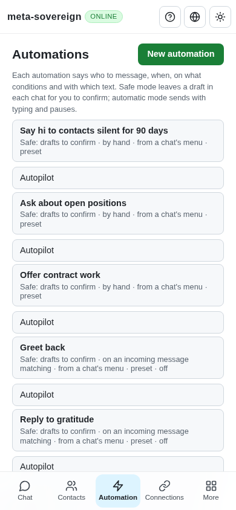
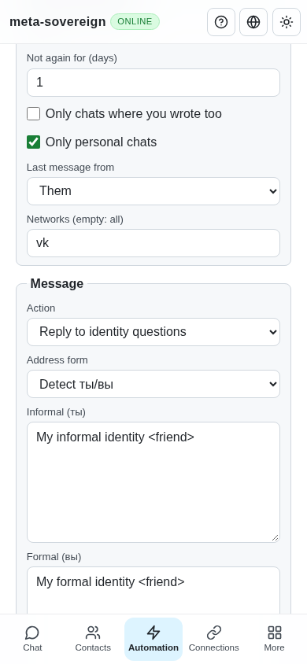

# Personal VK identity replies and learned address preference

Published parent `53a8479253b7a75b2f39cfa6d06ac816f6f7be93` has no identity preset. Its majority address scoring also loses a recent informal identity question among older formal messages. Two focused assertions fail on that actual parent; its production screen has no identity controls. They pass with this change.

Both pinned triggers, [informal](https://github.com/konard/vk-bot/blob/175d2d13218d9e791ae2f3e824a0d24f10319dcb/triggers/who-singular.js) and [formal](https://github.com/konard/vk-bot/blob/175d2d13218d9e791ae2f3e824a0d24f10319dcb/triggers/who-multiple.js), and their six tests were read completely as data. No downloaded implementation was executed. An independent parser recognizes their complete questions, with a 256-character bound and refusal of additional question text.

## Behavior and root causes

The disabled safe-mode preset reuses the shared automation editor, CLI, offline planner and both Lino API encodings. Its formal/informal replies remain editable. It plans only the latest incoming personal VK question, including condition-bypass previews. The shared gratitude/identity guard retains private-dialog, outgoing, deletion, service, timestamp and conflicting-history checks; saved policy and latest message are revalidated before typing and after outbox admission. Scheduled/incoming runs prepare drafts; recovery does not send.

The latest qualifying identity question now supplies an evidenced address preference through durable history. Older usage cannot override it; later explicit agreements can. The contact panel explains the source in all four languages. Authoritative outgoing flags identify owner aliases for this learning and shared conversation planning.

The tests also exposed mixed timestamp ordering: normalized VK imports retain numeric Unix seconds, whereas local outgoing receipts use ISO dates. Shared message ordering now compares seconds, milliseconds and ISO values as the same instant while preserving their original bytes. Invalid or simultaneous latest messages still refuse guarded replies. Existing clock arguments keep their original millisecond semantics.

See [user instructions](../../VK-IDENTITY.md).

## Reproduction and verification

```sh
python3 -B experiments/issue-56/vk-identity-parent.py
node --test --test-concurrency=1 js/tests/vk-identity.test.js
deno test --allow-all --no-check js/tests/vk-identity.test.js
RUN_BROWSER_E2E=1 E2E_EXECUTABLE_PATH=/opt/google/chrome/chrome python3 -B experiments/issue-56/vk-identity-parent.py --browser
RUN_BROWSER_E2E=1 E2E_EXECUTABLE_PATH=/opt/google/chrome/chrome node experiments/issue-56/vk-identity-browser.mjs
```

Nine focused Node and nine Deno cases cover all six pinned questions, preference retention and later agreement, mixed timestamps, latest-private selection, exact confirmation, late edits/messages/owner replies/policy changes, scheduler direction, frozen review, CLI/offline configuration, four locales and durable Lino reopen. Both default Lino encodings exercise the real VK text adapter against a local mocked endpoint, assert one positive receipt and refuse replay. There were no authenticated provider sessions.

The combined focused Node run passes 56 cases including gratitude, address learning and reengagement. Sixty-three existing automation/editor/server/CLI/i18n checks pass. One native Chromium scenario verifies actual-parent absence, edited informal/formal previews, save/reload and desktop/phone layouts. The existing gratitude browser case passes after shared helper extraction. The new scenario joins mandatory hosted Greetings coverage without increasing job budgets.

Independent Playwright MCP checks English, Russian, Hindi and Chinese labels, saved literal text including markup characters, both private previews and phone fit. Owned browsers and fixtures close with zero page exceptions and zero sends. Preserved console diagnostics include a missing fixture favicon and browser cache-write failures; console cleanliness is not claimed. Scoped lint/format/secrets/diff and the unchanged 6.5% duplication gate are required.




The [checked evidence](data/vk-identity.tar.gz) and [SHA-256 manifest](data/vk-identity.tar.sha256.json) preserve reference blobs, actual-parent sources, logs, verified browser bundle and screenshots. VK03 awaits its own exact-head hosted checks. All original unchecked criteria remain required; [PR #57](https://github.com/link-foundation/meta-sovereign/pull/57) stays draft and unmerged.

Subsequent [exact-head hosted verification](hosted-verification-2733.md)
passes all five workflows and 66 jobs at `2733ff54`. The relevant VK reply
criteria are now checked; 71 original inventory rows remain incomplete.
