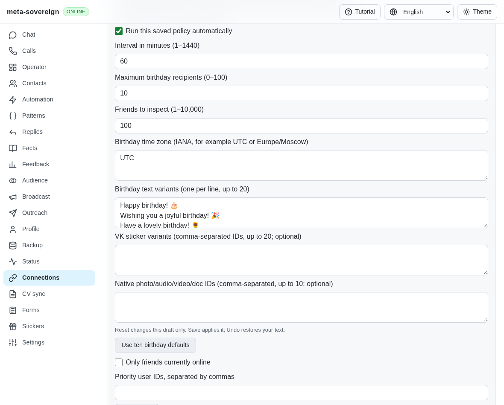

# Independent VK job policies (VD03)

Pinned desktop `8fbf3b7c42fd8e995ef137cab9b9653a7dc9b1a1` requires each
behavior to be independently toggleable (Bot Behavior 16). Its configuration
names online status, incoming friend acceptance, deactivated-friend cleanup,
outgoing-request cleanup, invitations and birthday congratulations.

The shared implementation maps those six switches to `online`, `friends`,
`cleanup`, `outgoing`, `wall` and `birthday`. Each owns a different
`provider-job:vk:*` configuration and corresponding state/plan records. The
friend-derived implementations share pacing and serialization, while reading
their own policy before scheduled admission. Disabling another policy is not
a prerequisite. Settings acknowledgements remain separate from provider waits.
The server starts the owned timers after acquiring its port and signals every
job before draining shutdown. Global scheduler suspension remains explicit.

| Surface                  | Independent policy admission                                                                           |
| ------------------------ | ------------------------------------------------------------------------------------------------------ |
| Foreground CLI           | `vk-online`, `vk-friends`, `vk-cleanup`, `vk-outgoing`, `vk-wall`, `vk-birthday` settings/run commands |
| Default text/binary Lino | Separate trusted `/api/vk/{name}` routes and acknowledged settings resources                           |
| Connections              | Online control plus the shared personal-policy control, bound to each named resource                   |
| Scheduler                | One retained minute timer per job; each uses its saved interval, enabled flag and own last attempt     |

All policies intentionally start disabled, preserving explicit owner consent.
The pinned desktop's enabled defaults are not imported. Wall destinations must
be configured before enabling invitations. Wall/birthday default intervals are
60 minutes and remain editable; this row verifies independent switches rather
than accepting their complete business behavior or other desktop requirements.

The new finite disk-store check enables exactly one of the six jobs at a time.
It reopens the actual Lino file before polling all six actual job/adapter
instances. The selected job must retain its policy and produce a positive
provider receipt; the other five must retain their settings and produce zero
provider reads or effects. Disabling the selected job, advancing two days and
reopening again must preserve the receipt and prevent every provider call.
All six timers must be cleared on Stop. Six cases pass in Node, Bun and Deno.
The first draft used `method` rather than the fake's actual `name` field for
the online call assertion; both the initial output and correction are retained.

The new mandatory `vk-independent` native group operates the six actual shared
controls through their routes, requiring twelve acknowledged toggles, six
reloads, unchanged other policies and retained wall destinations. Scheduling
stays visibly inactive and no provider action is requested. The focused native
Chromium check passes with zero provider effects and page exceptions. A missing
Playwright-managed binary is preserved as an environment failure; the check uses
the existing system Chrome in an owned profile without installing browsers.
The hosted Chromium and WebKit groups remain required at the published source.
Independent Playwright MCP also verifies all twelve toggles and six reloads,
then closes its browser and owned fixture with zero provider effects. Its
console retains a missing favicon, a Chromium cache-write failure and password
form hints; zero page exceptions does not mean a clean browser console. The
initial unsupported dynamic-import attempt is preserved separately.



[Phone viewport](../../screenshots/issue-56-vk-independent/birthday-enabled-phone.png).

```sh
node --max-old-space-size=384 --test --test-concurrency=1 js/tests/vk-independent-jobs.test.js
RUN_BROWSER_E2E=1 npm run test:e2e:vk-independent
```

Eight existing relevant archives verify 1,007 entries without extraction.
Their source audit records 45 later changed production files; archive integrity
alone does not establish current behavior or acceptance. The online admission
correction has its own fifteen parent regressions and five positive controls in
[the separate report](vk-online-admission.md). Existing job reports retain their
CLI, both Lino encodings, localized control and provider-receipt checks.

The new [checked evidence](data/vk-independent-jobs.tar.gz) and
[manifest](data/vk-independent-jobs.tar.sha256.json) preserve the pinned
configuration/requirements, finite tests, native receipt and final static checks.
VD03 remains unchecked pending same-source hosted receipts and a complete
criterion review. All forty unfinished criteria stay required in
[PR #57](https://github.com/link-foundation/meta-sovereign/pull/57).

The prepared hosted collector requires all five successful workflows at one
published source, 92 uniquely named existing portable policy checks, the six new
independence checks, and both engines' exact twelve-toggle/six-reload receipts.
Its nine-archive source audit verifies 1,057 entries, retaining historical
production differences for review. The collector preserves acceptance as false;
passing collection still requires the full manual criterion mapping. Production
review for this row covers independent settings keys, scheduling admission,
server port ownership and Stop drainage, shared controls and CLI delegation.
Broader job business behavior remains mapped to its separate inventory rows.
