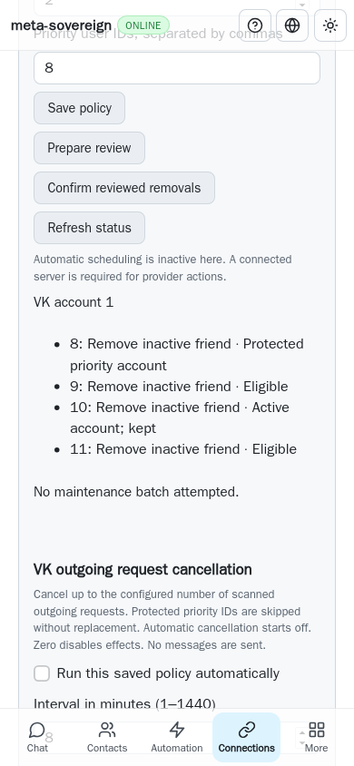
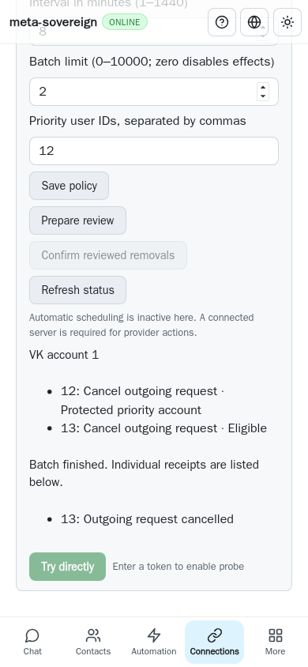

# VK friend maintenance (VK12/VK13)

This unit adds independent disabled policies for banned/deleted friend cleanup
and bounded outgoing request cancellation. See [usage](../../VK-FRIEND-MAINTENANCE.md).
Both inventory rows now pass exact published-head hosted checks in
[the checked receipt](hosted-verification-f2cf.md). This does not complete issue 56 or its other required features; PR57 stays
draft and unmerged.

The reference is `konard/vk-bot` at
`175d2d13218d9e791ae2f3e824a0d24f10319dcb`. Complete trigger blobs read:
`delete-deactivated-friends.js` (`d1c9eecf503e48e2187d8e43ce0d66f71beda3e9`)
and `delete-outgoing-requests.js` (`25873b2c4ebd518c9c0eebb69a6d18e9844ee4fd`).
The caller schedules them at 30 and eight minutes. Cleanup protects priorities,
filters `banned`/`deleted`, and paces five seconds; cancellation scans its
`maxRequests` limit, preserves priorities and paces three seconds. The port uses
owner-entered IDs, never the reference's personal IDs, and requires the actual
acknowledgement before retaining success.

Official current VK schemas were inspected through `VKCOM/vk-api-schema`:
methods `bbfbb96d5f57429eb018388fd14bce8c02d298a8`, responses
`6f022d46f611956a5061f29432d2bc3509546515`, objects
`c5d21bdb49d91dda0bf197177bf676b3a36b7646`. A generic `success` alone does
not confirm this operation: the matching `friend_deleted` or
`out_request_deleted` must also equal one. Writes have no retries.

Reproduction on the actual published parent `4dca9462`:

```sh
python3 -B experiments/issue-56/vk-maintenance-parent.py --browser
```

The selected adapter assertion fails because `maintenanceSnapshot` is absent;
its isolated actual-parent UI has neither maintenance panel and zero provider
effects. The first parent probe exposed a static import of a new CLI export;
that invalid probe is retained separately, and the CLI import now occurs only
inside its selected test. All parent sources are restored before verification.

Focused verification passes 50 Node and 48 Deno cases, plus two mandatory
browser-registry checks. Tests cover both actual method adapters,
read pagination, limits including zero, priorities from all three saved policies,
active-account preservation, late identity/relationship/deactivation/policy and
credential guards, distinct acknowledged receipts, durable uncertainty,
no replay from stale provider state, interval throttling, owned paced shutdown,
CLI, both default Lino encodings and offline/four-language states. Full runtime,
browser and platform matrices remain in hosted CI. Existing acceptance/request
and online browser flows also pass after sharing their delivery/control code.

```sh
NODE_OPTIONS=--max-old-space-size=384 node --test --test-concurrency=1 --test-timeout=30000 js/tests/vk-maintenance.test.js js/tests/vk-friends.test.js js/tests/vk-online.test.js js/tests/cli-import-surface.test.js js/tests/mcp-inspection-code.test.js
deno test --v8-flags=--max-old-space-size=384 --allow-all js/tests/vk-maintenance.test.js js/tests/vk-friends.test.js js/tests/vk-online.test.js
NODE_OPTIONS=--max-old-space-size=384 node experiments/issue-56/vk-maintenance-native.mjs
NODE_OPTIONS=--max-old-space-size=384 node experiments/issue-56/vk-maintenance-compat-native.mjs
```

One native WebKit scenario verifies both policies, protected and active users,
limits, explicit reviewed removals, unknown outcomes, failed-save recovery and
phone layouts. It performs five synthetic deletes, no messages and no page
exceptions. Independent Playwright MCP review verifies both policies in English,
Russian, Hindi and Chinese, including saved choices after reload. Its owned
fixture records six synthetic deletes and no messages. All fixtures close their
owned resources; no authenticated provider session or live provider effect is
claimed. The retained MCP console includes cache-write and favicon diagnostics
and password-form warnings; it is not a clean-console claim.

The [archive](data/vk-maintenance.tar.gz) and
[manifest](data/vk-maintenance.tar.sha256.json) retain parent/current sources,
reference/schema responses, test logs, built browser bytes, independent MCP
receipts and screenshot hashes. Recollect with
[collect-vk-maintenance.py](../../../experiments/issue-56/collect-vk-maintenance.py).
Before and after phone evidence:





The published parent's Ubuntu Deno job exceeded its ten-minute deadline before
finishing its serial suite. See the separate
[Ubuntu partition correction](ci-ubuntu-deno-shards.md) and
[macOS cold-setup correction](ci-macos-node-four.md). All five exact-head workflows now pass; both inventory rows are checked in
[the hosted receipt](hosted-verification-f2cf.md).

The initial 41/45 draft result had probe mistakes: an incorrect limiter argument,
a directory instead of a Lino file, a stale-list expectation after a valid
settling observation, and an expectation that other eligible targets would stay
blocked by one unknown target. A later reopen assertion selected the first
remaining target after the fixture removed the affected friend; it now restores
the stale target explicitly. These are retained without treating the draft
failures as provider verification.

Sharing the synthetic server fixture initially captured the separate friend
service’s timer in the maintenance test clock. Its ownership assertion caught
the third timer; the maintenance clock is isolated again. The failed draft and
corrected targeted check are retained alongside the final focused checks.
