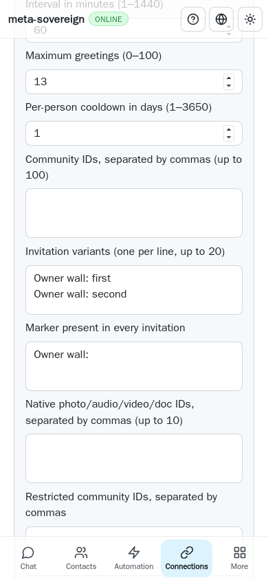
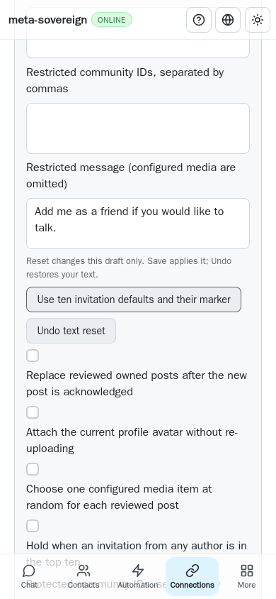

# Explicit invitation and birthday defaults

VD15's complete pinned desktop requirements call for ten invitation variants
and ten short birthday greetings, with random selection before sending. The
published parent `8bb1595f` has ten birthday defaults but only one invitation.
The shared policy editor provides no reset action. Existing reviewed delivery
already freezes each random choice; this change retains that behavior.

The wall policy now supplies ten original invitation variants. Birthday defaults
remain ten original short greetings. Both policies still start disabled and
retain saved owner catalogs on upgrade. Their read-only `messageDefaults` appear
in existing CLI status, both Lino API encodings and offline configuration.
Existing explicit Save applies a chosen default catalog; no provider operation
is needed to inspect or configure it.

The shared editor offers translated draft reset and undo. Invitation reset
explicitly includes its marker and restricted-community text, so restored
variants pass the existing validation. Undo restores those fields and the
owner's unsaved message text. Other settings remain in the draft. A reset does
not write storage; a refused Save retains the draft and previous saved values.

## Finite reproduction and checks

Run from the repository root:

```sh
python3 -B experiments/issue-56/message-defaults-before.py
node --test --test-concurrency=1 --test-timeout=30000 js/tests/vk-message-defaults.test.js
deno test --allow-all --no-check js/tests/vk-message-defaults.test.js
node experiments/issue-56/message-defaults-native.mjs
```

The parent probe restores its exact policy and prebuilt browser bytes, then
restores current bytes in `finally`. Its minimal regression fails with
`1 !== 10`; native WebKit captures missing reset controls for both policies.
Four focused tests pass on Node and Deno: unique ten-message catalogs, disabled
defaults and owner persistence; both ends of random selection with unchanged
reviewed delivery; CLI/offline reads; independent trusted saving through both
Lino transports. No full local suite or browser matrix runs.

One native WebKit case verifies both editors through draft reset, undo, refused
Save and acknowledged reload. An independent Playwright MCP review verifies
both editors in English, Russian, Hindi and Chinese at desktop and phone sizes,
including reload before Save to prove the reset did not persist. It reports zero
page exceptions, one expected favicon 404 and navigation-aborted owned requests.
All diagnostics are preserved. The browser and isolated temporary fixture close
with zero provider writes or messages; no authenticated provider claim is made.

Strict focused lint, formatting, secret scanning, diff checks and the unchanged
6.5% duplication gate pass. Thirty-two screenshots and exact source/log snapshots
are preserved in the [checked archive](data/vk-message-defaults.tar.gz) and
[hash manifest](data/vk-message-defaults.tar.sha256.json).




VD15 still requires exact-head hosted acceptance. All 60 unchecked inventory
rows remain required; [PR #57](https://github.com/link-foundation/meta-sovereign/pull/57)
stays draft and unmerged.
