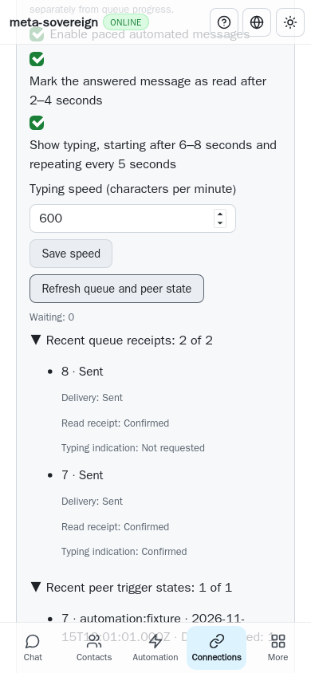
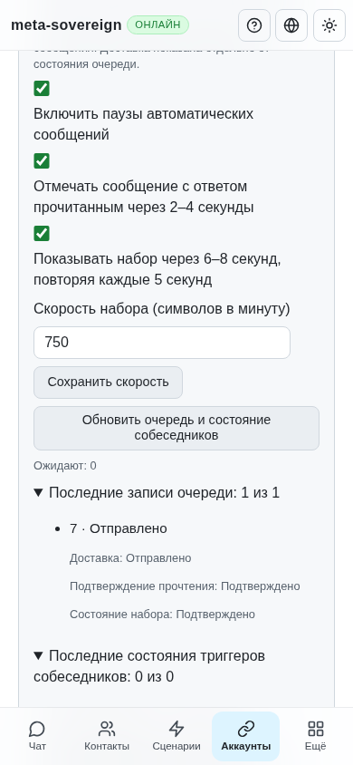

# Shared VK outgoing queue and public inspection

Published parent `5155e22b2b8e7e40b21d4766dd04f75044f41c53` sends a reviewed
VK sticker reply immediately without acknowledging its evidenced incoming
message. The parent render has no queue configuration or peer-state inspection.
Reproduce the finite failure and missing controls with
`python3 -B experiments/issue-56/vk-queue-before.py --browser`.
The actual parent reports `['messages.send']` where the regression expects
`['messages.markAsRead', 'messages.send']`.

The complete pinned `konard/vk-bot` runner, utils, JSON state and outgoing queue
at `175d2d13218d9e791ae2f3e824a0d24f10319dcb` establish the timing contract:
one outgoing message at a time, read acknowledgement after 2–4 seconds, typing
after 6–8 seconds repeated every five seconds, text after 10–14 seconds plus
characters at 450 per minute, and stickers after 6–8 seconds without typing.
The official method schemas at `333481bd082ad747d4873ef4a77f9247097eeef0`
identify `start_message_id`, typing and positive native send receipts. These
references are retained, not copied into production. The new queue gives each
request its own completion and awaits owned cancellable sleeps instead of
retaining unowned timeout callbacks.

A per-store FIFO now covers the reviewed automation runner, personal VK policies
and each ordered reengagement step. Exact native IDs reach the existing adapter;
deterministic send IDs and positive delivery receipts remain in the guarded
outbox. Existing manual sends are unchanged. Pacing defaults off. When enabled,
it checks fresh consent and proof before each side effect, freezes the admitted
settings even while another RPC is held, and refuses waiting work after settings
change. Native read/typing refusal or unconfirmed acknowledgement is recorded
accurately without inventing delivery. Indication failures do not authorize a
send that fails the separate fresh delivery guard.

Bounded acknowledged queue receipts are inspection records, not a replay log.
Failed writes preserve authoritative delivery separately. Unknown/sent outbox
records skip new indications; restart/settings/inspection never rearm work.
Shutdown signals every scheduler/job/queue before awaiting any drain. It aborts
waiting sleeps and awaits admitted RPCs before the final store flush.

The [user guide](../../VK-MESSAGE-QUEUE.md) documents the foreground
`vk-send-queue` command, default text/binary Lino endpoint and English, Russian,
Hindi and Chinese Connections controls. They share strict settings, failed-save
rollback, bounded queue/peer receipts and truthful offline inspection. No public
inspection action can start messages.

Forty-eight focused checks pass in Node and Deno. They cover pacing math,
text/sticker distinctions, per-request FIFO results, recovery after refusals,
settings changes during queued/active work, strict indications, causal reopen,
unknown delivery, bounded admission, real reviewed foreground and greeting-job
integration, stale reply evidence, opt-outs, CLI, both Lino forms, offline
configuration, streaming inspection, server shutdown and existing runner
behavior. The fixture's native calls are synthetic. Parent-failure logs and
initial fixture/browser diagnostics are retained alongside corrected runs.

One native WebKit scenario verifies acknowledged settings through reload, a
failed-save rollback, two synthetic deliveries, separate queue/delivery status,
one peer draft count and no replay or page exceptions. It is registered in the
hosted VK browser group. Independent Playwright MCP checks all four languages,
saved speed, receipts, reload and phone overflow. Its first run encountered
Chromium cache-write diagnostics; the retained repeat disables cache and passes
all four languages with no page exceptions or cache-write errors. Its diagnostic
list retains one favicon 404 and navigation-aborted event streams. All owned
browser/server fixtures close; no authenticated provider effect is claimed.

Strict lint, formatting, secret scanning and the unchanged 6.5% duplication
threshold pass. The [checked archive](data/vk-queue.tar.gz) and
[hash manifest](data/vk-queue.tar.sha256.json) retain source/parent bytes, pinned
references, finite logs and ten PNG hashes. Exact-head hosted verification is
still required. VK23's outgoing-script mapping is covered here, but neither VK23
nor VK26 is accepted yet. In particular, the pinned runner loads a peer's newest
100 messages on its first live update; the current general history backfill
must still be checked against that before-live-trigger requirement. All other
unchecked criteria remain required in
[PR #57](https://github.com/link-foundation/meta-sovereign/pull/57), which stays
draft and unmerged.
