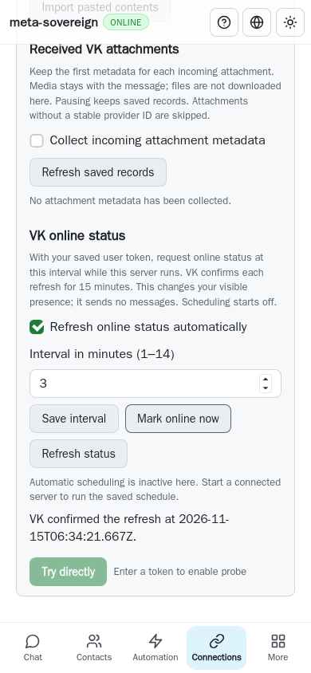
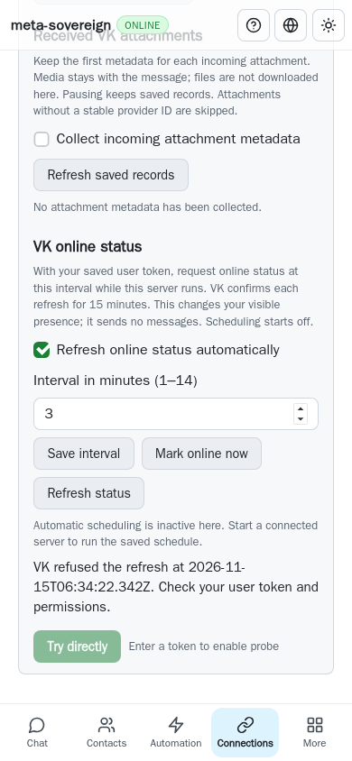
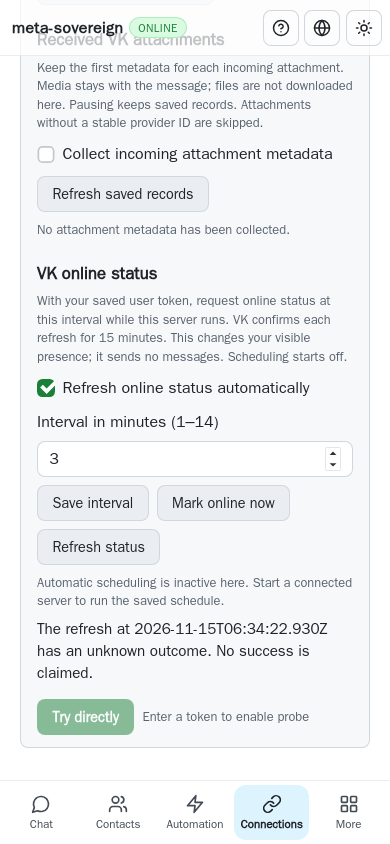

# Opt-in VK online-status schedule (VK10)

This unit implements the pinned `konard/vk-bot` online-status trigger and its
14-minute caller, through the shared store, CLI, default Lino API and four
translated connection panels. The trigger revision is
`175d2d13218d9e791ae2f3e824a0d24f10319dcb`; the trigger blob is
`f6d67ba383c5b3be5e7e56a14f134fe4dfb20b9f`, and its caller blob is
`422683021e1d58778c28d4fbddb489c20cc80328`. The current official VK schema
requires a user token and describes 15 minutes of online presence per refresh.

[Usage and exact behavior](../../VK-ONLINE-STATUS.md) describe opt-in,
intervals, explicit action, restart, uncertainty and offline capability.

Focused verification below passes; exact-head hosted results remain pending. VK10 stays
unchecked. [PR #57](https://github.com/link-foundation/meta-sovereign/pull/57) remains draft/unmerged, with every other incomplete original
criterion still required. No authenticated provider session is used for the
synthetic checks; those checks do not prove live token eligibility.

Reproduce the absent behavior on actual published parent `9e934842` using
`python3 -B experiments/issue-56/vk-online-parent.py --browser`. The selected
adapter assertion must fail before the fix; the parent UI has no online
controls. All replaced production sources restore in `finally`.

Run the focused suite with
`node --test --test-concurrency=1 --test-timeout=20000 js/tests/vk-online.test.js`.
It covers actual provider response semantics, opt-in/due time, real Lino
restart, overlap/drainage, intent/outcome write failures, redacted refusal and
unknown states, configuration rollback, CLI cleanup, both default encodings,
trusted-origin refusal, timer ownership and truthful offline controls.

The focused Node run passes 31 checks: 14 online-status regressions, 12
attachment regressions after extracting their shared store queue/UI state,
three CLI import contracts and two MCP code-generation checks. Deno passes
the same 26 feature checks. Two browser-registry checks also pass.
The default full runtime/browser matrices remain in hosted CI.

One native WebKit scenario exercises saved opt-in and interval through reload,
positive acknowledgement, provider refusal, a lost response retained as unknown
after reload, and a refused setting save that retains the last acknowledged
choice. It makes three synthetic provider calls, zero message sends and has
zero page exceptions. The independent MCP inspection verifies saved choices,
translated controls and acknowledged actions in English, Russian, Hindi and
Chinese with four synthetic calls and zero page exceptions. All owned browser
contexts and fixture servers close. The attachment native scenario and its
four-language MCP inspection pass again after the shared helper extractions.
Their updated screenshots are copied here with an `attachments-` prefix,
preserving the original attachment evidence images.

The first native run exposed a draft import error: importing the server job
from the browser settings API evaluated provider browser-script construction,
which the existing CSP correctly refused. Browser-safe persisted configuration
now has its own module; the native/MCP runs verify normal startup under the
unchanged CSP. The first cross-runtime account-scope fixture used assignment
to the session-storage global, which Deno did not replace. The fixture now
installs/restores its property descriptor; the same production scope checks
pass in both runtimes. Neither failure was hidden by a deadline increase.

Before (published parent):

Acknowledged refresh, followed by a distinct refusal and uncertainty:

The checked source/log archive and manifest are
[`vk-online.tar.gz`](data/vk-online.tar.gz) and
[`vk-online.tar.sha256.json`](data/vk-online.tar.sha256.json).
