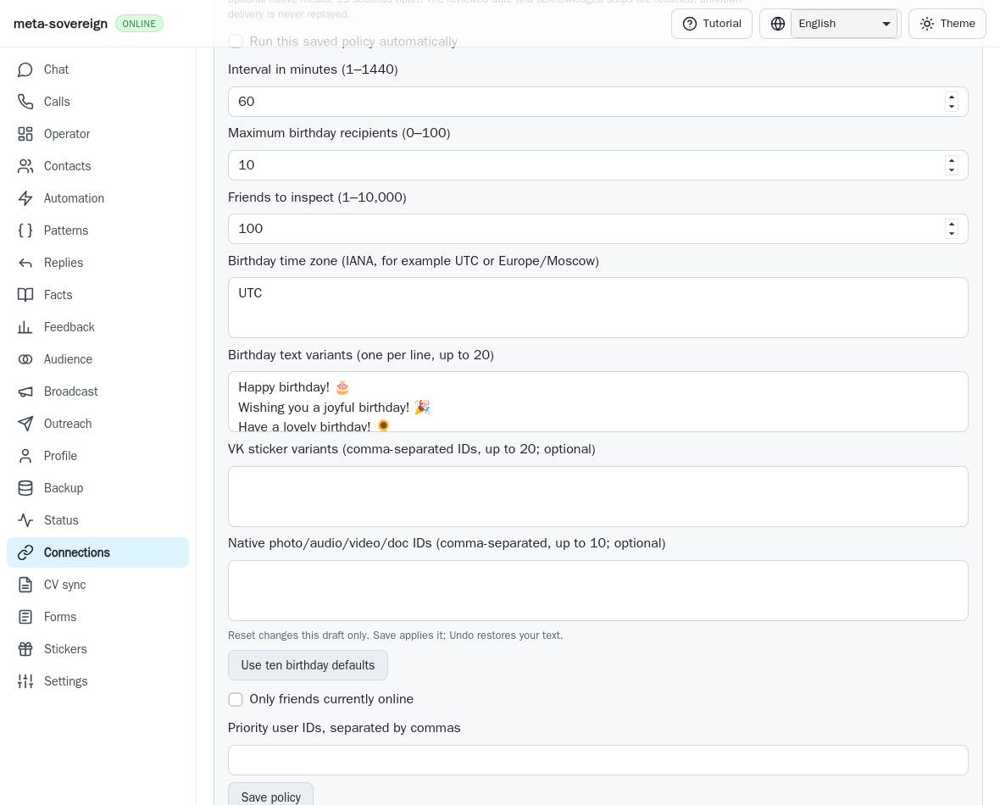
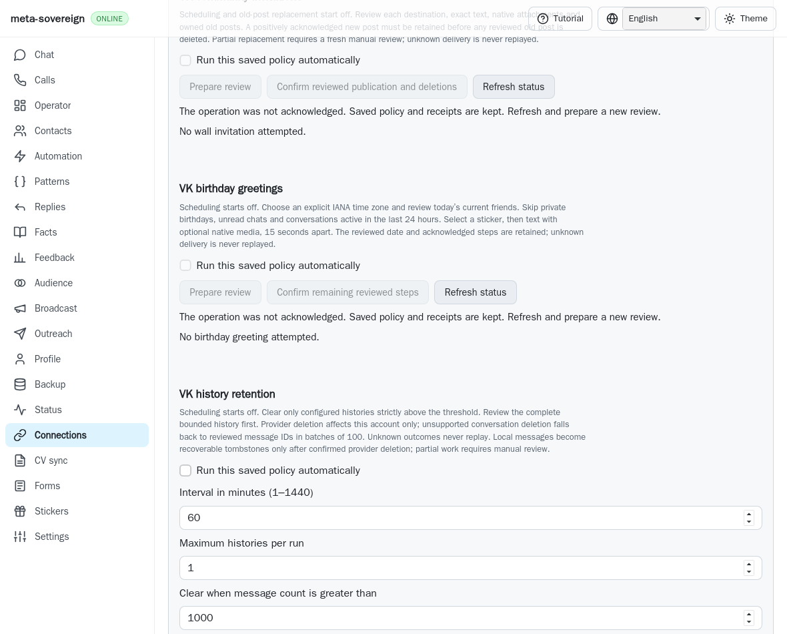
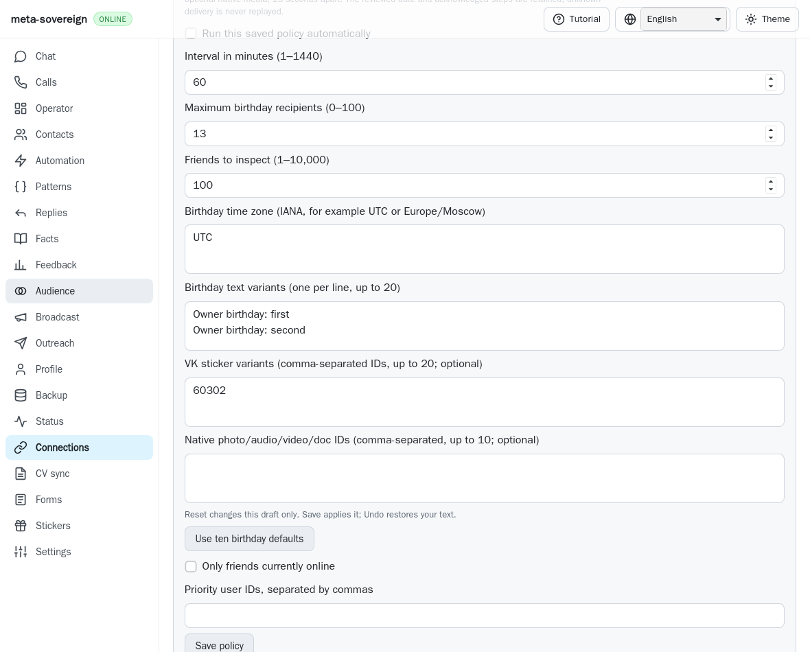

# Refused connected VK reads

A malformed persisted birthday catalog makes the connected server return HTTP 400. The production browser bridge previously converted every non-OK response
to an absent route. VK settings then loaded browser-local defaults, reported
success and hid the failed saved read. The exact published `bb9d8f23` bridge
reproduces `true !== false` in the production API regression and renders invented
birthday defaults without an alert in the private browser fixture.

The VK bridge now distinguishes absent/unsupported routes from a connected
refusal. No server or HTTP 404 retains offline editing; failed HTTP responses,
malformed JSON and contradictory success bodies return an unconfirmed read.
The existing policy controls show their translated alert, disable an initial
unloaded policy and retain the last acknowledged settings after failed refresh.
No saved records are rewritten and no provider operation is attempted. The
transport preserves cancellation and recovery options. The general discovery
bridge and other provider fallbacks are unchanged.

```sh
python3 -B experiments/issue-56/vk-read-failure-before.py
node --test --test-concurrency=1 js/tests/vk-read-failure.test.js
node --test --test-concurrency=1 js/tests/web-server-fetch.test.js js/tests/vk-friend-stats-feed.test.js
node experiments/issue-56/vk-read-failure-native.mjs
```

Two new and five existing focused Node checks pass. One private WebKit case
checks initial refusal, recovery to the exact owner catalog, a subsequent failed
refresh retaining that catalog, immutable saved records and zero provider
writes. Desktop and phone screenshots preserve all three states. Independent
Playwright MCP confirms the alert, absent initial editor and disabled run
control. Its first navigation omitted `/manual` and timed out on the import
view; correcting the test route required no product change. The missing favicon
and fixture HTTP 400 responses are expected. All fixture servers and browsers
close. Strict changed-file lint and formatting pass; the offline web bundle is
rebuilt. The new native case is registered in the existing engagement CI group.







Exact-head hosted checks and all 60 unchecked original inventory criteria remain
required in [PR #57](https://github.com/link-foundation/meta-sovereign/pull/57).
This correction does not establish complete desktop configuration or execution.

Evidence: [archive](data/vk-read-failure.tar.gz),
[hash manifest](data/vk-read-failure.tar.sha256.json).
