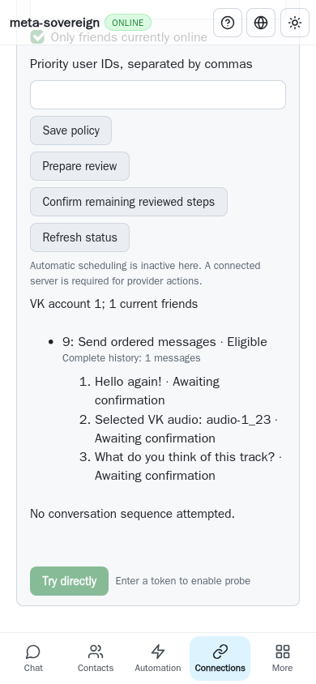
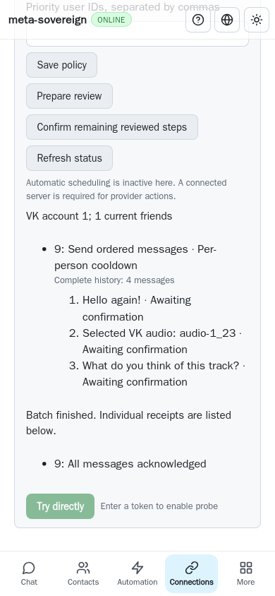

# Dormant VK topic, help and music conversations (VK16–VK18)

The pinned `konard/vk-bot` tree at
`175d2d13218d9e791ae2f3e824a0d24f10319dcb` has separate topic, help
and music triggers. Their blobs are respectively
`50dbdfd35b2d1776b69565c9753f21c7f2b537fa`,
`628d198f9f0c996a9a2d7a7ebe1f70388c97acca` and
`86d28291fa2bf90c6b86305d54a2e844db2d8c80`. Read all three complete
triggers: current online friends, nonempty dormant history, private write
permission, greeting before question and a separate audio message before the
music question. Topic defaults to seven days; help and music default to 31.
Owner question variants and an explicit native audio identity replace personal
reference content. A strict zero limit permits no sends.

Three independent disabled policies now expose those behaviors through saved
settings, foreground CLI, both default Lino encodings, offline configuration and
shared English, Russian, Hindi and Chinese controls. See the
[usage guide](../../VK-DORMANT-CONVERSATIONS.md) and its translations. Scheduling
starts only after server ownership and drains on shutdown; foreground commands
do not create background workers. Existing priority exclusions and opt-outs
apply across all VK friendship policies.

Review freezes the exact ordered text/sticker, selected question, audio identity,
native random IDs, credential, settings and complete bounded conversation.
Empty, unread, recent, protected, uncertain, service, future or unwritable
evidence cannot authorize delivery. Full current friends are bounded to 10,000;
configured scan limits bound per-person reads. Complete history is bounded to
1,000, reserving room for this sequence. Each step requires fresh policy,
consent and provider evidence after the actual rate wait and acknowledged intent.
Only exact positively acknowledged own messages may be removed when comparing
the conversation with its original baseline; unrelated replies, edits or changed
attachments stop continuation. Reviews expire after five minutes.

Each step uses a durable guarded outbox identity and positive native receipt.
Text, sticker and audio identities enter canonical Chat records. Steps are
15 seconds apart; people are 30 seconds apart. A definite partial delivery may
resume only through a fresh explicit review of its unchanged original remaining
steps. Acknowledged steps never repeat, including after durable Lino reopen with
a new causal writer. Scheduled runs retain partial sequences for manual review;
unknown delivery never automatically replays. A fresh explicit review can renew
an expired review when its original history and policy still match.

The official [VKCOM messages schema](https://github.com/VKCOM/vk-api-schema/blob/333481bd082ad747d4873ef4a77f9247097eeef0/messages/methods.json)
and response definitions are preserved at that exact revision. `messages.send`
accepts the native audio attachment identity and idempotency identifier, and the
single-destination response carries a native message ID. No authenticated live
provider delivery is claimed; every test uses finite synthetic responses.

The actual published `4bd81d2e` parent fails the new capability assertion and
lacks these controls. Before screenshots preserve that absence. Fourteen new
focused checks cover all policies, ordered text/sticker/audio delivery, history
filters, both admission stages, changed inputs and receipts, failed writes,
unknown outcomes, causal durable reopen, manual partial continuation, scheduling,
shutdown, CLI, both Lino encodings and offline translations. Selected existing
VK14/VK15, friendship and automation checks exercise the shared guards and
receipt projection.

Initial draft failures are retained. One restart test incorrectly passed a
directory instead of a Lino filename. Production causal admission then exposed
a real difference between a draft record and its acknowledged clock; compare
subsequent reads with the admitted record to preserve concurrent-write detection.
The queue also forwarded its previous result into a new preview argument,
mistaking manual review for scheduled review. Invoke the preview explicitly.
The restart regression asserts eligibility and actual remaining effects, rather
than accepting an empty successful batch. A draft assertion wrongly held an
expired review even after a fresh explicit review; its corrected case verifies
only original remaining effects. No failed draft is counted as passing.

One owned native WebKit scenario checks saved exact review with zero effects,
provider refusal, three ordered acknowledged messages, reload cooldown,
independent settings and failed-save rollback. Independent MCP checks all four
languages at 390 pixels with one synthetic three-message cycle, zero page
exceptions and no overflow. The fixture closes all owned resources. Preserve
favicon and browser cache-write console diagnostics; a clean console is not
claimed.

The unchanged duplication gate initially exceeded 6.5%. Shared personal consent
admission and a finite hostile-input fixture remove repeated logic without
changing the threshold or exclusions. Strict lint, format, secrets, workflow
contracts and focused verification are preserved in the checked
[archive](data/vk-reengage.tar.gz) and
[manifest](data/vk-reengage.tar.sha256.json), with actual-parent production bytes,
research, schema, failed drafts, screenshot hashes and built browser identity.

Exact-head hosted acceptance remains pending. VK16–VK18 and all other unchecked
inventory criteria remain required. [PR #57](https://github.com/link-foundation/meta-sovereign/pull/57)
stays draft and unmerged until every original criterion is verified.
