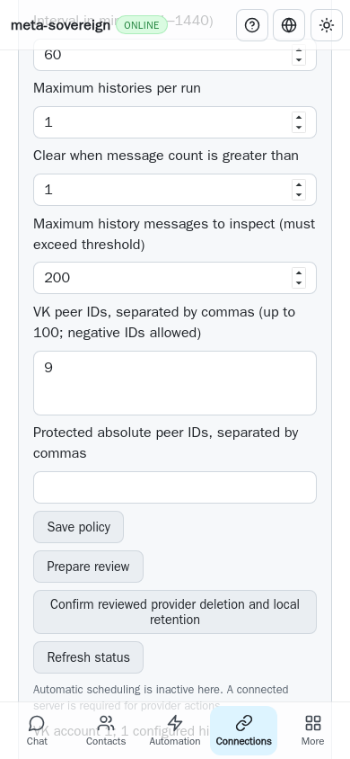
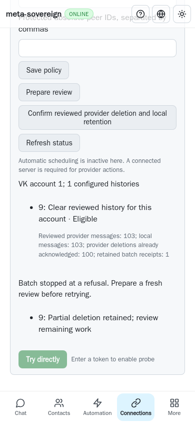
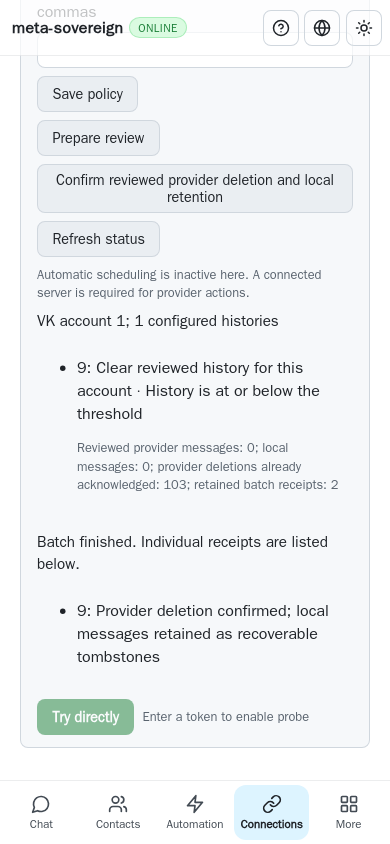

# Reviewed VK history retention (VK22)

The complete pinned `konard/vk-bot` retention trigger and message cache at
`175d2d13218d9e791ae2f3e824a0d24f10319dcb` are preserved in the evidence archive.
The trigger clears its cache even after a deletion batch fails. It tries the
obsolete `messages.deleteDialog` method and a legacy per-message parameter.
The current official VK schema at
`333481bd082ad747d4873ef4a77f9247097eeef0` specifies
`messages.deleteConversation`, `messages.delete` with `cmids`, and individual
per-message acknowledgements. Those method and response definitions are retained.

An independent disabled `vk-retention` policy configures explicit peers, a strict
message-count threshold, a finite complete-history scan and a per-run limit.
Protected absolute peer IDs, opt-outs, changed account/credential/policy/history,
expired review and uncertain receipts hold deletion. The saved review binds its
prior receipt and eligibility decision, so an edited review cannot bypass a zero
limit or replace an intervening unknown outcome. The
[four-language guide](../../VK-HISTORY-RETENTION.md) covers CLI and Connections.
The same controls use both default Lino encodings and offline configuration.

Only an issued, definitive VK error 3 permits fallback from conversation deletion
to batches of at most 100 reviewed conversation message IDs, two seconds apart.
Every actual rate admission acknowledges pending intent, then rechecks current
evidence. Writes have zero automatic retries. A mixed batch retains each positive
receipt before stopping. Causal Lino close/reopen preserves those receipts;
scheduling holds partial work and manual review resumes only remaining original
IDs. Unknown transport or malformed replies never cause fallback or replay.
Provider readback must show acknowledged IDs absent before local clearing.

Local matching requires provider ID, peer, text and timestamp. Only those reviewed
canonical records become acknowledged recoverable tombstones; original content,
causal synchronization and other providers remain intact. A failed local write
restores its payload. An acknowledged tombstone followed by a failed ledger write
is reconciled without issuing another provider deletion. Ledger writes are batched
after local acknowledgements, avoiding a full-history rewrite for every record.

Published parent `3ea98ecc` fails the adapter capability assertion and lacks the
controls in actual rendered before screenshots. Reproduce with
`python -B experiments/issue-56/vk-retention-before.py`. Eighteen new feature checks
cover native schemas, pagination/scan bounds, current-account deletion, fallback,
mixed acknowledgements, durable partial recovery, uncertainty, late guards,
failed acknowledgements, causal tombstone recovery, owned shutdown, CLI,
both Lino encodings and complete translations. The focused Node command passes
32 checks; Deno passes 31 with one existing runtime-specific skip.
Twenty shared guard checks pass. After extracting shared expiry and redacted-error
helpers, 38 focused retention, ordered-message and wall checks pass on each runtime.

One native WebKit scenario reviews 103 messages, retains the first 100 successful
deletions after the last three are refused, then manually resumes exactly those
three. It confirms all 103 local payloads remain under recoverable tombstones.
Independent Playwright MCP checks English, Russian, Hindi and Chinese phone
controls, one synthetic conversation deletion, three local tombstones, no
unexpected messages, no page exceptions and drained owned fixtures. Favicon and
cache console diagnostics are retained; a clean console is not claimed. No live
provider effect or authenticated provider session is claimed. The native case is
registered in the existing mandatory hosted VK browser group.

The first draft's restart fixture sampled a not-yet-due scheduler; advancing its
explicit clock exercises the actual scheduled partial hold. Failed draft and
strict lint logs are retained. Small shared helpers keep existing complexity,
function-size and duplication gates unchanged. Release notes extend the one
existing changeset. The checked [archive](data/vk-retention.tar.gz) and
[manifest](data/vk-retention.tar.sha256.json) preserve current/parent source bytes,
pinned references, schemas, logs and twelve PNG hashes.

Exact-head hosted acceptance remains required for VK22. Every other unchecked
criterion retains its full scope; [PR #57](https://github.com/link-foundation/meta-sovereign/pull/57)
remains draft and unmerged until the whole issue is verified.

Subsequent [exact-head hosted acceptance](hosted-verification-357.md) completes
this criterion. The preceding pending statements describe its original local
verification stage; every other unchecked original requirement remains active.
