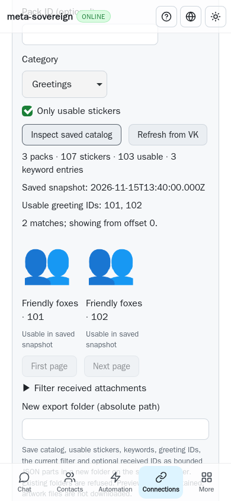
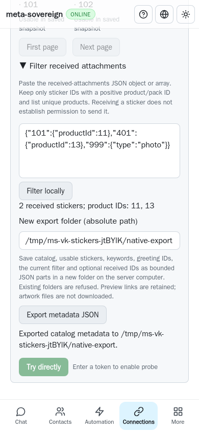

# VK25 sticker catalog pipeline

PR: https://github.com/link-foundation/meta-sovereign/pull/57

The complete pinned `konard/vk-bot@175d2d13218d9e791ae2f3e824a0d24f10319dcb`
scripts were read: root `filter-stickers.js`, `load-usable-sticker-packs.js`
and `stickers.js`; `stickers/load-keywords.js`, `load-greeting.js`,
`load-usable-greeting.js` and `get-all-greeting-ids.js`. The greeting metadata
was also inspected. Their Git blob responses are preserved in the archive.
The source downloads JSON metadata and preview URLs, without artwork binaries.
Its personal defaults remain editable shared collections rather than copied
personal content. Official native schemas are pinned at
`VKCOM/vk-api-schema@333481bd082ad747d4873ef4a77f9247097eeef0`.

The parent `8c3049337025d4286db77ae3a9690c0a95892589` has shared greeting
collections but no foreground catalog command or connection controls. The
actual-parent admission assertion fails (`false !== true`); its native screen
has no catalog controls and performs zero provider reads. Reproduce with
`python3 -B experiments/issue-56/vk-stickers-before.py --browser`.

The new account-scoped catalog explicitly reads purchased/active packs,
native keywords and additional greeting packs. It retains positive per-sticker
permission, ownership, active state, 512-pixel previews, background/light/dark
references and keywords. Unowned, inactive or permission-missing stickers are
never marked usable. Every matching greeting is retained, including multiple
IDs in one pack. Existing category and collection selection rules are reused.
Provider responses and unknown fields are normalized before persistence/export.

These native methods have no offset parameter. Count mismatches, chunked
responses, invalid IDs, duplicate pack/sticker identities and oversized evidence
are refused. Reads bound packs, stickers, dictionary rows and total descriptors;
extra greeting packs use batches of at most 50. Two consistent catalog reads
and repeated account/credential guards precede a durable acknowledged save.
Failed reads, changed credentials or failed flushes preserve the prior snapshot.
Successful empty catalogs are valid. Saved permission remains a snapshot,
without promising that a later send will succeed.

Inspection, 100-result paging and word/pack/category filters are provider-free.
Received attachment filtering supports source maps and stored metadata arrays,
keeps positive sticker/product IDs, and lists unique products without inferring
send permission. New-directory exports write packs, usable stickers, keywords,
all usable greeting IDs, the current selection and optional received/product
IDs as JSON parts of at most 1500 lines. The final manifest is a success receipt;
partial files after a failure do not imply completion. Existing paths and
paths resolving into the store are refused. Artwork URLs remain references.

Foreground CLI, both default Lino encodings, offline inspection and four
translated Connections controls share the same implementation. The existing
Stickers collection editor can toggle usable catalog items and save them with
its ordinary manual Save action. [The guide](../../VK-STICKER-CATALOG.md) also
has Russian, Hindi and Chinese versions. Shared read admission and runtime
ownership preserve existing cache behavior. Shutdown drains catalog work before
store release; removing only that lifecycle call reproduces premature close.
Tracing defaults off and emits only counts when explicitly enabled.

Focused Node and Deno checks cover 14 new catalog/interface cases plus 15
existing cache cases. They verify native ownership/permission distinctions,
all greeting IDs, filters, valid empty results, truncation/chunk/account/token/
catalog-change refusals, failed write rollback, causal text-store reopen,
concurrent admission, 1996 exported usable stickers in two bounded parts,
existing/symlink/store-directory refusal, corrupted saved hashes, CLI closure,
origin protection, both Lino forms, offline locales and held-request shutdown.
The larger export fixture initially reused IDs across packs; the production
duplicate guard correctly rejected it. Distinct fixture IDs restore exact
coverage without weakening that guard.

The mandatory native WebKit case verifies 103 usable stickers, two greeting
IDs, received filtering, export and a manually saved collection choice after
reload, with nine synthetic reads and no additional reload reads or sends.
Independent Playwright MCP repeats translated inspection, filtering, export
and reload in English, Russian, Hindi and Chinese. Four manifests independently
verify greeting/product IDs and bounded JSON parts. Initial external preview
fetch errors are preserved; the final synthetic-preview run has no page or
console errors, 36 synthetic reads and zero sends. Its browser and fixture close
with a positive resource receipt. No authenticated provider operation is claimed.

The [archive](data/vk-stickers.tar.gz) and
[manifest](data/vk-stickers.tar.sha256.json) preserve source blobs, parent
sources, regressions, focused results, unchanged quality gates and ten PNG
hashes. Rebuild with `python3 -B experiments/issue-56/collect-vk-stickers.py`.
VK25 remains unchecked until exact-head hosted verification. VK24 also awaits
the [security assertion follow-up](vk-cache-security-follow-up.md) and matrix.
Every other original unchecked requirement remains active; PR57 is draft and
unmerged.
