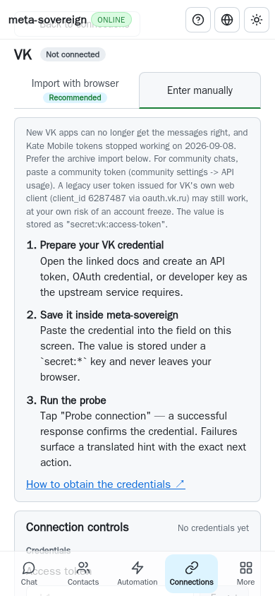
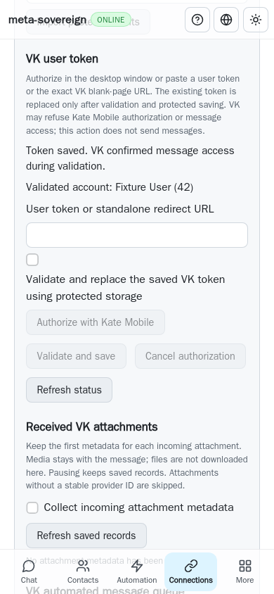
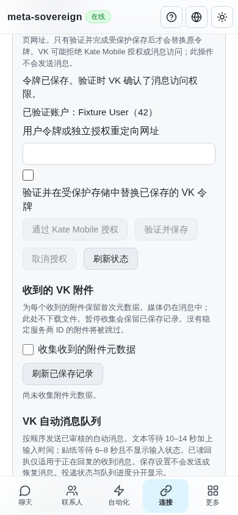

# Constrained VK user-token acquisition

VD13 in [PR57](https://github.com/link-foundation/meta-sovereign/pull/57) follows
the pinned [desktop requirements](https://github.com/konard/vk-bot-desktop/blob/8fbf3b7c42fd8e995ef137cab9b9653a7dc9b1a1/docs/REQUIREMENTS.md).
The complete requirements and authorization implementation were read; behavior
is implemented independently. This change supplies acquisition, validation,
protected saving and shared controls. It does not establish that VK currently
grants Kate Mobile authorization or message access.

Previously Connections had no acquisition control and the desktop process had
no constrained authorization window. The retained parent-bundle screenshot and
`vk-token-native-before.log` demonstrate that missing feature. The existing
read-only inspector was reusable; a login-page response alone was not proof of
successful authorization.

Reproduce with `node experiments/issue-56/vk-token-native.mjs --before`.
It serves the exact `ea0c506e` bundle to its owned browser without changing
the working tree or the user's application server.

The new service owns one finite, cancellable operation. The Electron window
has an ephemeral session, sandbox/context-isolation preferences, no Node or
preload, explicit HTTPS authentication hosts, no permissions, downloads,
webviews or popups. Only an exact main-frame standalone
`https://oauth.vk.com/blank.html` fragment can supply credentials. Raw tokens
and pasted URLs are bounded and strictly parsed; foreign hosts, credentials,
ports, dot segments, duplicate fields and the rejected localhost callback
cannot supply a credential. Subframe fragments never capture a token.

Only the token and optional account ID leave that window. Closing/cancelling
destroys it and awaits session clearing before validation. Production
validation reuses `users.get`, `account.getAppPermissions` and
`messages.getConversations(count=1)` through an abortable fetch. It sends no
messages. Valid users are saved only after explicit replacement consent and
acknowledgement from the protected store. A valid user without message access
is saved with a visible restriction. Invalid/community tokens and mismatched
accounts preserve the previous credential.

Saving uses the canonical `secret:vk:user-token` read by both live source
options and publication; existing legacy tokens remain fallbacks. A regression
seeds both old credential names and verifies both actual consumers select the
new acknowledged token. Failed mutation/flush uses the existing acknowledged
record rollback; a failure never claims durable success or guaranteed recovery
when the store itself cannot restore state. Cancellation waits for admitted
work and reports saved if its write was already acknowledged. Shutdown stops
admission and drains its owned operation. Restart reads the protected token
without replaying authorization or import.

The shared CLI, both default Lino encodings and four-language Connections
controls report operation IDs, identity and capability without token/URL
echoes. Import uses a masked terminal prompt or password field, cleared when
the request starts. Confirmation resets after each action. A failed read
retains the prior receipt and retries with bounded backoff; mutations never
replay automatically. Definite input refusals remain visible until another
action. A native browser run caught the server's additional sanitized HTTP
`error` field in refusal receipts: the strict validator now accepts only its
exact generic shape, while rejecting arbitrary error text and extra fields.

Read [the user guide](../../VK-USER-TOKEN.md) for protected setup, commands and
API fields. Reproduce focused local checks without a full suite:

```sh
node --test --test-concurrency=1 --test-timeout=30000 \
  js/tests/vk-token-acquisition.test.js js/tests/vk-token-api.test.js \
  js/tests/vk-token-authorization.test.js js/tests/desktop-lifecycle.test.js \
  js/tests/desktop-window.test.js js/tests/cli-help-imports.test.js \
  js/tests/cli-startup-imports.test.js
node experiments/issue-56/vk-token-native.mjs
```

The 41 focused Node cases pass, including private encrypted storage, strict
parsing/navigation, finite expiry, held validation cancellation, close/drain,
acknowledged-save cancellation, real read-only validation, both Lino forms,
CLI registration and existing desktop lifecycle behavior. The earlier
25-case draft also passed Deno. Current cross-runtime coverage belongs to
hosted CI. Lint/formatting and the unchanged 6.5% duplication gate are checked
separately; the observed duplication rate is 6.47%.

One native WebKit case covers import, refusal, cancellation during validation,
no-message capability, read-only reload, bounded failed-read recovery, no secret
in browser storage and both desktop/phone layouts. Independent Playwright MCP
covers English, Russian, Hindi and Chinese with the same consent, refusal,
protected import, reload and password-field checks; it records no page errors.
An initial viewport assertion ran during resize; immediate inspection found
390px viewport/scroll widths and no persistent overflow. The MCP experiment
now waits two animation frames after resizing; the complete four-language
rerun passes. No product layout was changed for that transient assertion.
All browser contexts, servers and operations close; fixtures use synthetic
identities and do not contact VK.

A finite real-Electron case is registered in the existing Linux x64 desktop
build: `experiments/issue-56/vk-token-electron.mjs` intercepts every HTTPS
request in its ephemeral session and drives a real main-frame redirect. It
checks actual preferences, token-only capture, window destruction and cleared
cookies. CI's `--no-sandbox` launcher flag is confined to this runner fixture;
the check establishes requested window preferences, not host kernel sandbox
enforcement. It uses a private temporary Electron profile, a 15-second
operation deadline and no account or running application server. This case
must pass on the pushed head before VD13 is accepted.

The initial hosted case stalled during Electron readiness. The corrected
entry releases ESM evaluation before awaiting readiness and can terminate a
readiness/cleanup stall. The [entry investigation](vk-token-electron-entry.md)
retains pinned loader evidence and a finite parent/current regression. The
[registry correction](vk-token-registration.md) restores the missing browser
npm command. Neither correction substitutes for real exact-head CI acceptance.

The [active checklist](vk-token-plan.md), [source/log archive](data/vk-token.tar.gz)
and [SHA-256 manifest](data/vk-token.tar.sha256.json) retain the evidence.
Exact-head hosted verification remains pending; all other unchecked criteria
remain required in this single draft PR.

Before:



After protected saving:



Translated independent browser evidence:


