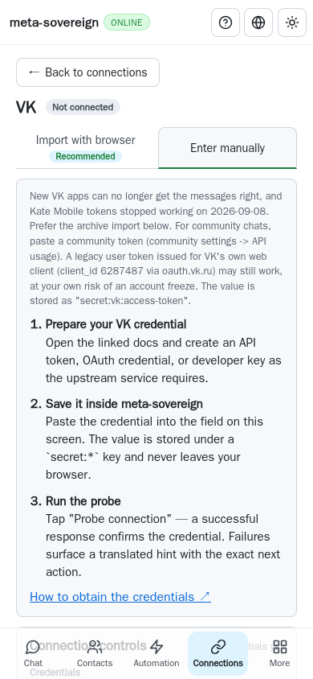
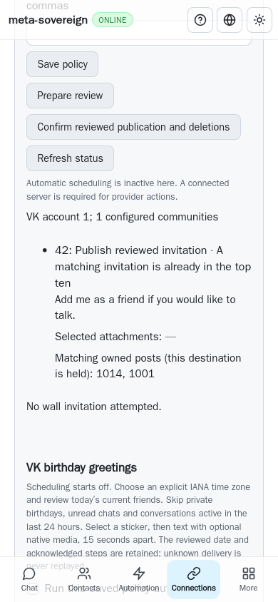
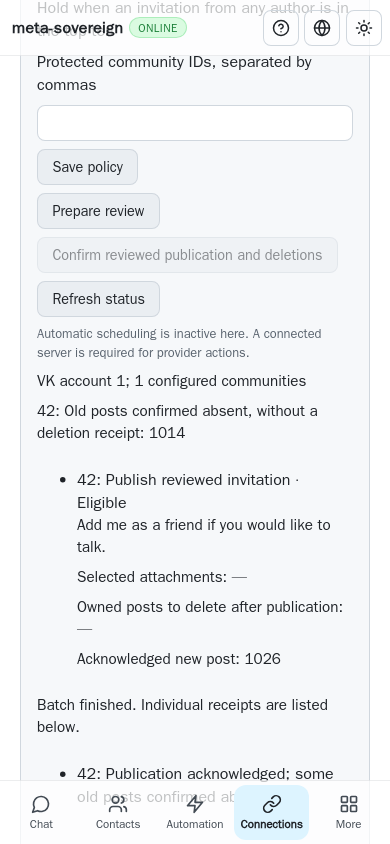

# Community invitation holds and confirmed absence

The complete pinned friend-invitation trigger preserved in
[the source audit](vk-friend-invitations.md) holds a matching invitation from
any author among the top ten posts. It also continues replacement when an old
post is missing. The earlier shared wall implementation only held the current
account's invitations and rejected every empty `wall.getById` result as
incomplete, preventing recovery after a concurrent removal. These are the two
remaining source-parity gaps found during the VK20 audit.

An optional `holdAnyVisible` setting now exposes the any-author hold through
`--hold-any-visible`, both Lino encodings, offline settings and the four-language
shared wall panel. It defaults off and upgrades existing policies without
changing their receipt identities. The default still holds owned visible
invitations. A changed policy or wall after review still requires a new review.

A successful bounded current read with an empty result establishes absence;
malformed reads and provider failures do not. Replacement first retains the
acknowledged new post. Every old-post check repeats the current consent,
credential, policy, review lifetime and durable journal checks. An old post
absent before deletion is skipped without issuing a delete. A post disappearing
during rate admission is checked again before dispatch. Definite 100/104
refusals require a subsequent successful absence read before continuing; an
unknown write or uncertain durable acknowledgement remains unknown. No write
is retried to resolve uncertainty.

The durable journal and CLI/API outcomes distinguish `absent` IDs from
positively acknowledged `deleted` IDs. A restored post after manual review
requires another review. Partial recovery preserves the original publication
and frozen media selection, and never republishes. The UI shows current result
progress for its matching review, lists absent IDs separately and removes
handled IDs from the remaining-delete list. Screenshot inspection caught and
corrected the stale original-review list; native assertions now check the
retained new receipt and empty remaining list after completion.

The actual parent `7fc97ee2` fails the successful-empty-read regression and
lacks the any-author checkbox. Seven new focused cases and 23 existing wall
cases pass on Node and Deno. They cover malformed reads, legacy settings,
foreign/own visible invitations, both definite refusal codes, pacing/rate-wait/
intent-acknowledgement races, manual recovery, restored posts, forged absence,
missing new receipts and unknown outcomes. Both existing and new native WebKit
wall flows pass. The new flow makes three finite synthetic attempts: a new
post, one refused delete whose absence is then confirmed, and one acknowledged
delete. Independent uncached MCP inspection verifies four translated phone
layouts, saved policy/reload, no page exceptions or overflow, and the same
three attempts. Its only console error is the fixture's missing favicon. All
owned browser and fixture resources are closed; no live
provider action is claimed.

Duplication briefly exceeded the unchanged 6.5% gate. Shared reviewed-action
helpers and one owned inspection-server wrapper remove repeated behavior
across both wall scenarios; the gate is retained. Formatting, strict scoped
lint, secrets and diff checks are preserved with the focused verification.

The [archive](data/vk-wall-parity.tar.gz) and
[manifest](data/vk-wall-parity.tar.sha256.json) retain exact parent bytes,
pinned reference source, original failing evidence, quality checks and twelve
PNG hashes. Run `python3 experiments/issue-56/collect-vk-friend-invitations.py
--parity` to verify the recorded evidence and compile the archive. The
[active checklist](vk-wall-parity-plan.md) still requires exact final-head
hosted verification before accepting VK20. Superseded 8f Checks were cancelled
by the next push; their aggregate failure identifies cancellation, rather than
a test assertion. All 57 unchecked inventory rows remain required in
[PR #57](https://github.com/link-foundation/meta-sovereign/pull/57).

Subsequent [exact-head hosted acceptance](hosted-verification-357.md) completes
this criterion. The preceding pending statements describe its original local
verification stage; every other unchecked original requirement remains active.
