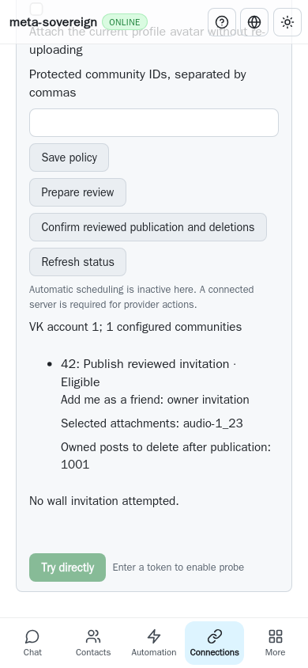
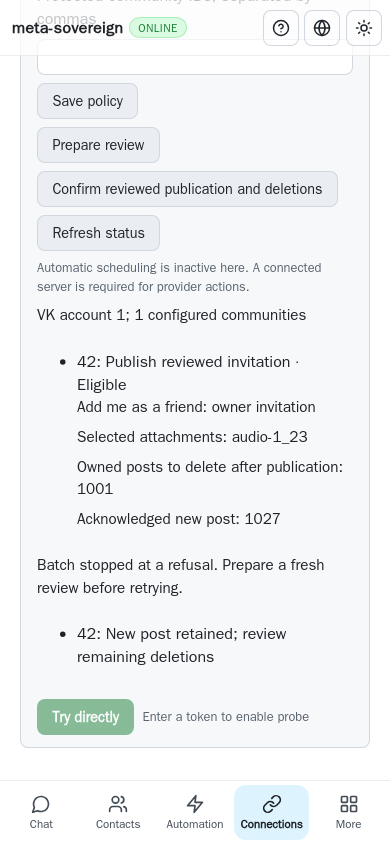
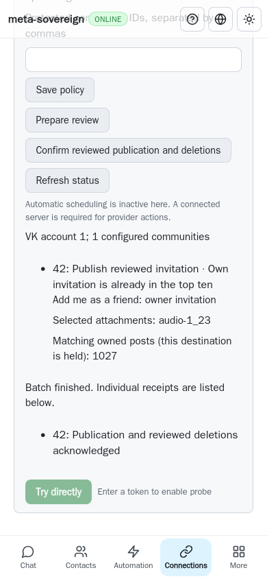

# Reviewed VK community invitations (VK19)

The complete pinned `konard/vk-bot` wall triggers at
`175d2d13218d9e791ae2f3e824a0d24f10319dcb` and desktop trigger,
catalog and tests at `8fbf3b7c42fd8e995ef137cab9b9653a7dc9b1a1` are
preserved in the evidence archive. They publish configurable invitations to
community walls, reuse native media and suppress matching visible posts.
The desktop trigger also reuses the active avatar without uploading it.
Personal reference destinations, messages and media are not copied as defaults.
The separate VK20 friend-invitation criterion remains required.

An independent disabled policy offers foreground `vk-wall` commands,
`/api/vk/wall` through both default Lino encodings, offline settings and shared
English, Russian, Hindi and Chinese controls. See the
[usage guide](../../VK-COMMUNITY-INVITATIONS.md) and translations. Configure
up to 100 communities, 20 message variants, a shared marker, native media,
optional avatar reuse and separate restricted-community content. Alternative
variants avoid repeating the previous selection. Zero permits no writes.
Replacement and scheduling are separately off initially.

Review freezes the account, credential identity, policy, destination, exact
message, attachments, native GUID, complete top ten and owned matching posts.
Replacement search must be complete and stable within 1,000 matches. Only
matching posts authored by the current account with deletion permission qualify.
Visible own invitations, daily cooldown, protected destinations, opt-outs,
future or incomplete evidence hold the action. The official
[VK wall schema](https://github.com/VKCOM/vk-api-schema/blob/333481bd082ad747d4873ef4a77f9247097eeef0/wall/methods.json)
is preserved at that exact revision.

A positive new-post receipt must be durably acknowledged before deletion.
Every write rechecks evidence after the real rate wait and acknowledged pending
intent, without automatic write retries. Each old deletion also reads back the
new post's author, exact text and native attachments, and the old post's unchanged
ownership, permission, text and full attachments. New/old post-ID collisions
refuse deletion. Every deletion needs its own positive receipt, five seconds
apart. Definite partial replacement survives causal Lino reopen and a fresh
manual review resumes only remaining original deletions, without reposting.
Unknown publication/deletion never automatically replays. Codes 15/210/219
durably pause the community for 24 hours; those codes and 10/14 also impose
account backoff. Stop, expiry, consent, credential, policy, provider or journal
changes prevent further effects. The owner serializes and drains scheduling;
foreground commands close their resources.

Published parent `05bcbddd` fails the new capability assertion and lacks the
controls. Eighteen new focused tests cover native adapters, pagination, avatar
fallback, variants, filters, positive post-before-delete ordering, causal restart,
unknown receipts, both late admission stages, hostile evidence changes, review
tampering, failed acknowledgements, ID collision, backoff, shutdown, CLI, both
Lino encodings and translated offline controls. Twenty-eight Node and 28 Deno
checks include existing follow-up, greeting and reengagement interfaces. Final
shared lifecycle checks also exercise both wall and personal-message jobs.

One native WebKit scenario records four synthetic attempts: a confirmed new
post, a refused deletion, that deletion confirmed after manual review, and an
unknown second-community publication. It checks no repost/replay, reload,
visible deduplication and failed-save rollback. Independent Playwright MCP
checks all four phone languages with two synthetic wall calls, no unexpected
messages or page exceptions, no overflow and drained owned resources. Preserve
favicon/cache console diagnostics; a clean console is not claimed. No
authenticated provider session or live effect is claimed.

Failed drafts are retained. The restart fixture initially advanced less than
its configured scheduling interval; the corrected finite clock crosses it.
A deletion-refusal fixture used a community-pause code while expecting an
immediate retry; it now uses a definite non-pause refusal and separately checks
every pause code. Screenshot review corrected held matching posts being
labelled as proposed deletions. Shared interface, durable-write and scheduler
fixtures reduce duplication without changing the gate or exclusions.

The [checked archive](data/vk-wall.tar.gz) and
[manifest](data/vk-wall.tar.sha256.json) retain parent/source bytes, research,
schema, failed drafts, focused checks and twelve PNG hashes. The hosted
reply-fixture failure is investigated [separately](ci-reply-fixture-clock.md).
Exact-head full CI remains required before VK19 acceptance. Every unchecked
criterion stays required and [PR #57](https://github.com/link-foundation/meta-sovereign/pull/57)
stays draft and unmerged until the full original scope is verified.
