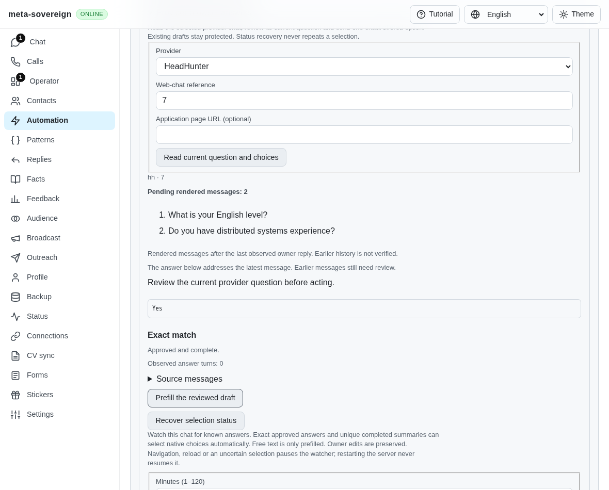
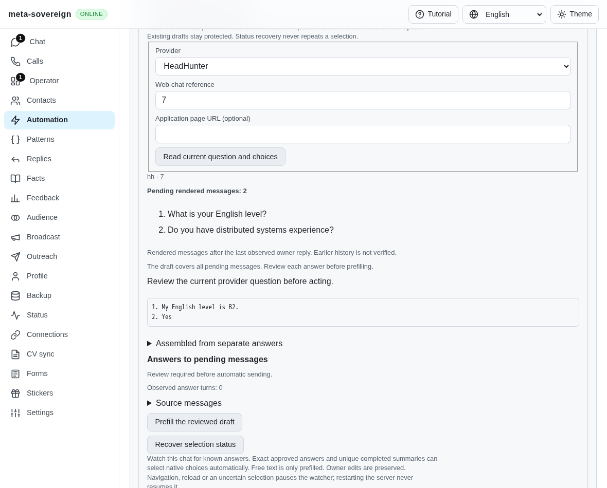
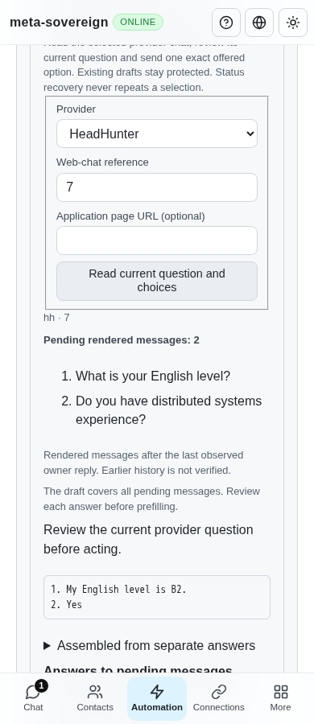

# Answer every pending message

Issue [56](https://github.com/link-foundation/meta-sovereign/issues/56), [PR 57](https://github.com/link-foundation/meta-sovereign/pull/57), and C3/C13/D in the pinned [chat requirements](https://github.com/konard/hh-job-application-automation/blob/fa0991b8c2d0896fb3b4be6c69947f0590094b15/docs/requirements/forms-and-chats.md).

## Reproduction and cause

At actual parent `6dea5f91d16930e9e36935f58d238254961b0ed8`, inspect a browser chat containing two unanswered incoming messages: “What is your English level?” and “Do you have distributed systems experience?”. Save approved answers to both. The review retains both questions but proposes only “Yes”. A later completed summary can similarly hide an earlier unresolved request. Archived chat planning joins earlier messages only with model drafting enabled, so opting out also drops saved-answer requirements. The finite browser watch independently plans only the latest body and holds every multi-message turn, including already completed summaries.

Run `python3 -B experiments/issue-56/whole-turn-before.py` to preserve four failing assertions and the parent screenshot. The shared probe compares against the pinned revision, including after the implementation is committed, and restores sources and the current web bundle in `finally`. Do not edit production sources while it runs.

## Change and limits

The shared planner now evaluates each pending message with the same current rules, profile, policy and bounded matching budget. Archived HH, Telegram, VK, email and WhatsApp turns retain every incoming message since the actual owner/service boundary, independently of model opt-in or message age. Unusable pending records refuse the turn rather than becoming fabricated service boundaries. Browser inspection and finite watches use the same planner with their observed rendered context. This does not establish complete provider history.

Free-text drafts assemble all actionable answers in order, preserve unknown placeholders and omit completed summaries or currently approved no-reply notices. Model opt-in fills only unresolved parts; completed summaries do not become model requests. More than 25 unresolved model parts refuses before calling the configured runner. Model opt-out retains the complete deterministic draft.

Strict native choices still apply to the latest message. Any earlier actionable message holds automatic selection for review; completed summaries and approved no-reply notices do not block it. All-approved free-text answers can be prefilled by the finite watch but are never automatically sent. Queued actions recheck the complete pending context and current answer knowledge. Native delivery reservations remain tied to the latest question, preserving uncertain-send protection. Archived native intents compare every pending message without inventing a rendered boundary.

Action limits remain explicit: at most 20 unique messages, 6,000 UTF-16 code units per body, 24,000 total input units, a shared finite match budget and 12,000 output units. Over-capacity inputs refuse instead of planning a partial turn. Shared Questions/Chat/Operator/watch reviews describe whole-turn coverage or the specific latest-choice scope in all four languages. Existing owner-draft and receipt guards remain enforced.

## Verification

- Four actual-parent regression assertions fail; the browser screenshot shows the omitted earlier answer.
- The initial focused planner/model/native-context group passes 61 Node and 61 Deno checks. The final expanded compatibility group passes 85 Node checks; the final planner/automation group passes 27 Node and 27 Deno checks, including the added model-capacity and trailing-notice regressions.
- Two production Chromium scenarios verify complete drafting/prefilling, zero sends, earlier-edit refusal, unresolved-answer holding and the 390-pixel layout. Four existing pending-context scenarios verify owner replies, event-time pointer guards and fresh explicit selection.
- Independent Playwright MCP verifies whole-draft prefilling, read-only response recovery without replay, stale-context refusal and desktop/mobile layout. The refactored preceding native-choice MCP probe also verifies one explicit click and recovery without a second click. All fixtures use isolated servers and synthetic providers, with no live account.
- Scoped formatting, strict lint, secret scanning and the unchanged duplication limit are checked before committing. Shared parent/browser/MCP helpers remove repeated verification setup; the MCP composer supplies repository-owned helper code because the tool VM has no ESM import callback.

Focused commands and raw outputs, source snapshots, actual-parent sources, screenshot hashes and byte-verified archive membership are preserved in [the evidence archive](data/whole-turn.tar.gz) and its manifest.

```sh
node --test --test-concurrency=1 --test-timeout=20000 js/tests/question-pending-plan.test.js js/tests/question-automation.test.js
deno test --allow-all --no-check js/tests/question-pending-plan.test.js js/tests/question-automation.test.js
node js/scripts/build-web.mjs
node experiments/issue-56/whole-turn-ui.mjs
node experiments/issue-56/whole-turn-ui.mjs --pending
node experiments/issue-56/question-controls-mcp-code.mjs whole-turn
```

Pass the last command's generated function to Playwright MCP after opening the private fixture URL printed by `question-browser-server.mjs`. Close MCP and the fixture when finished.

## Visual review

Actual parent proposes only the latest answer:



Both saved answers now appear in the shared review:





## Hosted failures and remaining work

Pushed parent `6dea5f91` has passing links, security and desktop workflows. Checks run [43040716998](https://github.com/link-foundation/meta-sovereign/actions/runs/43040716998) still has unresolved startup failures: Windows Deno job [130595253101](https://github.com/link-foundation/meta-sovereign/actions/runs/43040716998/job/130595253101) reaches release readiness at 6,201 ms but no control readiness before the existing ten-second deadline (preserved job log lines 7327–7345); macOS Node job [130595253486](https://github.com/link-foundation/meta-sovereign/actions/runs/43040716998/job/130595253486) reports import at 2,997 ms and release readiness 4,722 ms later, then the same missing-socket startup failure (1971–1985). These traces narrow the phases but do not prove the remaining cause. Investigate startup ownership/order without simply increasing deadlines.

Its Pages run [43040717004](https://github.com/link-foundation/meta-sovereign/actions/runs/43040717004) is cancelled during dependency setup, after repeated Ubuntu DNS failures (1298–1319), before application browser assertions. Preceding Checks run `43035096745` also has a WebKit Lino-sync navigation failure (job `130572980650`, preserved lines 2892–2894). Preserve and investigate these failures and require passing exact new-head CI.

The later job observation also preserves current-parent Chromium job `130595251117`: dependency installation exits 100 after DNS failures (627–633), before tests. WebKit job `130595251340` passes its Lino-sync group (2821–2824) but fails Questions while waiting for a hidden answer-rule form (2380–2389). The passing sync observation does not explain the preceding navigation failure. Both the hidden disclosure and repeated setup failures remain investigation work.

Full conversation retrieval, provider activity ownership, inactive acknowledgement/rejection delivery, unread traversal and held-chat orchestration, authenticated provider parity and every unchecked issue-wide criterion remain required. This unit does not complete issue 56; PR 57 remains draft and unmerged.
