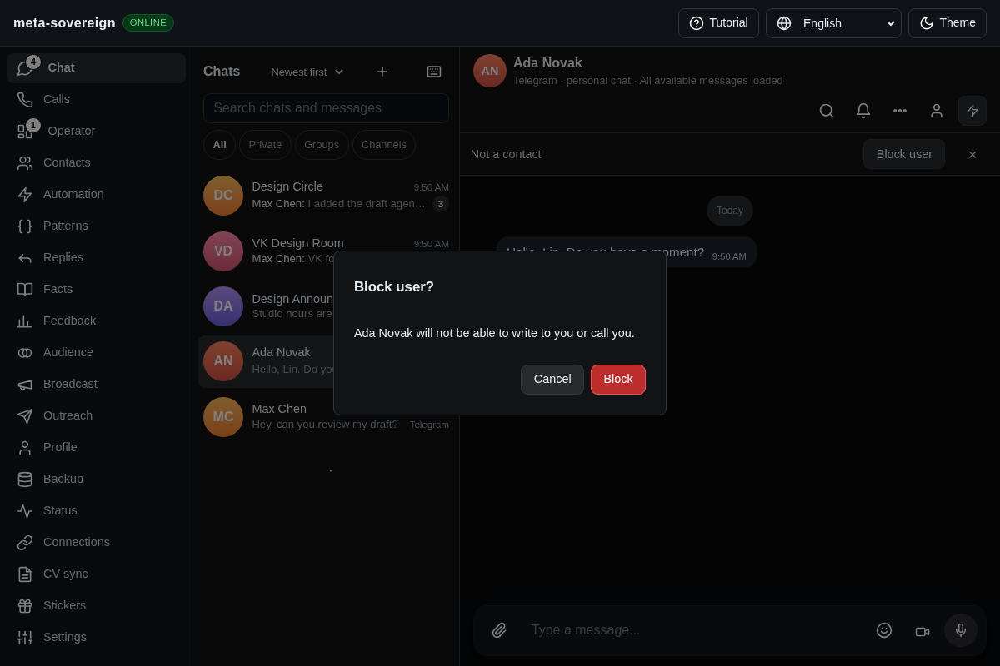
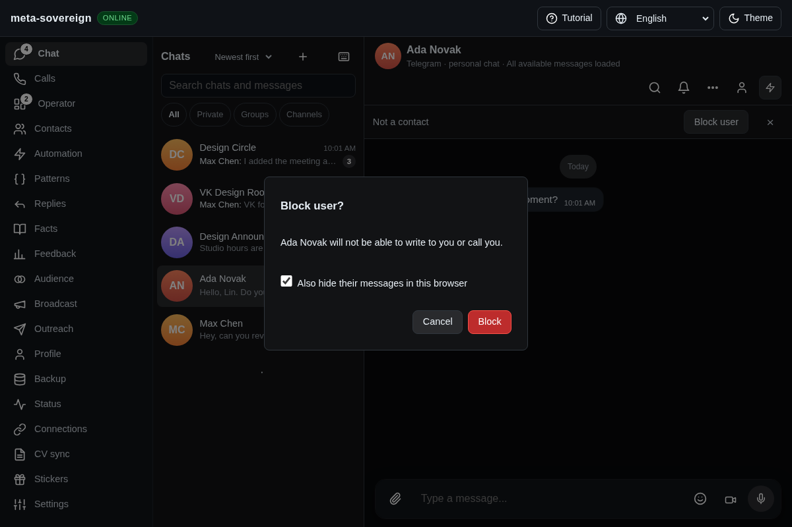

# Issue 71 · Hide messages from a specific sender

[Issue 71](https://github.com/link-foundation/meta-sovereign/issues/71) requests an optional way to hide someone's messages when blocking them in a private chat. The title calls out public chats and channels. The description asks to start with Telegram, extend the behavior to similar platforms and services, and collect the evidence, alternatives, and implementation plans here in a single pull request. The issue and [PR 72](https://github.com/link-foundation/meta-sovereign/pull/72) had no additional comments, reviews, or required sub-issues when the work was scoped.

## Repository evidence

- A private Telegram chat already offered Block user in two places, the profile and the stranger bar. Both reach the same peer action. The prepared branch showed a confirmation with Cancel and Block. The captured baseline in [block-before.png](block-before.png) shows the missing choice. [Peer actions](../../../js/src/web/chat-peer-actions.js) · [Telegram peer API](../../../js/src/sources/telegram-peers.js)
- Chat and Operator consume the same link records and chat state. Search, previews, pinned messages, and comments can render a message outside its original timeline. The app shell has a separate notification watcher when another section is open. Filtering only bubbles would leave the same text visible elsewhere. [Chat state](../../../js/src/web/chat-state.js) · [Operator view](../../../js/src/web/operator-view.js) · [Chat search](../../../js/src/web/chat-search.js) · [App notifications](../../../js/src/web/app-notify.js)
- Telegram user-session history and updates already distinguish user, group, and channel IDs. The Bot API and Telegram Desktop exports use different author shapes. Matching the message author by provider and ID makes the same rule apply across chats and permits a cached message to be restored without fetching it again. [MTProto history](../../../js/src/sources/telegram-history.js) · [MTProto updates](../../../js/src/sources/telegram-updates.js) · [Bot API and archive](../../../js/src/sources/telegram.js)
- The product vision favors a reversible, personal choice with accurate provider capabilities. The settings page already uses local preferences for presentation and privacy. Account switching scopes Telegram data by slot. [Product vision](../../PRODUCT-VISION.md) · [Chat references](../../CHAT-REFERENCES.md) · [Account scope](../../../js/src/web/telegram-account-scope.js)

## External findings and reusable components

| Reference                                                                                                                                                                                                                                                                                                                                                                                                                                                                                                                           | Observed behavior                                                                                                                                                                  | Implication for this issue                                                                                                                                    |
| ----------------------------------------------------------------------------------------------------------------------------------------------------------------------------------------------------------------------------------------------------------------------------------------------------------------------------------------------------------------------------------------------------------------------------------------------------------------------------------------------------------------------------------- | ---------------------------------------------------------------------------------------------------------------------------------------------------------------------------------- | ------------------------------------------------------------------------------------------------------------------------------------------------------------- |
| [Telegram block lists](https://core.telegram.org/api/block) and [Telegram tracker #1787](https://bugs.telegram.org/c/1787)                                                                                                                                                                                                                                                                                                                                                                                                          | The API documents peer block lists. Telegram's issue tracker separately records requests to hide an individual's messages in shared groups.                                        | Preserve the existing provider block and add the workspace visibility choice. The tracker is evidence of demand, with no dependency on Telegram resolving it. |
| [Telegram MTProto message shape](https://core.telegram.org/constructor/message) and [Bot API Message](https://core.telegram.org/bots/api#message)                                                                                                                                                                                                                                                                                                                                                                                   | MTProto can supply a user, group, or channel peer. A broadcast signature is text. In the Bot API, `sender_chat` can accompany a compatibility user in `from`.                      | Match real user peers. Leave anonymous administrators, unsigned broadcasts, and inferred or ambiguous authors visible.                                        |
| [Telegram Web A block modal](https://github.com/Ajaxy/telegram-tt/blob/f67a40879a7d78c2683ec5a296cf55bc22417d56/src/components/left/settings/BlockUserModal.tsx), [Telegram Desktop peer menu](https://github.com/telegramdesktop/tdesktop/blob/b16daff6df63e8a812bc2b52a04ff243f67a7d3f/Telegram/SourceFiles/window/window_peer_menu.cpp#L926), and [Telegram Web A message context menu](https://github.com/Ajaxy/telegram-tt/blob/f67a40879a7d78c2683ec5a296cf55bc22417d56/src/components/middle/message/MessageContextMenu.tsx) | Peer block and actions on a message have separate entry points. The Web A block list uses account-specific peer IDs.                                                               | Put the opt-in in the existing peer confirmation and offer a direct choice in the existing message menu.                                                      |
| [T3 Code appearance settings](https://github.com/pingdotgg/t3code/blob/08a463e29976617134de01e9341f898bc881d0eb/apps/web/src/components/settings/AppearanceSettingsPanel.tsx)                                                                                                                                                                                                                                                                                                                                                       | Settings group related controls and put reset actions next to their value.                                                                                                         | Use a standard Settings card and show a restore button beside each hidden sender.                                                                             |
| [Discord Ignore](https://support.discord.com/hc/en-us/articles/28084948873623-How-to-Ignore-Users-on-Discord), [WhatsApp blocking](https://faq.whatsapp.com/1142481766359885/?ac=202411&cms_platform=web&helpref=faq_content), and [Signal blocking](https://support.signal.org/hc/en-us/articles/360007060072-Block-numbers-usernames-or-groups)                                                                                                                                                                                   | Providers differ. Discord exposes a personal ignore action. WhatsApp describes continued visibility in shared groups. Signal excludes blocked contacts' messages in shared groups. | A shared local preference gives the same interaction with supported adapters. Use a native block only where the workflow can verify it.                       |
| [Matrix specification](https://spec.matrix.org/latest/client-server-api/#ignoring-users) and [matrix-js-sdk](https://matrix-org.github.io/matrix-js-sdk/classes/matrix.MatrixClient.html)                                                                                                                                                                                                                                                                                                                                           | The SDK manages Matrix account data for ignored users. Sync omits their non-state events, and clients must also handle cached history.                                             | The cache lesson applies here. The SDK needs a Matrix homeserver and cannot filter this workspace's Telegram, VK, or archive links.                           |

Teleproto already provides Telegram peer types, message search, and block calls through the existing adapter. React's external-store subscription and the workspace's Web Storage helper cover local preference updates and restoration. This implementation uses those components without adding a library. The pinned client code was reviewed for behavior and UI conventions. [Teleproto reference](../../CHAT-REFERENCES.md#projects) · [Local storage helper](../../../js/src/storage/local-storage.js)

## Requirement, options and execution

| Requirement                                                            | Options considered                                                                                                | Plan and implementation                                                                                                                                                                                                                                                                                                            | Verification                                                                                                                                                                                      |
| ---------------------------------------------------------------------- | ----------------------------------------------------------------------------------------------------------------- | ---------------------------------------------------------------------------------------------------------------------------------------------------------------------------------------------------------------------------------------------------------------------------------------------------------------------------------- | ------------------------------------------------------------------------------------------------------------------------------------------------------------------------------------------------- |
| Ask when blocking a user in a Telegram private conversation            | Always hide, prompt after the network call, or include an unchecked choice in the existing confirmation           | Include the checkbox in the shared profile and stranger-bar dialog. Apply a selected preference after the provider confirms the block. Cancel and failed requests preserve the previous preference.                                                                                                                                | Browser regression tests cancel, unchecked confirmation, a failed request, and a successful retry. Before and after show the same confirmation.                                                   |
| Completely ignore a specific sender in public chats and channels       | Native moderation, provider block alone, or reversible per-sender presentation                                    | Use a provider and author key throughout Chat and Operator. Suppress historical and live messages, conversation previews, quote text, known unread entries, browser notifications, search hits, comment rows, and message listings used by pinned, shared, and history panels. Keep provider cursors based on the unfiltered data. | Model and browser checks cover colliding IDs, outgoing and anonymous records, a group, a channel, a hidden reply quote, an all-hidden page, global search, live arrivals, and the Operator queue. |
| Extend the interaction to similar providers and services               | Add a separate block workflow per provider, guess by display name, or reuse normalized author identities          | Offer a message menu action for usable identities from Telegram, VK, X, Messenger, WhatsApp Cloud, LinkedIn and email. Keep each provider's rules independent. Reuse the app's normalized source records and existing menus.                                                                                                       | Browser check hides VK explicitly after confirming a Telegram rule with the same numeric ID leaves VK visible. Model checks exercise the other address forms and name-only records.               |
| Make the personal choice manageable                                    | Suppress each message individually, tie visibility to block state, or persist and restore per author              | Persist the choice in this browser with Telegram rules scoped to its account slot. Settings lists the matching rules with provider and address for disambiguation, and provides one restore action per sender.                                                                                                                     | Browser check reloads, restores Telegram, observes its old messages, and verifies the VK preference and provider block call count. Model check covers separate Telegram slots.                    |
| Collect the research, analyze every requirement, and execute in one PR | Link to research alone, or preserve the repository baseline, decision record, tests, and visual evidence together | Keep this case study and screenshots alongside the automated checks and changeset in PR 72.                                                                                                                                                                                                                                        | Compare the baseline fixture result with the new regression, review the linked screenshots and the PR checks.                                                                                     |

### Provider boundaries

- Telegram live user accounts and bot/archived messages can match user IDs when the adapter identifies a user. Broadcast channel identities, ambiguous signatures, and anonymous admins remain visible. Telegram Desktop export IDs such as `user42` map to the same author as connected Telegram ID `42`.
- VK and X use their user IDs, including X archive IDs. Messenger uses IDs from the live adapter, WhatsApp Cloud uses the verified sender address present in the received payload, LinkedIn uses profile URLs or person URNs, and email uses its envelope address as recorded by the adapter. A LinkedIn URL and URN do not establish an identity match by themselves. WhatsApp and Meta archives that carry only sender names leave those messages visible. The other providers use local hide and restore, since the app has no equivalent verified private block flow for them.
- The preference applies to Chat and Operator presentation in this browser. Network sync, exports, and the underlying link store retain the original records. Aggregate provider counts may include offscreen messages or unattributed activity. A read receipt, delivery status, and Telegram block status retain their existing provider meaning.

## Reproduction and evidence

1. Open a private chat with a Telegram user who also posted in a shared group and channel. Open the block confirmation in the stranger bar or profile. Before this change the dialog offered the provider block only.
2. In the new confirmation, select **Also hide their messages in this browser** and confirm. Messages from that Telegram ID disappear from the private chat and the shared timeline. Other senders stay visible, including a VK sender with the same numeric ID.
3. Open **Settings → Hidden senders** and restore the Telegram sender. Already loaded messages are shown again. The restore uses local settings and sends no provider request.

The automated reproduction is [the browser regression](../../../js/tests/e2e-hide-sender-browser.mjs). It failed on the prepared branch because the checkbox was missing. The regression also verifies that an older visible pin remains accessible, that clearing search resets its cursor, and that a hidden sender's new message does not trigger a browser notification when Settings is open. [Model tests](../../../js/tests/message-visibility.test.js) cover identity and leak prevention. Fixture runs use synthetic chats and stubbed provider responses on an isolated server.

| Prepared branch                                     | With the optional choice                                                  |
| --------------------------------------------------- | ------------------------------------------------------------------------- |
|  |  |

[Filtered group timeline](timeline.png) · [Reversible Settings entry](settings.png)
